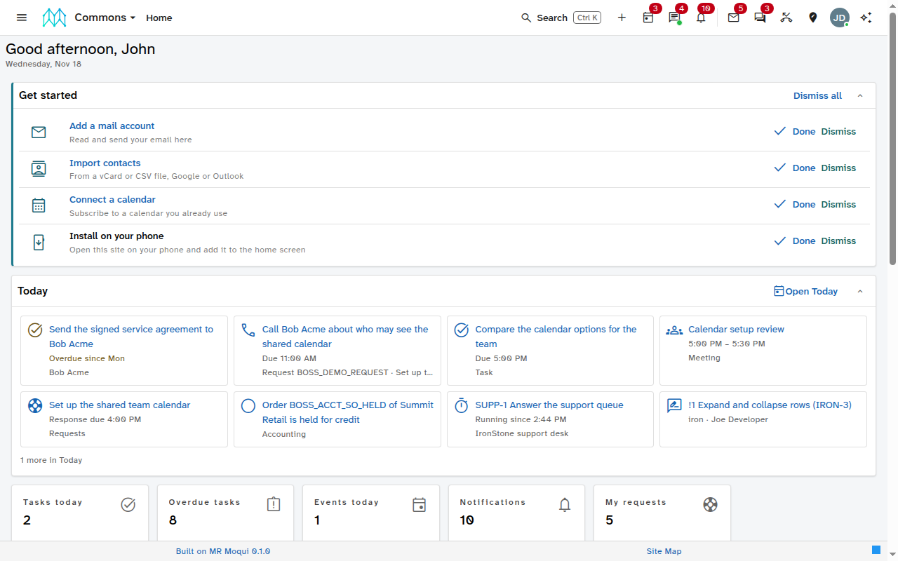
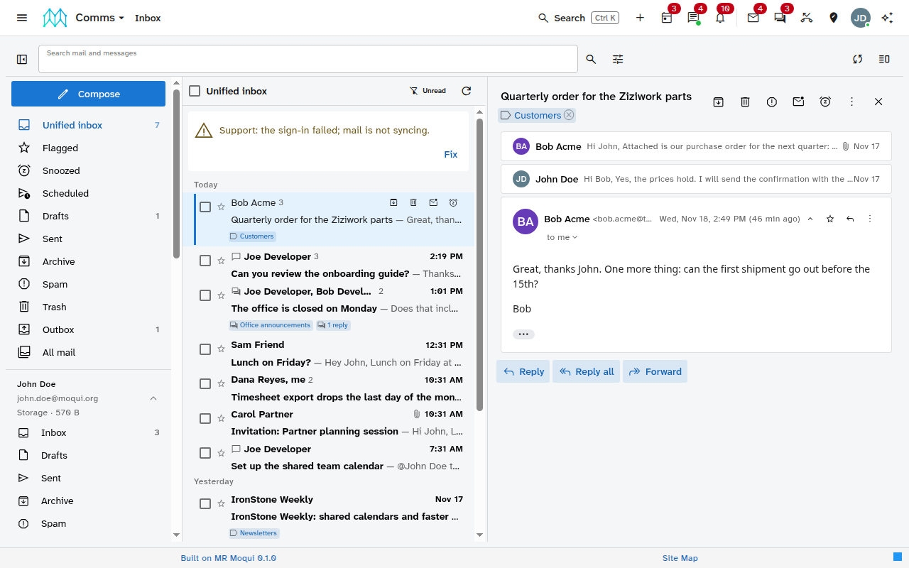
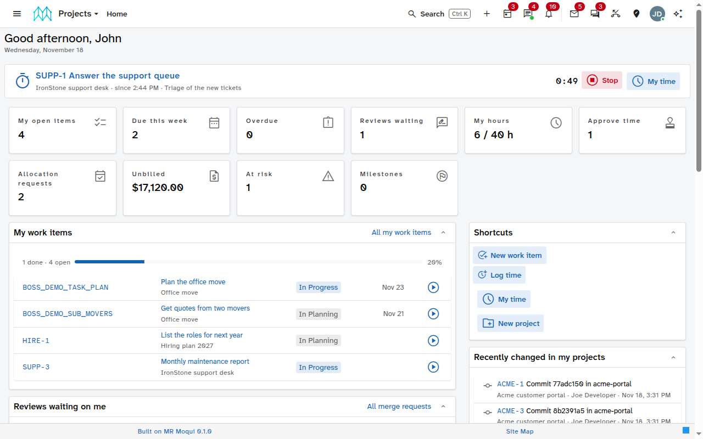

# IronStone BOSS - Business OS Suite

> **Not ready for production (before 0.1.0).** Like [MR Moqui](https://github.com/moqui/mr-moqui#readme), which it
> runs on, BOSS is in early development. Its data model and stored data change without migrations, and a security
> review is under way with its findings recorded openly in the mr-moqui repository. Run it only on development
> machines, with no real business data or credentials, and not exposed to the internet. The full notice is at the top
> of the [mr-moqui README](https://github.com/moqui/mr-moqui#readme).

IronStone BOSS is a business application suite for [MR Moqui](https://github.com/moqui/mr-moqui), the Moqui
framework in Rust: a business-in-a-box. It has sixteen apps, each for a role or a department, in one shell, on one
data model ([Mantle](https://github.com/moqui/mr-mantle)) and one database. Beside the ERP ground Moqui has always
covered (orders, inventory, manufacturing, accounting), it has a full groupware and communication suite, Commons and
Comms, and explicit CRM.

It is meant for a large organization, where every employee has Commons and Comms beside the apps of their role, and
for a small business, where one person may hold many apps and each app's home has to stand on its own. In a small
business or a home, Commons and Comms may be the whole system. Running mail, files, calendar, chat and calls on your
own hardware is a first purpose, not an extra: everything, files included, is in Postgres under one backup by default.



## What the apps share

- **One shell.** A header with search and the command palette (Ctrl+K), the app menu, quick access to today's
  schedule, chat, notifications and mail from any screen, and the Assist drawer.
- **Shared records.** A customer, a product or an order is the same screen in each app that shows it, and every
  record has its own conversation.
- **Keyboard.** Go-to keys, the palette and `?` for the list of keys on every screen; the Inbox and Chat have the
  keys of the mail and chat apps people know.
- **Phone and terminal.** Every screen works from a small laptop up, the ones used away from a desk at phone width,
  and the plain screens also render in the terminal UI.
- **Assist.** An agent in a drawer that works through the screens its user may open. Every write waits for the user's
  approval. Each app adds skills for its own work (`skill/`).
- **Access by role.** Each app is granted at its root, with groups for the roles inside it.

## The apps

Each is at `/qapps/<Name>` and has a design and a record of what is built in [`plan/`](plan/).

| App | What it covers | |
|---|---|---|
| **Workspace** | | |
| Commons | Contacts, calendar and schedules, tasks and requests, files, notes and knowledge, a vault for passwords and private contacts, your account | [design](plan/design-drawers-commons.md) · [built](plan/impl-drawers-commons.md) |
| Comms | Email, chat, calls, the conversation on every record, consent | [design](plan/design-drawers-commons.md) · [built](plan/impl-drawers-commons.md) |
| **Customer-facing** | | |
| Sales | Leads and opportunities, accounts and contacts, requests for quote, quotes and orders, customer agreements and prices, forecasts | [design](plan/design-sales.md) · [built](plan/impl-sales.md) |
| Marketing | Campaigns and budgets, segments and lists, email and SMS, experiments and drip sequences, promotions, content, events, surveys, lead capture | [design](plan/design-marketing.md) · [built](plan/impl-marketing.md) |
| Customer Service | Cases from intake to resolution, order enquiries, customer returns, warranty, knowledge and feedback | [design](plan/design-customer-service.md) · [built](plan/impl-customer-service.md) |
| Commerce | Store operations, merchandising, online orders and carts, promotions, checkout settings, integrations, store reports and storefront authoring | [design](plan/design-commerce.md) · [built](plan/impl-commerce.md) |
| **Supply & Operations** | | |
| Products | Products and variants, categories, features, prices and cost estimates, supplier catalogs, documents, units and barcodes | [design](plan/design-products.md) · [built](plan/impl-products.md) |
| Purchasing | Suppliers, purchase requests, sourcing, purchase orders and agreements, replenishment, receiving and supplier returns, bill exceptions | [design](plan/design-purchasing.md) · [built](plan/impl-purchasing.md) |
| Warehouse | Receiving, inspection, inventory, counts, transfers, picking, packing and shipping, returns, locations, a handheld mode | [design](plan/design-warehouse.md) · [built](plan/impl-warehouse.md) |
| Manufacturing | Production runs and routed work orders, bills of material and routings, quality, work centers, supply planning | [design](plan/design-manufacturing.md) · [built](plan/impl-manufacturing.md) |
| Maintenance | Facilities, equipment and assets, corrective and preventive work, procedures, dispatch, customer repair | [design](plan/design-maintenance.md) · [built](plan/impl-maintenance.md) |
| **Finance, People & Projects** | | |
| Accounting | Receivables, payables, payments, banking, general ledger, period close, fixed assets, inventory, tax, budgets, reports | [design](plan/design-accounting.md) · [built](plan/impl-accounting.md) |
| People | Employees and organization, positions and recruiting, time and leave, expenses, skills and training, reviews; payroll in preview mode | [design](plan/design-people.md) · [built](plan/impl-people.md) |
| Projects | Projects and roadmaps, work items, requests, code and merge requests, timesheets, resources, billing | [design](plan/design-projects.md) · [built](plan/impl-projects.md) |
| **Management** | | |
| Insights | Dashboards and KPIs, a report builder, scheduled reports and digests, business alerts, maps of business flows | [design](plan/design-insights.md) · [built](plan/impl-insights.md) |
| Admin | Users, groups and access, organizations and settings, integrations, mail, jobs and health, imports and exports, audit | [design](plan/design-admin.md) · [built](plan/impl-admin.md) |

Five pages are reached by a link, with no sign-in: an invitation to join (`/i/<token>`), a file or folder shared by
link (`/s/<token>`), email preferences and unsubscribe (`/u/<token>`), a published calendar (`/cal/<token>`), and a
project's request form (`/r/<token>`).





## Get it and try it

In an [mr-moqui](https://github.com/moqui/mr-moqui#quick-start) checkout:

```sh
./moq component-get mr-boss   # With mr-mantle, which it depends on
./moq load                    # Seed and demo data
./moq run
```

Open `http://localhost:8080` and sign in as `john.doe` with the password `moqui`. The app list shows the BOSS apps.
The demo data is a company, Ziziwork Industries, with its customers, suppliers, products, orders, mail and
projects. There is also a demo user for each role, such as `sales.rep`, `finance.ar` and `maint.tech`, with the same
password, to see an app as that role does.

## How it fits

- **[mr-mantle](https://github.com/moqui/mr-mantle)** is the data model and the service library underneath, and the
  only component BOSS depends on.
- **The framework** has the protocols: mail, CalDAV and CardDAV, WebDAV and SFTP, chat, calls and the agent runtime
  are in mr-moqui, and BOSS has the screens and the business data. The framework's own Comms, System and Dashboards
  screens are shown inside Comms, [Admin](plan/design-admin.md#14-screens-that-are-the-frameworks) and
  [Insights](plan/design-insights.md#42-framework-screens-shown-under-insights).
- **[mr-pass](https://github.com/moqui/mr-pass)**, IronStone PASS, is the public side: the Shop that Commerce runs,
  the Forum, and the customer and supplier pages of Sales, Marketing, Customer Service, Accounting and Purchasing.
  PASS runs without BOSS.
- **[mr-l10n](https://github.com/moqui/mr-l10n)** has Spanish and Simplified Chinese for nine of the apps so far.
- **[mr-home](https://github.com/moqui/mr-home)**, IronStone HOME, is a household suite planned on BOSS.

## Developing

Read mr-moqui's [AGENTS.md](https://github.com/moqui/mr-moqui/blob/master/AGENTS.md) and
[application practices](https://github.com/moqui/mr-moqui/blob/master/docs/dev/Practices-App-Dev.md) first.

- [`plan/`](plan/) has the designs. Start with the [initial design](plan/initial-design.md), the
  [document guide](plan/design-doc-guide.md), the [style guide](plan/style-guide.md) and the screens shared across
  apps ([design-crosscut](plan/design-crosscut.md)). Each app has `design-<app>.md`, `impl-<app>.md` (what is built,
  and what is left), `research-<app>.md`, and for the apps reviewed so far `ui-review-<app>.md`
  (the [convention](plan/design-doc-guide.md#ui-review-and-refinement-phase)).
- [`docs/`](docs/) has implementation notes for Accounting, Manufacturing, Products and Warehouse.
- `screen/<App>/`, `service/`, `entity/` and `data/` are the apps; `skill/` has the Assist skills and `report/` the
  datasets, dashboards, reports and alerts Insights loads.
- Tests are in two suites, described in [test/README.md](test/README.md):

```sh
./moq test mr-boss --spec SalesOpportunities   # The regression specs you touched, while working
./moq test-apps                                # Every app component's regression suite, before a commit
./moq accept mr-boss                           # The acceptance suite, before a release or when asked
```

## License and Contributing

[CC0 1.0 Universal with a Grant of Patent License](LICENSE.md). To contribute code, sign
[AUTHORS.md](AUTHORS.md) in a commit from the account that submits the pull request; its Contributing
section has the details.
