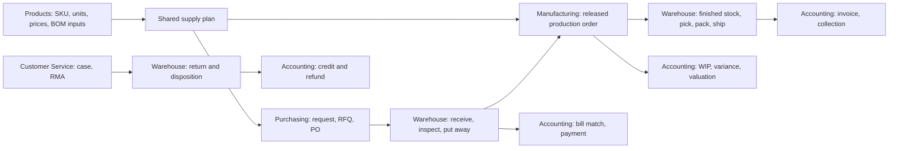

# IronStone BOSS — Core applications crosscut design

Oct 28, 2026 — draft; reviewed against research-crosscut.md, the reference apps and the other core designs ([review-core-apps.md](review-core-apps.md)); a register of the existing Mantle automation, one capability-group table, the external audience roots, named owners for bill intake, cost events, subcontracting, order holds and return settlement, and the missing per-app contexts; brought in line with the Oct 28 decisions of the implementation plans (each `impl-<app>.md` §4, and impl-drawers-commons §4's shared rules), which moved the external pages into PASS apps and reversed D5

This is the common business-screen and process design for Products, Warehouse, Manufacturing,
Purchasing, Customer Service and Accounting. It incorporates the existing Commons, Comms and
Projects contracts. Each app stands alone for its audience; shared screens are mounted inside
that app with its context, without requiring access to another app. This phase does not design
the remaining apps, but preserves extension points for them.

**Inputs.** [initial-design.md](initial-design.md), [design-doc-guide.md](design-doc-guide.md),
[style-guide.md](style-guide.md), [research-crosscut.md](research-crosscut.md), the six matching
research files, [design-drawers-commons.md](design-drawers-commons.md),
[design-projects.md](design-projects.md), [ss-inventory.md](ss-inventory.md) and
[usl-inventory.md](usl-inventory.md). Current source takes precedence over research-era claims
that a capability is absent. Proposed additions below are specifications, not implemented APIs.

**Sections.** [1 conventions](#1-conventions-and-authority) · [2 registry](#2-shared-screen-registry) ·
[3 screens](#3-shared-business-screens) · [4 processes](#4-cross-app-process-contracts) ·
[5 access](#5-external-access-and-shared-configuration) · [6 validation](#6-end-to-end-acceptance) ·
[7 needs](#7-framework-and-data-needs) · [8 decided](#8-decided) · [9 open](#9-open)

**Source paths.** Baseline screen paths below are relative to
`mr-moqui/runtime/component/mr-marble/screen/SimpleScreens/`, with `BasicHandheld/` a sibling.
Mantle source paths are relative to `mr-moqui/runtime/component/mr-mantle/`. Third-party paths
start at `~/work/moquiwork/3p_other/`; Odoo's app path is `odoo/odoo/addons/` and ERPNext's
is `frappe/erpnext/erpnext/`. Reference code is evidence for behavior; BOSS keeps its own
Moqui screen/service design.

## 1. Conventions and authority

### 1.1 One definition, contextual mounts

A shared screen is one `screen/Shared/<Name>.xml`, mounted through `subscreens-item location`.
The including root sets `appRoot`; server actions resolve the authenticated organization's
scope, roles, record visibility and permitted actions. Context specifies tabs, fixed filters
and emphasis, never grants authority. A supplied organization, customer, supplier or app name
cannot enlarge access. The same service authorization applies to direct requests and batch actions.

Screen paths, action names and shared model choices in this file are the integration contract.
App authors propose changes here rather than silently varying them. Existing paths of the
Projects and Commons PoCs remain valid. A screen's Context exposes canonical record identity,
selection and filters through the implemented context element; shell providers use that context.

### 1.2 Current capability and proposed work

The six app roots and section placeholders exist but are not complete applications. Their
`BOSS_PRODUCTS`, `BOSS_WAREHOUSE`, `BOSS_MANUFACTURING`, `BOSS_PURCHASING`,
`BOSS_CUSTOMER_SERVICE` and `BOSS_ACCOUNTING` grants remain an implementation concern.
Commons and Projects have working shared screens, intake, record links, calendars and time
services. The shared OrderDetail and InvoiceDetail currently implement Projects billing only;
the general contexts specified here extend them rather than treating them as already complete.

Verify names in active XML, excluding comments. In particular, old cost/configuration and
tax-rate definitions inside XML comments are design references, not runtime entities.
Use `parity` for baseline replacement, `new` for essential first-release additions, and `later`
for advanced functionality. All three receive an explicit design; `later` is not an omission.

### 1.3 Common interaction and transaction behavior

XML widgets first; use current list/board/tree/calendar capabilities before proposing new
widgets. A custom `.qvue` screen specifies its terminal twin and uses the existing `m-*` inputs.
Amounts retain currency and quantity retains UOM; server-side decimal arithmetic determines
totals and conversions. Lists distinguish empty, loading, failed and access-limited results.
Handheld operations show one task, scanned identity, quantity/UOM and an explicit confirmation.
They are online-first; an interrupted request is reconciled by its operation identity before retry.

Every stock or financial posting has a server operation identity, revalidates current status,
availability, permission and period, and atomically records its document links and movements.
Retries return the prior result instead of posting again. The identity is one Mantle operation
record keyed by `operationKey` (CX-POSTING): a retry with the same request hash returns the stored
result, and a different request under the same key is refused. A posting-guard failure is split
by source: a finance user's direct post is refused with the reason; an automatic post from an
operational event (a receipt, issue, shipment or production fact) goes to the error journal with
the failed guard named, and close refuses a period that still holds one (impl-accounting §4).
Posted movements are corrected by linked reversals or adjustments, not deletion. Independent
imported rows, supplier groups or batch documents report named failures and continue; an
internally dependent posting remains atomic. A failed posting never displays success or advances
its source document.

#### Existing Mantle automation on the designed paths

These Mantle service and entity ECA rules, and two ServiceJobs, run today on paths that the six designs use. Each
design names the rules on its own paths and gives the same verdict as this register: **kept**
(the rule runs as it is), **conditioned** (the rule runs only under a stated condition, or a BOSS
guard runs first) or **replaced** (a BOSS service does the work and the rule is guarded off). A
design that leaves a rule out changes nothing: the rule still runs. A change to a rule's condition
is proposed Mantle work in CX-AUTOMATION (§7.1). Each such change sits behind its own flag, off by
default, so plain Mantle and its flow specs keep their behavior; the flag lives with its owner's
settings (impl-accounting §4). Rule IDs and files were read in active
`mr-mantle` XML.

| Rule (file) | What it does today | Designed path | Verdict | Owner, decision and where |
| --- | --- | --- | --- | --- |
| `ShipmentIncomingDeliveredCreateInvoices` (`service/AccountingInvoice.secas.xml`) | When an incoming shipment reaches ShipDelivered, calls `mantle.account.InvoiceServices.create#PurchaseShipmentInvoices`, which bills accepted and rejected quantity at the PO price | Warehouse Receive and ReceiveRemaining (`deliver#Shipment`) | conditioned | Accounting (D2). It runs only for a supplier whose proposed `SupplierProfile.selfBillingIndicator` is Y. It then calls `create#PurchaseShipmentInvoices` with a proposed `acceptedOnly=true` parameter, which bills accepted quantity with no open inspection. It never bills a service PO line or a subcontract output (D14). §4.4. |
| `ShipmentOutgoingPackedCreateInvoices` (same file) | When an outgoing shipment reaches ShipPacked, calls `create#SalesShipmentInvoices`, which creates the sales invoice and captures card payment | Warehouse Pack CompletePack | conditioned | Accounting policy, Warehouse trigger (D3). Behind D3's flag the rule creates the sales invoice InvoiceInProcess without applying payments, and a proposed ShipShipped rule finalizes it (posting it, applying captured payments and sending it); with the flag off Mantle finalizes at pack as before. CompletePack says that it creates the invoice. Reopening a package, a put-back or an order change between pack and ship first calls proposed `ironstone.accounting.InvoiceServices.release#ShipmentDraftInvoice`; after ship a change goes through returns and credit memos (impl-accounting §4). §3.8. |
| `OrderPlacedAutoApprove` (`service/OrderReturn.secas.xml`) | On OrderPlaced with no store approval delay, calls `mantle.order.OrderServices.autoApprove#Order`, which approves a covered order after `mantle.order.OrderInfoServices.check#OrderPreApprove` | Purchasing PO place; any sales order placed in BOSS | conditioned | Purchasing for POs (D8): proposed SECA `ironstone.purchasing.ApprovalServices.check#PurchaseApprovalRequired` on `check#OrderPreApprove` adds an approve warning to a purchase part with no current approval decision. Accounting for sales orders (D7): proposed `ironstone.accounting.CreditServices.evaluate#OrderCredit` on the same hook adds a warning and places a Credit hold. §3.6. |
| `OrderPlacedReserveAssets`, `OrderApprovedReserveAssets`, `OrderItemCreateCheckReserve`, `OrderItemUpdateCheckReserve` (`service/ProductAsset.secas.xml`); `OrderPlacedAuthorizePayments` (`service/AccountingPayment.secas.xml`); `OrderPlacedSendEmail`, `OrderApprovedSendEmail`, `OrderApprovedNotify` (`service/OrderReturn.secas.xml`); `OrderItemHandleChange` (`entity/Order.eecas.xml`) | Reserve stock, authorize payments, send the placed and approved email and the high-priority notice, and handle an order item change | any order placed, approved or changed | kept | A credit hold keeps the reservations (R-SB-09). An order change locks the order with OrderHold rather than moving it back to Placed, which would run these rules again (D7). On a PO the reservation, payment and store-email rules do nothing; proposed `send#PurchaseOrder` sends POs (Purchasing §6). §3.6. |
| `OrderItemWorkEffortCheckComplete` (`service/OrderReturn.secas.xml`) | Completes an order part when every required work effort of its items is complete, closed or cancelled | subcontract service PO lines | kept | Purchasing. A subcontract service line completes with its operation; matching still waits for `accept#ServiceItem` (§4.3). |
| `ReturnApprovedProcess` (`service/OrderReturn.secas.xml`) | On ReturnApproved, calls `mantle.order.ReturnServices.create#ReturnShipment`, then `process#ReturnItemResponses` for every `responseImmediate` item and every replacement item | Customer Service and Purchasing ReturnDetail authorization | conditioned | Customer Service (D11). The rule keeps only `create#ReturnShipment`. Proposed `mantle.order.ReturnPolicyServices.authorize#Return` wraps `approve#Return` and sets `responseImmediate` to N unless a published policy allows advance replacement or instant credit and the actor holds the financial capability. On a supplier return the response processing already does nothing, so Purchasing's path is unchanged. §3.18. |
| `ShipmentDeliveredReturnReceive` (same file) | When a return shipment reaches ShipDelivered, calls `receive#ReturnShipmentItems`, which cuts `returnQuantity` to the received quantity and sets ReturnReceived | Warehouse Returns ReturnReceipt | replaced | Warehouse (D11). Proposed `mantle.shipment.WarehouseTaskServices.receive#ReturnItems` records received, accepted and rejected quantity per line and sets `ReturnItem.receivedQuantity` without changing `returnQuantity`. §3.18. |
| `ReturnReceivedProcess` (same file) | On ReturnReceived, calls `process#ReturnItemResponses` for every response not yet processed | return receipt, before inspection | replaced | Accounting (D11). Credits, refunds and replacements run only through proposed `ironstone.accounting.ReturnSettlementServices.settle#Return`, after disposition. §3.18. |
| `AssetReceiptGlPost`, `AssetIssuanceGlPost`, `InvoiceGlPost`, `PaymentGlPost`, `PaymentApplicationGlPost` and the other auto-post rules of `service/AccountingLedger.secas.xml` | Post each new AssetReceipt and AssetIssuance through `mantle.ledger.AssetAutoPostServices.post#AssetReceipt` and `post#AssetIssuance`, and each invoice, payment and application | every receipt, issue, production movement and financial document | kept | Accounting (D12). Each posts through `post#AcctgTrans`, where the AC-06 posting guard runs; AC-19 adds base-currency conversion (CX-FX). Component issues and output receipts post only through these rules; proposed `post#CostClose` never posts them again. Warehouse and production guards pass `acquireCost`, so they post the right value. §4.1. |
| `AssetIssuanceGlRePost` (same file) | On any AssetIssuance update, calls `repost#AssetIssuance`, which unposts and deletes the posted transaction and posts a new one at the original date | `cancel#AssetIssuance`; `issue#AssetToWorkEffort` adding to an earlier issuance | replaced | Accounting AC-06 changes `repost#AssetIssuance` to post a dated reversing delta in an open period instead of unposting and deleting (R-SA-02). Production never triggers it: BOSS never updates or cancels a posted production issuance, unused material returns through a new receipt, and each issue is a new issuance (D13). §3.9. |
| `AssetDetailPhysicalVarianceGlPost` (same file) | Posts a physical inventory variance through `post#PhysicalInventoryVariance` | Warehouse CountReview PostCount | kept | Warehouse. Proposed `post#Count` passes the count's physicalInventoryId and an open-period date, and posts one variance per asset (R-SA-16). |
| `AssetStatusAvailableReservations` (`service/ProductAsset.secas.xml`) | When an asset reaches AstAvailable, calls `mantle.product.AssetServices.reserve#IncreasedAsset`, which reserves it to waiting orders by priority | quality release from AstQuarantine | kept | Crosscut quality (D21). Proposed `dispose#Inspection` first reserves output that has customer demand to that order item, in the same transaction (R-SA-10). §3.19. |
| `PaymentApplyForInvoice` (`service/AccountingPayment.secas.xml`), `InvoiceApplyForPayments` (`service/AccountingInvoice.secas.xml`) | Apply a payment that carries `forInvoiceId` when the payment is delivered or the invoice approved | payables | conditioned | Accounting (D4). The hold guard is inside Mantle, behind the hold flag, at the one point where a payment is applied to a payable invoice; both rules catch its refusal, so a payable with an open hold is not applied and the payment stays unapplied with a named exception (R-SB-16; impl-accounting §4). §3.16. |
| `InvoiceFinalizedSendEmail` (`service/AccountingInvoice.secas.xml`) | Sends the store invoice email on Finalized | store invoices | conditioned | Accounting. Proposed `ironstone.accounting.InvoiceServices.send#Invoice` and this rule deduplicate by invoice, version and template, so a store invoice is not sent twice (R-SB-15). §3.16. |
| `WorkEffortRequestFromWork` (`entity/Work.eecas.xml`) | On a task's status change, calls `mantle.request.RequestServices.complete#RequestFromWork` | linked work on any request | conditioned | Crosscut request policy (R-XC-40, D23). The service checks the request type first. §3.11. |
| `ShipmentShippedSendEmail`, `ShipmentDeliveredSentEmail`, `ShipmentPackageDeliveredCheckShipment` (`service/Shipment.secas.xml`) | Send the shipped and delivered emails; deliver a shipment when its packages are delivered | Warehouse Ship and PackageTracking | kept | Warehouse (§15.2). |
| ServiceJob `create_RecurringOrders` (`data/MantleSetupData.xml`) | Nightly: clones recurring orders and invoices those marked `recurAutoInvoice` | recurring billing | kept | Accounting (D24). RecurringInvoices monitors its last result. |
| ServiceJob `send_SalesInvoicePastDueEmails` (same file) | Weekly past-due emails; paused | dunning | kept paused | Accounting. Dunning is the only scheduled reminder sender; Setup readiness flags the job if it is unpaused. |

Two existing services also carry built-in behavior that the designs do not use.
`mantle.work.ManufacturingServices.create#ProductionRun` writes material lines from the legacy
single-level `PatMfgBom` associations; proposed `create#ProductionOrder` writes the run's own
`ProductionRunLine` rows from the BOM and routing as of the chosen date instead and does not use
those automatic lines (D15; impl-warehouse §4). `mantle.order.OrderServices.create#PurchaseRequestOrder`
sources every item of the request again on each call and can place and approve the POs; every
Create purchase order action opens Purchasing's RequestSourcing instead, and no context calls it
directly (R-PUR-01, §3.11). Three new rules are proposed: the Request create and status rules
that give a request in a service queue its CaseProfile, queue and SLA (Customer Service, D23),
the Purchasing SECA on `check#OrderPreApprove` (D8), and the ShipShipped rule that finalizes the
pack invoice behind D3's flag (Accounting).

### 1.4 Capability groups

Each app's role words map to one proposed user group named `BOSS_<APP>_<CAPABILITY>`, where
`<APP>` is the app that owns the guarded services. The app files define their own rows; this table
collects them (D22). Each app's root user group has the name of its artifact group (`BOSS_PRODUCTS`,
`BOSS_WAREHOUSE`, `BOSS_MANUFACTURING`, `BOSS_PURCHASING`, `BOSS_CUSTOMER_SERVICE`,
`BOSS_ACCOUNTING`); they are different entities. The root group grants the launcher and, for
Products, catalog read. A group grants a capability; organization, party, facility and record
scope are checked separately. Several groups compose on one user. A shared mount checks these
groups and never another app's root group. The groups are proposed seed data in CX-ACCESS.
Accounting keeps the AR, AP and GL segments in its group names (`BOSS_ACCOUNTING_AR`, `_AP`,
`_GL`), and the global units are written only by the framework `ADMIN` group (decided Oct 28, 2026).

**Organization filters** (impl-drawers-commons §4, for every BOSS root). An app's ordinary groups,
and Commons' and Comms' `ALL_USERS`, take `MANTLE_USER_ORG` and `MANTLE_PRIVATE_CONTACT`, so a user
works within their own organizations: the active organization when one is set, or else every
organization they belong to with its direct children. Each app's admin group, `BOSS_<APP>_ADMIN`,
has `AUTHZT_ALWAYS` and `AUTHZA_ALL` on its root with `MANTLE_ACTIVE_ORG` and
`MANTLE_PRIVATE_CONTACT`: every organization until one is made active. Framework `ADMIN` keeps its
rows. `MANTLE_USER_ORG`'s Product, ProductCategory and ProductFeature filters admit `_NA_`, as its
Party filter does. Facility and plant scope is `MANTLE_USER_ORG`'s Facility filter on
`Facility.ownerPartyId`, so vendor-custody facilities are in scope (impl-warehouse §4,
impl-manufacturing §4). Services still check organization access themselves, whatever the filter.
External customer and supplier contacts are PASS public accounts with no UserGroup (§5), so no
portal group exists.

| Group | Grants | App terms that map to it |
| --- | --- | --- |
| `BOSS_ACCOUNTING_READ` | Reports, and financial values on shared mounts | Accounting report reader; Warehouse and crosscut financial-read; Manufacturing and Purchasing money columns |
| `BOSS_ACCOUNTING_AR` | Customer invoices and credits, receipt allocation, collections, dunning, statements, return credit | Accounting AR; Customer Service F for the credit (`invoice.credit`); credit manager with `BOSS_ACCOUNTING_APPROVE` |
| `BOSS_ACCOUNTING_AP` | Bills and supplier credits, bill intake, placing a bill hold, payable selection; includes the match operator | Accounting AP; Purchasing AP intake (create a draft bill, upload bills) |
| `BOSS_ACCOUNTING_MATCH` | Evaluate and apply a bill match | Accounting and Purchasing match operator (D4). It is the one match group: AP includes it, and buyers who match bills are given it; Purchasing has no match group of its own |
| `BOSS_ACCOUNTING_TREASURY` | Payments, gateway actions, refund payments, bank accounts and bank details, reconciliation, internal transfers | Accounting treasury; Customer Service F for the refund (`payment.refund`); Purchasing payer |
| `BOSS_ACCOUNTING_GL` | Journal entries, asset books, inventory valuation, production cost close preview | Accounting GL; crosscut GL approver, lease and period-run approver with `BOSS_ACCOUNTING_APPROVE` |
| `BOSS_ACCOUNTING_TAX` | Tax statements and their outputs | Accounting tax; tax admin with `BOSS_ACCOUNTING_ADMIN` |
| `BOSS_ACCOUNTING_APPROVE` | Bill approval, hold release, payment run approval, period close, cost close posting, receiptless credit | Accounting finance approver; Purchasing finance approver; crosscut financial release role |
| `BOSS_ACCOUNTING_ADMIN` | Settings (including MatchPolicies and CostingPolicies), locks, setup and audited data repair | Accounting finance admin |
| `BOSS_CUSTOMER_SERVICE_AGENT`, `BOSS_CUSTOMER_SERVICE_MANAGER` | Work cases, reply, request order changes and returns; team assignment, merge, approve order changes, read feedback | Customer Service A; M |
| `BOSS_CUSTOMER_SERVICE_ORDER_DESK`, `BOSS_CUSTOMER_SERVICE_RETURN_AUTHORIZER` | Apply an approved cancellation or short-pick substitution (D9); authorize a return (`return.authorize`) | Customer Service D; R |
| `BOSS_CUSTOMER_SERVICE_KNOWLEDGE`, `BOSS_CUSTOMER_SERVICE_ADMIN` | Author and review articles; service settings, queues, SLA policies and templates | Customer Service K; S |
| `BOSS_WAREHOUSE_RECEIVE`, `BOSS_WAREHOUSE_INSPECT`, `BOSS_WAREHOUSE_ISSUE` | Receive, ReturnReceipt, AdHocReceipt and ShipmentDetail receipts; save readings and submit inspections; issue, return unused and receive output in MaterialIssueReceipt | Warehouse receive, inspect, issue; Purchasing receiver and inspector; Customer Service W (receive and inspect) |
| `BOSS_WAREHOUSE_MOVE`, `BOSS_WAREHOUSE_COUNT`, `BOSS_WAREHOUSE_COUNT_REVIEWER`, `BOSS_WAREHOUSE_ADJUST` | Putaway, move, repack and container moves; counts; count review; adjustments, scrap and approved count variances | Warehouse move, count, count reviewer, adjust |
| `BOSS_WAREHOUSE_PICK`, `BOSS_WAREHOUSE_PICK_SUPERVISOR`, `BOSS_WAREHOUSE_PACK`, `BOSS_WAREHOUSE_SHIP`, `BOSS_WAREHOUSE_DISPATCH`, `BOSS_WAREHOUSE_SHIPPING_MANAGER` | Pick and put back; waves and load assignment; pack, complete and reopen a package; rate, label, ship and record delivery; delivery trips (later); carriers and box types | Warehouse pick, pick supervisor, pack, ship, dispatch, shipping manager |
| `BOSS_WAREHOUSE_STOCK_PLANNER`, `BOSS_WAREHOUSE_MANAGER` | Start a SupplyPlanning run and convert transfer suggestions; stock, reservation and ProductFacility policy | Warehouse stock planner (R-XC-20), warehouse manager; Products stock policy |
| `BOSS_WAREHOUSE_QUALITY_MANAGER` | Verify and dispose inspections, edit inspection templates, extend expiry | Warehouse quality manager; Customer Service W for disposition (`quality.dispose`); Purchasing quality administrator |
| `BOSS_WAREHOUSE_FACILITY_ADMIN`, `BOSS_WAREHOUSE_INTEGRATION_OPERATOR` | FacilityDetail, PutawayRules and printer bindings; external stock feeds | Warehouse facility admin, integration operator |
| `BOSS_PURCHASING_REQUESTER`, `BOSS_PURCHASING_BUYER`, `BOSS_PURCHASING_PLANNER` | Own purchase requests; source, award, send and revise POs, authorize supplier returns; SupplyPlanning, reorder rules, the plan schedule and buy conversion | Purchasing requester, buyer, planner |
| `BOSS_PURCHASING_APPROVE` | Decide request, award, PO and supplier approvals | Purchasing purchase approver (D8) |
| `BOSS_PURCHASING_READ`, `BOSS_PURCHASING_ADMIN` | Purchasing lists and reports; purchasing and approval policies | Purchasing report reader, purchase administrator |
| `BOSS_PRODUCTS_CATALOG_EDIT`, `BOSS_PRODUCTS_ADMIN` | Master data, categories, content, identifiers, associations, packaging, kit components and product parties; catalog settings and taxonomy | Products catalog editor, catalog administrator |
| `ADMIN` (framework) | System administration, including the global units and conversions other than currencies | Products unit administrator. Units are global rows, so their writes stay with the system administrators, not a Products group |
| `BOSS_PRODUCTS_PRICE_READ`, `BOSS_PRODUCTS_PRICE_EDIT` | Sales-direction prices, price lists and rules, the full PriceExplain trace; maintain and publish them | Products price reader, price editor; Purchasing price-policy grant |
| `BOSS_PRODUCTS_SUPPLIER_PRICE_READ`, `BOSS_PRODUCTS_SUPPLIER_PRICE_EDIT` | Read and maintain supplier offers | Products and Purchasing supplier-price reader and editor |
| `BOSS_PRODUCTS_COST_READ`, `BOSS_PRODUCTS_COST_ESTIMATE`, `BOSS_PRODUCTS_COST_APPROVE` | Read standard estimates and cost history; draft estimates and roll-ups; approve an estimate | Products cost reader, cost estimator, standard-cost approver |
| `BOSS_MANUFACTURING_READ`, `BOSS_MANUFACTURING_PLAN`, `BOSS_MANUFACTURING_SCHEDULE` | Read runs, methods, schedules and reports; create, release and change runs and convert make suggestions; move and commit operations | Manufacturing production reader, planner, scheduler; crosscut method readers |
| `BOSS_MANUFACTURING_METHOD`, `BOSS_MANUFACTURING_METHOD_APPROVE` | Edit draft BOM lines and routings; release them and approve amendments | Manufacturing method engineer, method approver |
| `BOSS_MANUFACTURING_OPERATE`, `BOSS_MANUFACTURING_SUPERVISE` | Execute operations and record quantities, time, downtime and loss; start, hold, complete and cancel runs and approve substitutes, loss and staged release | Manufacturing operator, supervisor |
| `BOSS_MANUFACTURING_QUALITY_INSPECT`, `BOSS_MANUFACTURING_QUALITY_VERIFY`, `BOSS_MANUFACTURING_QUALITY_ADMIN` | Production inspections; verification; inspection templates in production context | Manufacturing quality inspector, verifier, administrator |
| `BOSS_MANUFACTURING_COST`, `BOSS_MANUFACTURING_RESOURCE_ADMIN`, `BOSS_MANUFACTURING_DISPLAY` | Read frozen estimates and cost evidence and request cost review; work centers and production settings; one plant's WallDisplay only | Manufacturing cost estimator, production/resource administrator, plant display |
| `BOSS_WAREHOUSE_ADMIN`, `BOSS_MANUFACTURING_ADMIN` | All authz on the Warehouse or Manufacturing root, in every facility or plant until an organization is made active | Warehouse and Manufacturing administrator (impl-warehouse §4, impl-manufacturing §4) |

The shared quality services (§3.19) accept the Warehouse and Manufacturing inspection groups for
recording and submitting, `BOSS_WAREHOUSE_QUALITY_MANAGER` or `BOSS_MANUFACTURING_QUALITY_VERIFY`
for verification, and `BOSS_WAREHOUSE_QUALITY_MANAGER` or `BOSS_MANUFACTURING_QUALITY_ADMIN` for
templates. Apply match accepts `BOSS_ACCOUNTING_MATCH` or `BOSS_ACCOUNTING_AP`;
buyers who match bills are given `BOSS_ACCOUNTING_MATCH`. The person who places a hold cannot release it. The existing
`BOSS_PROJECT_*` groups are unchanged, except that they take `MANTLE_USER_ORG` with the rest. Each
`BOSS_<APP>_ADMIN` above is also its app's admin group under the organization filters: Products'
catalog administrator, Accounting's finance admin, Purchasing's purchase administrator and Customer
Service's S. Customer Service's C (the customer contact), the InvoicePay customer and external
supplier contacts map to no group.

## 2. Shared-screen registry

These section numbers are stable across the six app designs. Contact, employee, request, task,
calendar, Chatter, files and approvals references keep their existing design owner.

| Screen | Path | Archetype | Impl | Purpose | Main record | Reused | Roles | Scope | Context |
| --- | --- | --- | --- | --- | --- | --- | --- | --- | --- |
| ContactDetail | Commons/Contacts/ContactDetail | detail | xml | Maintain the existing contact record | Party | Commons §6; §3.1 here | party readers | parity | Party partyId |
| Customer360 | Shared/Customer360 | 360 | xml | Customer operations and financial context | Party | own §3.2 | customer readers | parity | Party partyId |
| Supplier360 | Shared/Supplier360 | 360 | xml | Supplier sourcing, receipts and AP context | Party | own §3.3 | supplier readers | parity | Party partyId |
| PersonDetail | Projects/Resources/PersonDetail | detail | xml | Existing person/resource context; full Employee360 deferred | Party | Projects §9; §3.4 here | resource readers | parity | Party partyId |
| Product360 | Shared/Product360 | 360 | xml | One product master with contextual business tabs | Product | own §3.5 | product readers | parity | Product productId |
| OrderDetail | Shared/OrderDetail | detail | xml | Sales/purchase parts and fulfillment/settlement | OrderHeader | own §3.6; preserves Projects §10 | order readers | parity | OrderHeader orderId; part and item selection |
| InventoryAvailability | Shared/InventoryAvailability | list | xml | Explain physical, usable and projected stock | Asset; AssetReservation; projections | own §3.7 | stock readers | parity | product/facility/lot filters; asset selection |
| ShipmentDetail | Shared/ShipmentDetail | detail | xml | Shipment lines, sources, packages and handling | Shipment | own §3.8 | shipment readers | parity | Shipment shipmentId |
| MaterialIssueReceipt | Shared/MaterialIssueReceipt | task | xml | Issue, receive or return production material | AssetIssuance; AssetReceipt | own §3.9 | material operators | parity | work effort, operation and movement source |
| FacilityDetail | Shared/FacilityDetail | detail | xml | Facility, locations and operational policies | Facility | own §3.10 | facility readers | parity | Facility facilityId |
| EquipmentDetail | Shared/EquipmentDetail | detail | xml | Equipment identity, availability and permitted book data | Asset | own §3.10 | equipment readers | parity | Asset assetId |
| RequestDetail | Shared/RequestDetail | detail | xml | Existing request with case/purchase/inventory contexts | Request | Projects §6; extensions §3.11 | request readers | parity | Request requestId |
| WorkItemDetail | Shared/WorkItemDetail | detail | xml | Existing task and follow-up work | WorkEffort | Projects §5; §3.12 here | work-item readers | parity | WorkEffort workEffortId |
| Calendar | Commons/Calendar | calendar | qvue | Existing schedules and resource availability | WorkEffort | Commons §7; §3.13 here | calendar readers | parity | calendar/resource and date range |
| Chatter | Shared/Chatter | panel | qvue | Existing messages, activities and internal notes | Canonical host record | Commons §15; §3.14 here | host readers | parity | host entity and canonical key |
| RecordFiles | Shared/RecordFiles | panel | qvue | Existing authorized record files | Canonical host record | Commons §9; §3.14 here | host readers | parity | host entity and canonical key |
| Notifications | Commons/Notifications | list | xml | Approvals waiting: the Commons notification center's Approvals list with domain providers; apps mount it as `<App>/Approvals` (Accounting, Customer Service, Manufacturing, Purchasing), each filtered by the list of approval topics it owns | NotificationMessage | Commons §4; §3.15 here | recipient | parity | topic and recipient filters |
| InvoiceDetail | Shared/InvoiceDetail | detail | xml | Invoice/bill lines, sources and settlement | Invoice | own §3.16; preserves Projects §10 | invoice readers | parity | Invoice invoiceId |
| ReturnDetail | Shared/ReturnDetail | detail | xml | Authorization, physical disposition and settlement | ReturnHeader; ReturnItem | own §3.18 | return readers | parity | ReturnHeader returnId |
| QualityInspection | Shared/QualityInspection | task | xml | Capture and verify source-linked inspection | proposed QualityInspection | own §3.19 | inspectors; contextual readers | new | inspection and source identity |
| InspectionTemplates | Shared/InspectionTemplates | settings | xml | Maintain effective-dated quality checks | proposed InspectionTemplate; InspectionTemplateItem | own §3.19 | quality administrators | new | template and as-of date |
| SupplyPlanning | Shared/SupplyPlanning | split | xml | Explain and convert common buy/make/transfer suggestions | Requirement; proposed PlanningRun | own §3.20 | planners; contextual readers | new | run, facilities and selected requirements |
| PriceLists | Shared/PriceLists | list | xml | Find scoped rule-based price lists | proposed ProductPriceList | Products §7; §3.21 here | price editors | new | list rows and scope |
| PriceListDetail | Shared/PriceListDetail | detail | xml | Edit effective list scope and rules | proposed ProductPriceList; ProductPriceRule | Products §7; §3.21 here | price editors | new | price list and selected rules |
| PriceExplain | Shared/PriceExplain | report | xml | Explain one resolver result | PriceServices result, extended | Products §7; §3.21 here | authorized price readers | new | product and pricing inputs |
| SupplierPrices | Shared/SupplierPrices | list | xml | Maintain supplier offers and dated quantity tiers | ProductPrice | Products §8 (Products route `Products/Suppliers/SupplierPrices`); §3.21 here | supplier-price readers/editors | parity | external vendor, internal buyer, optional product |
| InvoiceMatch | Shared/InvoiceMatch | split | xml | Match bills to PO and accepted receipts | InvoiceItem; proposed InvoiceMatch | own §3.22 | match operators; financial release role | new | invoice, source lines and match revision |
| BillOfMaterialsDetail | Shared/BillOfMaterialsDetail | detail | xml | Edit and release an effective-dated manufacturing method | proposed ProductBom; ProductBomItem | Manufacturing §5; §3.23 here | method readers; method approvers | parity | product, organization, BOM and as-of date |
| BillOfMaterialsExplosion | Shared/BillOfMaterialsExplosion | report | xml | Explain the method as of a date and its component requirements | proposed ProductBom; ProductBomItem | Manufacturing §5; §3.23 here | method readers | new | BOM, quantity/UOM and as-of date |
| BillOfMaterialsCompare | Shared/BillOfMaterialsCompare | report | xml | Compare the method at two dates, or a draft with the released lines | proposed ProductBomItem | Manufacturing §5; §3.23 here | method readers | new | BOM, two dates and comparison quantity |
| WhereUsed | Shared/WhereUsed | report | xml | Trace a component through effective-dated methods | ProductAssoc; proposed ProductBomItem | Manufacturing §5; §3.23 here | method readers | parity | component, organization and effectivity |
| RoutingDetail | Shared/RoutingDetail | detail | xml | Maintain the effective-dated operation sequence and resources | WorkEffort WepRouting and WepRoutingTask; WeatRoutingComp | Manufacturing §5; §3.23 here | routing editors; method approvers | new | routing, as-of date and selected operation |
| ProductionCostClose | Shared/ProductionCostClose | task | xml | Review and post WIP/output cost allocation and variance | proposed ProductionCostEvent; ProductionCostAllocation | Accounting §10; §3.24 here | financial readers; GL/finance approver | new | organization, run, source revision and accounting date |
| InventoryValuation | Shared/InventoryValuation | report | xml | Reconcile stock value with inventory/WIP/GL | Asset; AssetValuationSummary view | Accounting §10; §3.25 here | financial readers; revaluation by finance capability | parity | organization/facility/product/as-of |
| Leases | Shared/Leases | detail | xml | Inspect lease terms, schedule and financial posting | proposed AccountingLease | Accounting §9; contexts in §5 | lease readers; finance capability for mutations | later | supplier, asset and organization |
| InvoicePay | PASS: Billing/InvoicePay | detail | xml | Customer invoice view and confirmed payment, a page of the PASS Billing app | Invoice | Accounting §4; contexts in §5 | verified customer capability | new | invoice and external customer scope |
| SupplierBillUpload | PASS: Supplier/BillUpload | wizard | xml | Accept a supplier's own bill evidence, a page of the PASS Supplier app | proposed submission; Invoice | Accounting §5; contexts in §5 | verified supplier capability | new | supplier, internal buyer and eligible source PO |
| StockAtDate | Shared/StockAtDate | report | xml | Stock by product, facility, lot and owner at a past date | proposed `mantle.product.InventoryReportServices.get#InventoryAtDate` over AssetDetail | Warehouse §14; §3.26 here | stock readers | new | product/facility/location/lot/owner and as-of filters |

Dashboard widgets (§3.17) are forms/providers on app landing screens, not another screen.
Shared paths above are canonical definitions; each app table enumerates its own mounted routes.
External pages are not BOSS screens. They are PASS apps in mr-pass (§5): Billing with InvoicePay,
Supplier with BillUpload and Purchasing's pages, and Support with Customer Service's customer
pages; their paths carry the `PASS:` prefix.
Screen names and paths use full words (D27); menu titles keep "BOM", "RFQ", "SLA" and "CSAT".

## 3. Shared business screens

### 3.1 Contact record

Reuse the Commons contact record and contact-mechanism forms. Customer and supplier role
screens add business tabs around it; they do not create a second person, organization or
address book. Editing a business contact requires party-write authority independently of
viewing an order or invoice. Source: design-drawers-commons §6.

**Per-app context.** Commons §6 owns the contact record and has no per-app table, so the core-app
mounts are listed here.

| App | Tabs or panes shown | Filters fixed | Action set | Emphasis |
| --- | --- | --- | --- | --- |
| Customer Service | Contact, communication, roles, consent (read) | customer contacts of a permitted customer organization | maintain channels under party write; Invite to support (a PASS invitation bound to the Support app and the customer) only for the external-access administrator | who can be contacted |

### 3.2 Customer360

**Layout.** 360, XML; customer identity, account hierarchy and contact card above counters;
tabs for Overview, Orders, Cases, Returns, Invoices/payments, Receivables, Agreements, Service,
Delivered items, Shipping, Finance details, Activities and Files. Chatter is a side column at
wide desktop widths and a tab otherwise. Financial counters and credit policy are omitted from
unauthorized responses, not merely hidden in the browser. The counters strip shows
CustomerFinancialSummary to `BOSS_ACCOUNTING_READ` holders and CustomerServiceStatistics to Customer
Service roles.

| Form | Kind | Purpose | Highlighted fields | Widgets of note | Services | Derived from |
| --- | --- | --- | --- | --- | --- | --- |
| CustomerIdentity | display; single for party editors | Read/edit the existing contact record | party, legal/display name, organization, roles, contact purposes | Commons contact record | `mantle.party.PartyServices.update#PartyDetail`; existing contact services in Commons §6 | SimpleScreens `Party/EditParty` `EditOrganizationForm`, `EditPersonForm`; Commons ContactRecord |
| BusinessRelationships | list, editable rows | Account hierarchy, account contacts and classifications | from/to party, relationship type, role, dates, classification | party lookup | `mantle.party.PartyServices.set#PartyClassification`, `remove#PartyClassification`; entity services for `PartyRelationship` and `PartyRole` behind role checks | `Party/EditParty` contact/account relationships, classifications and roles forms |
| CustomerOrders | list, read | Customer orders and fulfillment progress | order, date, status, total, promised date | links into same-app OrderDetail | entity reads, with `mantle.order.OrderInfoServices.get#OrderDisplayInfo` for detail | `Party/FinancialInfo` `OrderList`; Odoo customer smart buttons |
| CustomerCasesReturns | list, read | Cases and return progress | request/return, status, owner, due, last activity | status and SLA indicators | entity reads; `mantle.order.ReturnServices.get#ReturnDisplayInfo` | Frappe Helpdesk customer tickets; `Return/FindReturn` `ReturnHeaderList` |
| CustomerMoney | list, read | Unpaid/paid invoices, receipts and credits | invoice/payment, due, currency, unpaid/applied amount | amount drill-down | `mantle.account.InvoiceServices.get#InvoiceDisplayInfo`, `mantle.account.PaymentServices.get#PaymentDisplayInfo` | `Party/FinancialInfo` `UnpaidInvoiceList`, `PaidInvoiceList`, `PaymentList` |
| CustomerFinancialSummary | display, read | Finance-gated counters per organization and currency | organization, currency, open receivable, overdue, credit limit, available credit, billed this year, last payment date and amount | one value per currency, never summed across currencies; drill-down into CustomerMoney and CustomerAging | `mantle.account.InvoiceServices.get#InvoiceDisplayInfo` reads; proposed `ironstone.accounting.ReportServices` customer summary (AC-12) over Invoice, PaymentApplication and proposed `CustomerCreditPolicy` | ERPNext party dashboard (billing this year, total unpaid, credit limit); Odoo partner total invoiced and credit limit |
| CustomerAging | list, read | Open receivables in due-date buckets | invoice, due date, currency, current, 1–30, 31–60, 61–90, over 90 days, total | bucket totals per currency; Statement action | entity reads over Invoice by `dueDate`; existing Aging report query through proposed AC-12 adapters | Accounting Aging report; Odoo partner ledger and follow-up |
| CustomerCredit | single | Maintain organization-specific credit policy | customer, organization, currency, limit, overdue threshold, hold, reason | money and effective dates | proposed `ironstone.accounting.CreditServices.store#Policy`, `release#CreditHold` over proposed `CustomerCreditPolicy` (AC-11) | ERPNext Customer Credit Limit; Accounting CreditPolicy |
| CustomerServiceStatistics | display, read | Service measures for this customer | period, open cases, failed SLAs, average first response, average resolution, satisfaction average and count, the denominators | period selector; drill-down into Cases | proposed `ironstone.customerservice.ReportingServices.get#CustomerServiceStatistics` (CS-REPORTING) | Frappe Helpdesk TicketStats; research-customer-service customer context |
| ServiceAgreements | list, read | Service agreements and coverage | agreement, type, period, covered products or serials, entitlement, status | coverage end badge | entity reads for `Agreement`, `AgreementItem`, `AgreementTerm` | `Party/FindAgreement` `AgreementList`; Customer Service warranty context |
| DeliveredItems | list, read | Serials and lots delivered to the customer and their warranty coverage | product, serial or lot, ship date, order, warranty end and its source | links into the same-app OrderDetail and the Customer Service warranty assessment | entity reads over AssetIssuance, ShipmentItemSource and OrderItem; warranty term from the product's `PftWarranty` feature (CS-WARRANTY) | Odoo partner serial numbers (`action_view_stock_serial`); ERPNext customer dashboard Support group |
| ShippingDefaults | list, editable rows | The customer's carrier accounts and preferred shipping method | carrier, account number, from and thru dates; preferred ship method | carrier lookup | entity `mantle.shipment.carrier.PartyCarrierAccount`; preferred method as a proposed `PartySetting` type; Warehouse or Customer Service with party-write authority | Carbon customer shipping; Mantle PartyCarrierAccount |
| PaymentDetails | list; dialog | Customer bank accounts and payment methods | method, type, bank, masked account number, owner, from and thru dates | masked values; finance gate; audit of every change | `mantle.account.PaymentMethodServices.create#BankAccount`, `update#BankAccount`, `store#PaymentMethodInfo` behind a finance-capability guard (`BOSS_ACCOUNTING_TREASURY`) | `Party/UpdatePaymentMethodInfo` `PaymentMethodInfoForm`; Carbon customer bank accounts |
| PartyIdentifications | list, editable rows | Registration and identity numbers | type, value, issued by, expiry | type lookup | entity `mantle.party.PartyIdentification` behind party-write authority | `Party/EditParty` `AddIdentificationForm`, `IdentificationsForm` |
| TaxRegistrations | list, editable rows | Tax authority registrations and exemptions | tax authority, tax ID, exempt, nexus, from and thru dates | authority lookup; finance gate | entity `mantle.other.tax.TaxAuthorityParty` behind `BOSS_ACCOUNTING_TAX` | Carbon customer tax tab (`customer+/$customerId.tax.tsx`); Mantle TaxAuthorityParty |
| CustomerActivities | component | Follow-ups, promises and conversation | host party, activity, visibility | shared Chatter and Today activity creation | existing Commons §15 services | `Party/EditParty` note forms; Odoo chatter |
| CustomerFiles | component | Documents with party visibility | host party, type, file | shared RecordFiles | existing Commons §9 services | `Party/EditParty` content forms |

**Actions.** Save contact for party editors; New case, New return and Schedule activity for
their respective domain roles; statements and credit-policy changes for Accounting-authorized
users. Statement opens Accounting Statements with the customer fixed, mounted in the current app
for `BOSS_ACCOUNTING_AR` holders. A PaymentDetails or TaxRegistrations change is audited and
needs its finance group. Order changes enter the controlled case/change flow rather than bypassing order guards.
Creating a customer uses existing person/organization/account services and role relationships;
it does not create a second Party when the contact already exists.

**Navigation.** Customer list, case, order and invoice all reach the same record in the current
app. Links to another app appear only when that app is available; essential tasks retain a
same-app shared mount. **States.** Record unavailable is indistinguishable from inaccessible;
an empty financial tab does not imply a zero balance if it cannot be loaded.
**Source.** research-crosscut §3; research-customer-service customer context; research-accounting
AR/collections; Commons §6; baseline `Party/FinancialInfo.xml`.
**Needs.** CX-ACCESS, CX-CREDIT, CX-SHELL.

**Per-app context**

| App | Tabs or panes shown | Filters fixed | Action set | Emphasis |
| --- | --- | --- | --- | --- |
| Customer Service | Contact, Orders, Cases, Returns, permitted invoice summary, Service (stats, agreements and coverage), Delivered items, Shipping, Activities, Files | current customer and organization; support-visible records | contact update, case, return, controlled order change, follow-up, shipping defaults with party authority | customer history and next action |
| Accounting | Contact, Orders, Invoices/payments, Receivables (aging), Statements, Credit, Agreements, Finance details, Activities, Files | current customer and accounting organization | financial actions, credit policy, statement, payment details and tax registrations, collection activities and promises | balances and settlement |
| Projects (existing) | Existing client/contact links; optional customer mount for internal financial staff | projects visible to the user | existing project billing actions only | service delivery and client visibility |

### 3.3 Supplier360

**Layout.** 360, XML; shared contact card plus Sourcing, Prices, Purchase orders, Receipts,
Returns/credits, Bills/payments, Terms, Agreements, Performance, Finance details, Activities and
Files. Dates, quantities and supplier
identifiers remain visible beside price; cost access is independently authorized.

| Form | Kind | Purpose | Highlighted fields | Widgets of note | Services | Derived from |
| --- | --- | --- | --- | --- | --- | --- |
| SupplierIdentity | single | Edit existing supplier party/contact data | party, name, contacts, roles, classifications | Commons contact record | `mantle.party.PartyServices.update#PartyDetail`; Commons contact services | `Supplier/FindSupplier` create forms; `Party/EditParty` contact forms |
| SupplierRelationships | component | Reuse business contact and account relationships | parent/child account, contacts, roles, classifications, dates | BusinessRelationships from §3.2 with supplier scope | same guarded PartyRelationship/PartyRole/classification services as §3.2 | `Party/EditParty` relationship, role and classification forms |
| SupplierProfile | single | Maintain organization-specific sourcing defaults as effective-dated rows with audit-logged key fields | supplierPartyId, organizationPartyId, currencyUomId, settlementTermId, selfBillingIndicator, approvalStatus, incoterm, block/reason, fromDate/thruDate; the buyer as a dated Buyer-to-Supplier PartyRelationship | a change ends the current row and starts the next; approval links; settlementTermId and selfBillingIndicator editable only with the finance check | proposed `ironstone.purchasing.SupplierServices.store#SupplierProfile` over proposed `mantle.party.supplier.SupplierProfile` | ERPNext supplier defaults; Purchasing supplier context; complete new profile inputs listed here |
| SupplierPrices | component | Embed supplier offers with this supplier fixed | product, supplier item code, min qty, price/currency, increment, UOM, lead time, preference | canonical SupplierPrices | same guarded ProductPrice services as Products §8 | [Products-owned SupplierPrices](design-products.md#8-suppliers); Catalog EditPrices baseline |
| SupplierOrders | list, read | PO status and outstanding supply | order/part, requested date, outstanding qty, status | current-app OrderDetail links | entity reads and `mantle.order.OrderInfoServices.get#OrderDisplayInfo` | `Party/FinancialInfo` `PurchaseOrderList` |
| SupplierReceipts | list, read | Accepted/rejected/delayed receipts and returns | shipment, product, accepted/rejected qty, promised/actual date | ShipmentDetail, inspection and return links | entity reads and shared §3.8/§3.18 services | Warehouse receipt views; ERPNext supplier delivery score |
| SupplierMoney | list, read | AP invoices, credits and outgoing payments | bill, due, hold, currency, unpaid, payment | shared InvoiceDetail and match links | `mantle.account.InvoiceServices.get#InvoiceDisplayInfo`, `mantle.account.PaymentServices.get#PaymentDisplayInfo` | `Party/FinancialInfo` `UnpaidPayablesList`, `PaidPayablesList`, `OutgoingPaymentList` |
| SupplierAgreements | list, read | Terms and committed/consumed quantities | agreement, period, committed/released qty, settlement terms | agreement detail link | entity reads for `Agreement`, `AgreementItem`, `AgreementTerm` | `Party/FindAgreement` `AgreementList` |
| SupplierPerformance | display | On-time delivery, quality and price variance with evidence | period, due/received qty, rejected qty, price variance | denominator and source drill-down | proposed Purchasing scorecard service | ERPNext Supplier Scorecard; Purchasing Performance |
| SupplierCollaboration | component | Activities and documents on the supplier | party, visibility, files/activity | Chatter and RecordFiles | Commons §9/§15 services | baseline Party notes/content |
| PaymentDetails | list; dialog | Supplier bank accounts and payment methods | method, type, bank, masked account number, owner, from and thru dates | masked values; finance gate; audit of every change | the §3.2 PaymentDetails services behind the finance guard (`BOSS_ACCOUNTING_TREASURY`); a change voids any pending payment-run approval that pays this supplier | `Party/UpdatePaymentMethodInfo` `PaymentMethodInfoForm`; Carbon supplier bank accounts (`supplier+/$supplierId.bank-accounts.tsx`) |
| PartyIdentifications | list, editable rows | Registration and identity numbers | type, value, issued by, expiry | type lookup | as §3.2 | `Party/EditParty` `AddIdentificationForm`, `IdentificationsForm` |
| TaxRegistrations | list, editable rows | Tax registrations and exemptions, including 1099 status | tax authority, tax ID, exempt, nexus, from and thru dates | finance gate | as §3.2 (`BOSS_ACCOUNTING_TAX`) | Carbon supplier tax; Mantle TaxAuthorityParty |

**Actions.** New purchase request/RFQ/PO for buyers; maintain supplier prices for authorized
pricing editors; approve/pay bills only for financial roles. Supplier default terms stay on
SupplierProfile: finance edits `settlementTermId` and `selfBillingIndicator` on the Terms tab
through proposed `store#SupplierProfile`, which checks `BOSS_ACCOUNTING_AP` for those two fields (D26, D2). Supplier contacts
are invited to the PASS Supplier app through a PASS invitation bound to the app and the supplier (§5), not
ordinary Party user-account administration.
**Source.** research-purchasing supplier records; research-products supplier prices;
research-accounting AP; SimpleScreens `Supplier/FindSupplier.xml`, `Party/FinancialInfo.xml`.
**Needs.** CX-ACCESS, CX-PRICING, CX-MATCH, CX-SOURCING, CX-SHELL.

**Per-app context**

| App | Tabs or panes shown | Filters fixed | Action set | Emphasis |
| --- | --- | --- | --- | --- |
| Purchasing | All supplier business tabs, Finance details (PaymentDetails, PartyIdentifications, TaxRegistrations) and financial summary subject to role | supplier and buying organization | source, negotiate, order, resolve match exceptions, maintain profile, classifications and approval status, invite supplier contacts to the PASS Supplier app; terms and the self-billing flag read only, finance edits them | open supply and performance |
| Products | Contact, Prices, product-related agreements, Files | supplier, internal buyer and optionally product | maintain permitted supplier ProductPrice rows | alternate sources and product codes |
| Warehouse | Contact, Orders, Receipts, Returns, quality evidence | supplier and authorized facilities | receipt/return execution; read price only with permission | delivery and disposition |
| Accounting | Contact, Bills/payments, Returns/credits, Terms, Agreements, Orders, Receipts, Finance details, Activities | supplier and accounting organization | approve, hold/release, payment, debit/credit application, terms and self-billing, payment details and tax registrations | liability and settlement |
| Manufacturing | Contact, Subcontract orders (the supplier's service POs, filtered to subcontracting), Receipts, Performance, Files; prices, agreements and money only with their grants; qualifications once designed (§9) | supplier and organization; subcontract POs | read; buyer actions by grant | outside processing |

For purchase prices `vendorPartyId` is the external supplier and `customerPartyId` the internal
buyer. For sales prices `vendorPartyId` is the internal seller. A non-null vendor field alone
does not identify a supplier price; supplier and organization context must both be checked.

### 3.4 Employee/person context

Reuse Projects PersonDetail and Commons directory/contact context for people assignments.
Manufacturing labor uses Projects time services; this pass does not design HR/payroll or expose
employee compensation through operational screens. Full Employee360 remains for People.

### 3.5 Product360

**Layout.** 360, XML, with title/status/action row and tabs Summary (with tag chips),
Variants & features, Categories, Identifiers, Dimensions & units, Packaging, Documents, Prices, Suppliers,
Parties, Costs, GL mappings (Accounting), Associations, Connections, Kit components (pick-assembly products only),
Quality, Replenishment (Warehouse) and History. Stock mounts InventoryAvailability with product fixed; the BOM tab mounts
BillOfMaterialsDetail, BillOfMaterialsExplosion, BillOfMaterialsCompare, WhereUsed and
RoutingDetail (§3.23). Access follows capability, not another app's launcher grant. The
ProductConnections pane shows in every context, each count limited to records the user may read;
the Quality tab shows to quality groups and to Purchasing supplier-quality readers.
Product content keeps typed ProductContent rows while preview and collaboration use existing
Commons components. Equipment product templates include meters and maintenance defaults.

| Form | Kind | Purpose | Highlighted fields | Widgets of note | Services | Derived from |
| --- | --- | --- | --- | --- | --- | --- |
| Product | single | Maintain master data | ID/name, type/class, owner, amount/UOM, lifecycle, sales/support dates, inventory/shipping flags | server-search owner/unit; status-bar | entity `mantle.product.Product` through guarded CatalogServices; lifecycle moves through proposed `ironstone.products.CatalogServices.transition#ProductStatus` | Catalog EditProduct EditProductForm |
| CloneProduct | dialog | Copy selected master sections | new ID/name, categories/features/dimensions/associations/prices/content/identifiers copy flags | explicit copy checklist | `mantle.product.ProductServices.clone#Product` | Catalog EditProduct CloneProductForm |
| AddIdentification | dialog | Assign a typed code | type, value | barcode validation | entity `mantle.product.ProductIdentification` through identifier guard | Catalog EditProduct AddIdentificationForm |
| Identifications | list, editable rows | Maintain product codes | type, value | collision feedback; label link | entity through identifier guard | Catalog EditProduct IdentificationsForm |
| GenerateOtherIdentification | dialog | Propose scoped slug | product, store, segment, language/name | preview | `mantle.product.StoreServices.generate#UrlSlugFromProductName` | Catalog EditProduct GenerateOtherIdentification |
| AddOtherIdentification | dialog | Add a scoped identity | type, value, store, market segment | scope lookup | entity `mantle.product.ProductOtherIdentification` | Catalog EditProduct AddOtherIdentificationForm |
| OtherIdentifications | list, editable rows | Maintain scoped IDs | type/value, store, segment, dates | effective date | entity | Catalog EditProduct OtherIdentificationsForm |
| NewFeature | dialog | Create and apply a feature | feature type, description, application type, number/UOM, amount | feature type lookup | `mantle.product.ProductServices.create#ProductFeature`; apply#ProductFeatures | Catalog EditProduct NewFeatureForm |
| AddFeature | dialog | Apply an existing value | feature, application type, dates, amount | server-search feature | `mantle.product.ProductServices.apply#ProductFeatures` | Catalog EditProduct AddFeatureForm |
| ProductFeatures | list, editable rows | Maintain applications | feature, type, application, amount, dates | guard distinguishing identity | entity ProductFeatureAppl | Catalog EditProduct FeaturesForm |
| AddDimension | dialog | Add a measurement dimension; existing `ProductDimension` rows are shown and migrated, and new ones are `ProductUomDimension` rows | dimension type, value, UOM | decimal/unit pair | entity `mantle.product.ProductDimension` | Catalog EditProduct AddDimensionForm |
| Dimensions | list, editable rows | Maintain physical dimensions | type, value, unit | unit validation | entity | Catalog EditProduct DimensionsForm |
| AddUomDimension | dialog | Add commercial measurement | unit, dimension, segment, value | unit/segment lookup | entity `mantle.product.ProductUomDimension` | Catalog EditProduct AddUomDimensionForm |
| UomDimensions | list, editable rows | Maintain measurement context | dimension, UOM, segment, value | unit validation | entity | Catalog EditProduct UomDimensionsForm |
| CreateProductLocation | dialog | Set preferred product location | facility, location, minimum/maximum stock if present in baseline | location lookup | entity `mantle.facility.ProductFacilityLocation` | Catalog EditProduct CreateProductLocation |
| ProductLocations | list, editable rows | Maintain location policy | facility/location, baseline stock policy fields | authorized facility filter | entity | Catalog EditProduct ProductLocationList |
| CreateProductMeter | dialog | Add equipment model meter definition | meter type, UOM, default/description from baseline | meter-type/unit lookup | entity `mantle.product.maintenance.ProductMeter` | Catalog EditProduct CreateProductMeter |
| ProductMeters | list, editable rows | Maintain meter templates | meter type, UOM, baseline fields | unit lookup | entity | Catalog EditProduct ProductMeterList |
| CreateProductMaintenance | dialog | Add scheduled maintenance template | maintenance type, interval quantity/UOM, meter reference, repeat policy from baseline | maintenance/meter lookup | entity `mantle.product.maintenance.ProductMaintenance` | Catalog EditProduct CreateProductMaintenance |
| ProductMaintenance | list, editable rows | Maintain equipment-model schedules | maintenance type, interval, meter reference | dated/policy edit | entity | Catalog EditProduct ProductMaintenanceList |
| AddCategory | dialog | Apply a category | category, interval, sequence | category lookup | entity ProductCategoryMember | Catalog EditCategories AddCategoryForm |
| ProductCategories | list, editable rows | Maintain memberships | category, interval, sequence | view branch link | entity | Catalog EditCategories CategoriesForm |
| AddAssociation | dialog | Link another product | association type, target product, dates, quantity, sequence | product lookup | entity ProductAssoc through cycle/domain guards; refuses `PatMfgBom` (KitComponents, BillOfMaterialsDetail) and `PatPackagingFor` (Products Packaging) | Catalog EditAssocs AddAssocToForm |
| AssociationsTo | list, editable rows | Maintain outgoing associations | type, product, dates, quantity, instruction | type-specific editing | entity | Catalog EditAssocs AssocToListForm |
| AssociationsFrom | list, read | Show incoming uses | type, source product, dates, quantity | authorized source links | entity | Catalog EditAssocs AssocFromListForm |
| ProductPrices | list, editable rows | Maintain scoped base prices | price type/purpose, parties/agreement/store, amount/currency, quantity basis, dates | explain link, role-filtered columns; margin column for cost and price readers | proposed `mantle.product.PriceServices.store#ProductPrice`, `expire#ProductPrice` | Catalog EditPrices PricesForm |
| NewProductPrice | dialog | Add a dated price | scope, purpose/type, amount/currency, quantity/UOM, dates | role-aware party lookup | proposed `store#ProductPrice` | Catalog EditPrices NewPriceForm |
| SupplierPrices | component | Embed vendor offers with this product fixed | supplier, internal buyer, other-party item ID/name, min qty/increment/UOM, lead time, preference, price/currency, dates | canonical SupplierPrices | same guarded ProductPrice services as Products §8 | [Products-owned SupplierPrices](design-products.md#8-suppliers); Catalog EditPrices baseline |
| ProductContentList | list | Select typed document/text | type, locale, feature/store, interval, resource | existing preview | entity ProductContent | Catalog Product/Content/ContentList ContentList |
| NewProductContent | dialog | Upload a typed file | type, locale, scope, dates, file | upload | `mantle.product.ProductServices.create#ProductContent` | same NewContentForm |
| NewProductLocation | dialog | Link a resource | type, locale, scope, location | authorized resource chooser | same create service | same NewLocationForm |
| NewProductText | dialog | Create text | type, locale, scope, text | existing editor | same create service | same NewTextForm |
| ProductContentMetadata | single | Edit content applicability | content ID, type, locale, scope, dates | date interval | `mantle.product.ProductServices.update#ProductContent` | Catalog Product/Content/ContentDetail UpdateContentForm |
| ProductContentText | single | Edit/replace a content version | content ID, text/file, expected revision | version-aware editor | same update service with proposed revision guard | same UpdateTextForm |
| Variants | component | Preview/generate actual SKUs | virtual product, selected feature sets, identity fields | Products VariantBuilder | `mantle.product.ProductServices.create#VariantProducts`; proposed preview/selection extension | Catalog `EditAssocs` `CreateVariantsForm`, `AllSelectableFeaturesForm`; Products §4 |
| ProductStock | component | Show stock, facility policy and the product's tracking policy | product, facility, quantities; lot/serial tracking, shelf life and expiry exceptions for the product | shared InventoryAvailability; Warehouse TrackingPolicy with product scope | `mantle.product.AssetServices.get#AvailableInventory`; projection services §3.7; proposed `mantle.facility.FacilityServices.store#ProductFacilityPolicy`; proposed Warehouse `WarehousePolicyServices.store#TrackingPolicy` | §3.7; baseline Facility products; Warehouse StockPolicies |
| ProductBom | component | Show the effective-dated BOM, where-used and routing | product, as-of date, component quantities | BillOfMaterialsDetail and BillOfMaterialsExplosion (§3.23) | proposed `mantle.product.BomServices.get#BomExplosion` of the BOM and routing as of one date | [Manufacturing explosion](design-manufacturing.md#billofmaterialsexplosion) |
| ProductPackaging | component | Embed the product's packs with the base product fixed | pack product, contained quantity and unit, identifier type and value, from and thru dates | Products-owned Packaging forms | proposed `mantle.product.ProductServices.store#ProductPackaging` (PRD-PACKAGING) | [Products-owned Packaging](design-products.md#product360-context-passed); impl-products §4 |
| KitComponents | component | Embed the components of a pick-assembly kit | component product, quantity, sequence, from and thru dates | Products-owned KitComponents; shown only for `PtPickAssembly` products | proposed `mantle.product.ProductServices.store#KitComponent` over `ProductAssoc` `PatMfgBom` rows | [Products-owned panes](design-products.md#product360-context-passed); Catalog EditAssocs `AddAssocToForm`, `AssocToListForm` with type PatMfgBom |
| ProductParties | component | Embed customer, manufacturer and distributor item codes | party, role, party item ID and name, from and thru dates | Products-owned ProductParties | entity `mantle.product.ProductParty` through the catalog guard | [Products-owned panes](design-products.md#product360-context-passed); ERPNext Item customer items |
| ProductTags | component | Embed the tag chips of the Summary tab | tag category, from and thru dates | Products-owned ProductTags; chips read only without catalog edit | `mantle.product.ProductServices.add#ProductsToCategory`, `remove#ProductsFromCategory` over proposed `PctTag` categories | [Products-owned panes](design-products.md#product360-context-passed); Odoo product tags |
| ProductConnections | display, read | Transaction connections of the product | per-type counts and links: sales and purchase order items by part direction, invoices, shipments, production runs, BOM where-used, requests, agreements; sold, purchased and produced in the last 365 days | each count links into the same-app list, Warehouse Movements or Traceability with the product fixed, for the types the user may read | entity reads over OrderItem, InvoiceItem, ShipmentItem, `WorkEffortProduct`, ProductBomItem, RequestItem, AgreementItem and AssetDetail | Odoo product smart buttons (`action_view_sales`, `action_view_po`, `action_view_mos`); ERPNext item dashboard |
| ProductQuality | component | Inspection templates that apply to the product and its recent results | template, context, effective dates; last inspections with source, result and date | links into QualityInspection and InspectionTemplates | proposed `mantle.product.QualityServices` reads (CX-QUALITY) | Carbon part quality tab; ERPNext Item quality inspection template |
| ProductCosts | component | Explain estimates and actual/valuation history | product, org/facility, effective dates, currency/UOM, source | mounted StandardCosts/CostHistory from Products | proposed Products cost services and Accounting valuation reads | Products §7; Accounting valuation |
| ProductGlMappings | list, editable rows | The product's and its categories' GL account mappings for one organization, in the Accounting context only | organization, GL account type, GL account; category mappings beside them | organization-scoped; edited by `BOSS_ACCOUNTING_ADMIN`, read otherwise | entity `mantle.ledger.config.ProductGlAccount` and `ProductCategoryGlAccount` behind the Accounting guard; PostingDefaults stays the bulk editor | impl-accounting §4; Accounting PostingDefaults |
| ProductHistory | list, read | Explain master/price changes | time, actor, field, previous/current, source | audit list and permitted value columns | entity audit reads | Dolibarr price history; existing audit log |

**Actions.** Save master, clone, build variants, explain price, print labels/manual and
retire/reactivate each require the relevant grant and state. Product manual output uses
`mantle.product.ProductServices.get#ProductManualDocumentData`. VariantBuilder, PriceExplain,
StandardCosts and CostRollup retain their full definitions in Products; this screen mounts or
links them with product fixed. Saving an estimate never calls
`mantle.product.AssetServices.update#ProductAcquireCost` to rewrite inventory.

**States.** Draft/Active/Discontinued/Obsolete are proposed lifecycle labels/seed work, not
existing seeded Product statuses. Their proposed status IDs are `PrdDraft`, `PrdActive`,
`PrdDiscontinued` and `PrdObsolete` (PRD-LIFECYCLE).
Proposed `mantle.product.ProductServices.check#ProductUsable` (usage Sell, Purchase, Replenish, Produce,
Receive or Return) is the one check that planning, purchase order line creation and production
order create and release call (D19); for Sell and Purchase it also reads proposed nullable
`Product.salesAllowed` and `purchaseAllowed`, null meaning allowed (impl-products §4).
Sales/support dates retain their meaning. Retirement prevents
new use while preserving orders, stock and history. Read-only contexts omit write capabilities;
supplier costs are absent for customer-facing users. Changes that would alter an active SKU's
barcode/feature identity are refused with affected-record links.
**Source.** research-products §2–§13; Catalog forms above; Odoo product/supplierinfo; ERPNext
Item and variant controller; current ProductDefinitionEntities.
**Needs.** CX-ACCESS, CX-PRICING, CX-COST, CX-AVAILABILITY, CX-FACILITY-POLICY,
CX-PRODUCTION, CX-LABELS, CX-METHOD; Products lifecycle, identifiers, packaging, variant and content refinements in §7.2.

**Per-app context**

| App | Tabs or panes shown | Filters fixed | Action set | Emphasis |
| --- | --- | --- | --- | --- |
| Products | All master tabs, Packaging, Parties, Connections, Stock, BOM tab, Kit components, Quality, Costs; equipment templates by type; no GL mappings | product, visible owner and organization | master editing plus independently granted price/supplier-price/cost actions; kit components and product parties with `BOSS_PRODUCTS_CATALOG_EDIT` | catalog correctness |
| Purchasing | Summary, Identifiers, units/barcodes/packaging, Suppliers/prices, purchase history (Connections), Stock, Documents, permitted estimates and BOM links if granted | product, external supplier/internal buyer | supplier prices and sourcing policy; master data by separate grant; no order action for a product `check#ProductUsable` refuses | supply options |
| Warehouse | Summary, Identifiers, Dimensions/units, Stock/locations, Replenishment, Documents, History | product and authorized facilities | permitted stock/location policy; master read-only by default | physical identity |
| Manufacturing | Summary, Identifiers, Dimensions & units, BOM/where-used, routing, Costs, Stock and Documents | product and production scope | BOM/routing/estimate actions by their grants | manufacturability |
| Accounting | Summary, Costs/history, source movements, permitted Prices, GL mappings (ProductGlMappings) | product and accounting organization | valuation/revaluation in accounting workflows; GL mappings by finance admin | cost evidence and posting accounts |
| Customer Service | Summary, customer-safe and warranty/coverage documents, identifiers, availability and permitted customer price explanation | customer/order context; no cost or supplier-price data | read; a substitute opens the guarded order-change proposal (OrderChangeDetail) and must be confirmed | identification, coverage and promises |

### 3.6 OrderDetail

**Layout.** Detail, XML; identity/status, parties, dates and totals above Items, Fulfillment,
Invoices/payments, Agreements, History, Chatter and Files. Lines use the full width, so Chatter
is a tab. Sales/purchase meaning is resolved per `OrderPart` vendor/customer direction, not
by an invented OrderHeader purchase flag. Mixed parts are filtered by actual organization access.

| Form | Kind | Purpose | Highlighted fields | Widgets of note | Services | Derived from |
| --- | --- | --- | --- | --- | --- | --- |
| HeaderForm | single | Order identity, references and dates | order, name, date, priority, external reference, currency and exchange-rate basis | read-only status-bar; open hold reasons as a banner; guarded edit | `mantle.order.OrderServices.update#OrderHeader` | `Order/OrderDetail` `HeaderForm`; Carbon sales order exchange rate |
| RelatedDocuments | display, read | Counts of the documents linked to the order | shipments, invoices or bills, returns, cases, production runs, linked purchase orders | each count links into the same-app list or detail | entity reads over ShipmentItemSource, OrderItemBilling, ReturnItem, RequestRecord, OrderItemWorkEffort and RequirementSupply | Odoo sale order stat buttons |
| OrderHolds | list, read; dialog | Open and released hold reasons | hold type (Credit, Change, Purchase, Manual), source, placed by and date, released by and date | Place hold and Release dialogs by the owning capability | proposed `mantle.order.OrderServices.hold#Order`, `release#OrderHold` over proposed `mantle.order.OrderHoldReason` | new; D7 (fields listed here) |
| Parts | list; dialog | Parties, addresses, shipping/billing and terms | part, vendor/customer, facility, addresses, currency, settlement | contact and facility lookups | `mantle.order.OrderServices.create#OrderPart`, `update#OrderPart`, `set#OrderBillingShippingInfo`; entity `OrderPartParty` | `Order/OrderDetail` `AddPartForm`, `EditPartForm`, `EditPartNonEdForm`, `CreateOrderPartParty`, `SetOrderInfoForm` |
| OrderItems | list, editable rows | Product and other charge lines with fulfillment/billing totals | product/item type, qty/UOM, unit price, tax, required date, received/shipped/billed; line margin and order margin per currency for cost readers | product lookup with availability and price explanation; totals; margin = unitAmount minus `OrderItem.standardCost`, omitted without cost access | `mantle.order.OrderServices.create#OrderItem`, `update#OrderItem`, `delete#OrderItem`, `add#OrderProductQuantity`; new lines call proposed `check#ProductUsable` | `Order/OrderDetail`, `Order/OrderItems` product/other-item forms and `OrderItems`; `Order/EditItem` `EditOrderItem`; Odoo sale margin |
| QuickItems | list, first row | Rapid order entry with selectable products | part, product, quantity, price, date | keyboard quick entry | `mantle.order.OrderServices.add#OrderProductQuantity` | `Order/QuickItems` `QuickItemOptions`, `QuickItemList` |
| AvailabilityReservations | list, read; dialog | Show promises and guarded reservation changes | item, facility, reserved/short qty, required date | shared availability; reservation dialog | `mantle.product.AssetServices.reserve#AssetForOrderItem`, `remove#OrderItemReservations` | `Order/ItemReserve` `ReserveItem`; §3.7 |
| Shipments | list, read; dialog | Create/link fulfillment from remaining quantities | part, shipment, type, remaining qty, facility | shared ShipmentDetail | `mantle.shipment.ShipmentServices.create#OrderPartShipment`, `add#OrderPartToShipment` | `Order/OrderDetail` `AddOrderPartToShipmentForm`; Odoo purchase receipts |
| OrderMoney | list; dialog | Order payments, applications and invoices | payment, method, amount, authorization, invoice | financial-role gate and gateway result link | `mantle.order.OrderServices.add#OrderPartPayment`; `mantle.account.PaymentServices.update#Payment`, `authorize#OrderPayments`; invoice reads | `Order/OrderDetail` `AddPaymentForm`, `UpdatePaymentForm`, `GatewayAuthorizeForm`, `GatewayResponseList` |
| Promotions | list; dialog | Explain existing sales-order promotions | promo code, applied adjustment, eligibility | visible separate promotion step | `mantle.product.PromotionServices.apply#OrderPromotions`; entity `OrderPromoCode` | `Order/OrderDetail` `AddPromoCode`, `AddPartyPromoCode`, `OrderPromoCodeList` |
| OrderHistory | list, read | Revisions, related orders and communications | revision (`orderRevision` and its time), changed fields from the audit log, actor, stored PDF of a sent revision, child order, message | audit timeline; as-of print; scoped message detail | entity reads; `mantle.order.OrderInfoServices.send#OrderStoreEmail` for store and sales mail; proposed `ironstone.purchasing.OrderServices.send#PurchaseOrder` for a PO, because the store service sends nothing without a store | `Order/OrderDetail` `AuditLogList`, `ChildOrderList`, `EmailMessageList`, `SystemMessageList`, `SendPlacedEmailForm` |
| InvoiceFromSource | dialog | Create a draft invoice or bill from the order | part, items and quantities, basis (ordered, or accepted and received), through date, down-payment percent | preview of lines already billed; duplicate guard result | proposed `ironstone.accounting.InvoiceServices.create#InvoiceFromSource`, which uses `mantle.account.InvoiceServices.create#EntireOrderPartInvoice` and `mantle.account.PaymentServices.apply#OrderPaymentsToInvoice` and never calls `create#PurchaseShipmentInvoices` directly | `Order/OrderDetail` `invoiceOrderPart` (Create Invoice); Odoo purchase Create Bill |
| RecordServiceAcceptance | dialog | Record accepted quantity of a service or non-stock purchase line | order item, accepted quantity and UOM, acceptance date, acceptor, evidence file, operation key | file upload; the evidence file attaches through OrderContent | proposed `ironstone.purchasing.ReceiptServices.accept#ServiceItem` over proposed `mantle.order.purchase.ServiceAcceptance` | Odoo purchase manual received quantity for service lines |
| Recurrence | dialog | Existing recurring order options | period, next date, end date, remaining count | date-period controls | `mantle.order.OrderServices.update#OrderRecur` | `Order/OrderDetail` `RecurOptions` |
| OrderCollaboration | component | Notes, activities and typed attachments | order identity, note/file, visibility | Chatter and RecordFiles | existing Commons services; `mantle.order.OrderServices.create#OrderContent`, `update#OrderContent` where typed content is needed | baseline Order note/content forms |
| ProjectBilling | component | Retain existing estimate, project shares and billing context | projects, milestone shares, billed qty/amount | existing Projects billing forms | existing `ironstone.projects.BillingServices` calls in Shared/OrderDetail | design-projects §10; implemented Shared/OrderDetail |

**Actions.** Draft edits call guarded order services. Propose/place/approve, close remaining
items, cancel and clone use the corresponding existing OrderServices transitions, with status,
authority and confirmation checked server-side. Approval thresholds add recorded policy decisions
before the approve call. A partial receipt/shipment is not undone by canceling the remainder.
Customer Service requests changes through a linked case; applying an approved change revalidates
the order revision, shipped/billed quantities, reservations and payment consequences atomically.
Frozen lines are corrected through returns/credits or explicit change processing, never silent edits.

- **Approve.** Every BOSS approve action calls one guard instead of raw `mantle.order.OrderServices.approve#Order`.
  The guard runs `check#OrderPreApprove`, where the Purchasing approval SECA and Accounting's
  `evaluate#OrderCredit` add their warnings (§1.3), and refuses while a warning has no recorded
  decision. A purchase part needs a current PurchaseApprovalDecision for its revision (D8). A
  sales part that fails the credit check gets a Credit hold; reservations made at Placed stay.
- **Holds and changes.** A change or revision locks the order with OrderHold through proposed
  `hold#Order`, which writes a proposed OrderHoldReason (holdTypeEnumId Credit, Change, Purchase
  or Manual; sourceId of the CreditHoldDecision or the change Request; placed and released by and
  date). A PO revision holds with a Change reason and, when applied, writes its audit-logged
  fields and increments `orderRevision` (impl-purchasing §4). Placed, Processing and Approved can
  go to Hold; a Sent PO first un-sends to Approved. The order is edited while held and returns to Approved through proposed
  `release#OrderHold`, which releases one reason and moves the order only when no other reason is
  open, so one app cannot release another app's hold. Nothing builds on OrderBeingChanged, which
  Mantle allows only from Open or Proposed (D7).
- **Customer Service changes.** Customer Service applies two kinds of change: cancelling the
  eligible remainder (proposed `ironstone.customerservice.OrderChangeServices.apply#OrderChange`
  cancel kind, which calls `mantle.order.OrderServices.cancel#OrderItem` with cancelQuantity and
  `mantle.product.AssetServices.reduce#AssetReservation`), and a substitute on a short pick, which
  Warehouse then picks. A price, address, carrier or date change is a proposal routed to the order
  owner (Sales, later) (D9). The change is its `RqtOrderChange` Request, its lines RequestItems
  linked to their order items by RequestItemOrder, decided by an OrderChangeDecision record
  (impl-customer-service §4). On an applied change, Warehouse revalidates open picks and puts
  picked stock back, and between pack and ship Accounting releases the in-process invoice (below);
  after ship the change answers AlreadyShipped and a return handles it (R-CS-03).
- **Between pack and ship.** Packing created the sales invoice, which behind D3's flag stays in
  process until the ShipShipped rule finalizes it (§1.3). A change that touches a
  packed shipment first calls proposed `ironstone.accounting.InvoiceServices.release#ShipmentDraftInvoice`;
  captured payment returns to unapplied, or proposed `ironstone.accounting.SettlementServices.refund#OrderPayment`
  refunds it when the change reduces the order. After ship, a change goes through returns and
  credit memos (D3; impl-accounting §4).
- **Purchase parts.** Send PO calls proposed `send#PurchaseOrder`, which stores the sent revision's
  PDF as OrderContent and issues the PO's link to the PASS Supplier app (§5). Closing a purchase
  remainder calls proposed `ironstone.purchasing.OrderServices.close#PurchaseRemainders`, because
  `cancel#OrderItem` measures outbound issuance, not receipt (R-PUR-03). Create bill opens
  InvoiceFromSource with `BOSS_ACCOUNTING_AP`; it bills the ordered basis or the accepted and
  released received quantity, behind the duplicate-source guard of AC-02 (D2). Service lines
  record acceptance in ServiceAcceptance; a subcontract line is accepted by proposed `receive#SubcontractOutput`,
  not by hand (D14).

**States.** Closed/posted-related parts are read-only except authorized correction actions.
Cross-company and external client views omit restricted parts. Source failures retain the last
known display with a stale marker and block posting from stale quantities.
**Navigation.** All line-level receipt, invoice, production and request links retain their source
keys. Projects' existing estimate and money visibility remain intact.
**Source.** research-crosscut §3; research-purchasing POs; research-customer-service order desk;
SimpleScreens `Order/OrderDetail.xml`; Odoo `odoo/addons/purchase/views/purchase_views.xml`.
**Needs.** CX-ACCESS, CX-POSTING, CX-PRICING, CX-APPROVAL, CX-ORDER-CHANGE, CX-ORDER-HOLD,
CX-CREDIT, CX-AUTOMATION, CX-SHELL.

**Per-app context**

| App | Tabs or panes shown | Filters fixed | Action set | Emphasis |
| --- | --- | --- | --- | --- |
| Purchasing | Header/addresses/terms, Items, Sources (request, requirement, award), Approvals and revisions, Acknowledgements, Receipts/inspection, Bills/match, Money (finance capability), Returns, Agreements, History, collaboration | buying organization's purchase parts | draft/edit/place, price explain, policy approval, send revision, Purchase hold, change (OrderChanges), cancel remainder, close, clone, print, receive by stock role, match exceptions, Create draft bill (InvoiceFromSource) with AP capability, request supplier prepayment, RecordServiceAcceptance | supplier commitments |
| Warehouse | Header, Items, Fulfillment, History; money only with financial role | parts at authorized facilities | reserve, pick/pack/ship/receive through stock services; put-back after an applied change | locations and quantities |
| Customer Service | Header, Items, Fulfillment/tracking, permitted money, History, Cases | customer-facing sales parts | request change/cancellation; apply an approved eligible-remainder cancellation or short-pick substitution with `BOSS_CUSTOMER_SERVICE_ORDER_DESK`; other changes are proposals; RMA and communication | promise and resolution |
| Accounting | Header, Items, Invoices/payments, Fulfillment, History, hold reasons | accounting organization | create invoice or bill from source, payment, Credit hold and release, release of a packed shipment's draft invoice, refund; operational facts read-only | postings and applications |
| Manufacturing | Header, Items with production links (a sales order's supplying runs; a service PO's run and operation), Fulfillment, History | source sales orders and subcontract POs linked to visible runs | read; request a change through intake; no place or approve | provenance and due dates |
| Projects | Existing Details, Projects, Lines, Milestone shares, Invoices | visible linked projects and money-management authority | existing send/print estimate | project billing, preserved |

### 3.7 InventoryAvailability

**Layout.** XML list with summary strip, find form and expandable facility/location/lot rows;
Projection is a date-bucket tab over the same product scope. Stock is never editable as a total.

| Form | Kind | Purpose | Highlighted fields | Widgets of note | Services | Derived from |
| --- | --- | --- | --- | --- | --- | --- |
| InventoryFind | find | Select stock scope and horizon | product, organization/owner, pool, status/hold, facility/location, lot/serial, as-of horizon | barcode/product lookup; explicit Any/None scope | none | SimpleScreens Asset inventory/report find forms |
| Availability | list, read | Distinguish physical, reserved and usable quantities | product, UOM, facility, on-hand, reserved, available, held, incoming | totals with source drill-down | `mantle.product.AssetServices.get#AvailableInventory`, `get#AvailableInventoryMulti`; `AssetSummaryView`/`AssetLocationSummary` reads | baseline inventory summary; ERPNext stock balance |
| Projection | list, read | Show demand and supply chronology | date, source, demand, supply, projected, freshness | source links; graph over identical dataset | `mantle.product.InventoryReportServices.get#InventoryProjectedInfo` plus proposed fresh planning read | baseline projected inventory; Carbon planning |
| Reservations | list, read | Explain allocations and shortages | order/item, reserved/short, promise, asset | OrderDetail links | entity `AssetReservation`; `mantle.product.AssetServices.get#AvailableForOrder` | `Asset/AssetDetail` `ReservationsListForm` |
| FacilityPolicy | single | Maintain per-product facility defaults | product, facility, minimum stock, reorder qty, replenishment method; the product's tracking and shelf-life exception | default/override source label | proposed `mantle.facility.FacilityServices.store#ProductFacilityPolicy` over `mantle.facility.ProductFacility` and `ProductFacilityLocation` | `Facility/EditFacilityProducts` `AddProductForm`, `ProductList` |
| Movements | list, read | Stock movements in the scope | date, product, lot/serial, from and to location, quantity and unit, source document, actor | source links; date-period find | entity reads over AssetDetail, AssetReceipt and AssetIssuance | Warehouse Movements; ERPNext stock ledger |

**Actions.** Read/refresh everywhere; replenishment, transfer, count and reservation corrections
only through their authorized workflows. Every ProductFacility and ProductFacilityLocation write
goes through proposed `store#ProductFacilityPolicy`, a Warehouse-owned contract
(CX-FACILITY-POLICY): this form, FacilityPolicies (§3.10), Purchasing ReorderRules and Products
Stock all call it, so the rows get one validation (D20, R-XC-09). Product-scope tracking and
shelf-life exceptions are Warehouse's TrackingPolicy, mounted at Product360 Stock. Quantity in
AstQuarantine with an open inspection is held, not available (D21). Stock at a past date is the
Warehouse StockAtDate report (§3.26), which Customer Service mounts (D24). Customer-facing quantity may be masked to availability
bands while internal roles see exact quantities. Promise dates are projections with freshness,
not a guaranteed delivery date unless an order promise has been accepted.

**States.** Current `get#InventoryProjectedInfo` aggregates indexed data and returns a danger
message when search is unavailable. Do not convert missing search results into zero demand.
The proposed planning read validates against transactional records before supply creation;
index age is shown and stale/unavailable data blocks conversion. On-hand reads can still work.
**Source.** research-warehouse inventory; research-crosscut §3; current InventoryReportServices.xml.
**Needs.** CX-AVAILABILITY, CX-PLANNING, CX-FACILITY-POLICY, CX-ACCESS.

**Per-app context**

| App | Tabs or panes shown | Filters fixed | Action set | Emphasis |
| --- | --- | --- | --- | --- |
| Warehouse | Summary, Locations/lots, Reservations, Projection (incoming and projected), Policy with the product TrackingPolicy exception, Movements; a later Age column with an age-bucket saved find | authorized facility, owner and pool | open Move, Adjustments, CountDetail, MaterialIssueReceipt and source documents; policy edits through `store#ProductFacilityPolicy`; bulk Relocate on selected rows | physical stock and exceptions; holds and transit separated |
| Purchasing | Summary, Projection, Policy | buying org and replenishment facilities | buy/transfer planning and sourcing policy | net shortages and incoming supply |
| Manufacturing | Summary, Projection, lots when issuing | production facility, components/output of current run | planning/material issue links | component readiness |
| Customer Service | Availability, incoming and customer-safe promise projection | customer/order product and shipping facilities | read only | promise and alternatives |
| Products | Summary, Projection, Policy with the product TrackingPolicy exception | current product and authorized facilities | policy through `store#ProductFacilityPolicy` with Warehouse's warehouse-manager group | lifecycle and stocking policy |

### 3.8 ShipmentDetail

**Layout.** Detail, XML; origin/destination, parties, dates and status above Items, Packages,
Tracking, Transit (transfers), Documents, financial links and History. Stock task mounts (receive/pick/pack) link to
the same shipment and source lines. A task screen may narrow the form set but does not own a
second shipment balance. Tracking is phone-capable; scan tasks use Warehouse's handheld layout.

| Form | Kind | Purpose | Highlighted fields | Widgets of note | Services | Derived from |
| --- | --- | --- | --- | --- | --- | --- |
| ShipmentHeader | single | Maintain draft shipment logistics | shipment/type, from/to parties/facilities, route, dates, method | facility/address lookups, status-bar | `mantle.shipment.ShipmentInfoServices.get#ShipmentDisplayInfo`, `get#ShipmentContactInfo`; `mantle.shipment.ShipmentServices.update#ShipmentAndRouteSegment` | `Shipment/ShipmentDetail` `EditShipment` |
| ShipmentParties | list, editable rows | Assign shipping roles | party, role, date | party lookup | entity services for shipment party associations | `Shipment/ShipmentDetail` `AddParty`, `RolesForm` |
| ShipmentItems | list; dialog | Lines and order/return sources, remaining quantities | product, UOM, ordered/handled/rejected, source item | expandable sources and quantity controls | `mantle.shipment.ShipmentServices.create#ShipmentItem`, `update#ShipmentItem`, `ensure#ShipmentItemQuantityRemaining` | `Shipment/ShipmentDetail` `AddItemForm`; `Shipment/ShipmentItems` item and source lists |
| ShipmentReservations | dialog | Select eligible stock before handling | source line, asset, facility, available/reserved, requested | tracked-stock selector | `mantle.product.AssetServices.reserve#AssetsForOrder`, `reserve#AssetForOrderItem`, `reduce#AssetReservation` through stock guard | `Shipment/ItemReserve` `ReserveItem`; `Shipment/UpdateItemAsset` `UpdateForm` |
| ShipmentMovements | list, read | Reconcile issued and received source quantities | source, asset/lot, accepted/rejected/held, issued, entered quantity and unit with the applied factor, destination/package, time | source/reversal/inspection links | entity `AssetReceipt`, `AssetIssuance` | `Shipment/ShipmentItems` `ItemSourceReceiptList`, `ItemAssetReceiptList`, `ItemSourceIssuanceList`, `ItemAssetIssuanceList` |
| ShipmentReceive | dialog | Receive one source line with physical detail | source, quantity and entered unit, lot/serial, location, accepted/rejected, reason | scan and explicit quantity confirmation | `mantle.shipment.ShipmentServices.receive#ShipmentProduct` through the WH-POST guard, which receives into AstQuarantine and calls proposed `create#Inspection` when an inspection applies; `receive#EntireShipment` only as "Receive all as expected" with explicit confirmation, because it accepts every unit not yet handled | `Shipment/ReceiveItem` `ReceiveForm`; Warehouse receiving tasks |
| ShipmentPickPack | component | Link into operation tasks with same line identity | shipment, product/source, location/container, qty | handheld pick/pack forms | `mantle.shipment.ShipmentServices.get#ShipmentProductByScan`, `pickMove#ShipmentProduct`, `pack#ShipmentProductScan`, `pack#ShipmentItemSource`, `unpack#ShipmentItemIssuance` | `Shipment/ShipmentDetail` `PickScanForm`, `PackScanForm`; `Shipment/ShipmentItems` packing forms |
| ShipmentPackages | list, editable rows | Package contents, dimensions, carrier and labels | package, type, weight/UOM, tracking, label state, return label and return tracking code (`ShipmentPackageRouteSeg.returnLabelUrl`, `returnTrackingCode`) | package/content expansion | `mantle.shipment.ShipmentServices.create#ShipmentPackage`, `update#ShipmentPackageAndRouteSeg`, `add#ItemToPackage`, `update#ShipmentPackageContent`, `delete#ShipmentPackage`, `print#ShipmentLabels` | `Shipment/ShipmentPackages` package/options/label/content forms |
| ShipmentAssemblies | component | Preserve pick-assembly fulfillment | assembly and component, required/issued/unused qty | material issue/receipt links | `mantle.shipment.ShipmentServices.pack#ShipmentAssemblyComponent`; Manufacturing production services via §3.9 | `Shipment/ShipmentDetail` assembly forms; `Shipment/ShipmentItems` component packing forms |
| ShipmentTracking | list, read | Route/package events and estimated delivery | package, event, time, carrier reference, tracking URL and ETA (`ShipmentPackageRouteSeg.trackingUrl`, `trackingEta`; `ShipmentRouteSegment.estimatedArrivalDate`) | carrier link; local event list | entity reads; gateway refresh through configured carrier service | `Shipment/PackageTracking` `EtaPackageList`; Odoo delivery tracking |
| ShipmentMoney | list, read | Related order and invoice settlement, and freight cost | source order/invoice, amount/currency, status; freight actual transport, service, other and total cost with currency (`ShipmentRouteSegment.actualCost`, `costUomId`) | financial-role gate (`BOSS_ACCOUNTING_READ`) | shared order/invoice reads; entity reads of ShipmentRouteSegment | `Shipment/ShipmentDetail` `ShipmentOrderPaymentList`, `ShipmentInvoicePaymentList` |
| ShipmentHistoryFiles | component | Audit, messages, typed documents and activity | shipment, event/file, actor, visibility | Chatter, RecordFiles, audit list | `mantle.shipment.ShipmentServices.create#ShipmentContent`, `update#ShipmentContent`, `send#ShipmentStoreEmail`; shared services | baseline shipment audit/content/email forms |
| InvoiceFromSource | dialog | Create a draft bill from an incoming receipt | shipment, source lines, accepted and released quantity, through date | preview of quantity already billed; duplicate guard result | §3.6 InvoiceFromSource with the shipment fixed; bills accepted quantity with no open inspection | §3.6; Odoo purchase Create Bill from receipt |

**Actions.** Complete packing, ship, deliver and cancel call existing `complete#ShipmentPack`,
`ship#Shipment`, `deliver#Shipment` and `cancel#Shipment` in ShipmentServices behind §1.3 guards.
Packing an outgoing shipment creates the sales invoice through the pack rule; behind D3's flag
the invoice stays in process and the ShipShipped rule finalizes it at ship (§1.3, D3). Reopen
package and a put-back on a packed shipment before ship call proposed `release#ShipmentDraftInvoice`
before `unpack#ShipmentItemIssuance`; after ship, a change goes through returns and credit memos. An
incoming purchase receipt creates no bill except for a
self-billing supplier (D2); Create bill opens InvoiceFromSource with `BOSS_ACCOUNTING_AP`.
One open ShpTpPurchase receipt serves each PO part: Warehouse's NewReceipt and Purchasing's
Expected receipt both call proposed `mantle.shipment.WarehouseTaskServices.ensure#PurchaseReceipt`.
A short receipt finishes through proposed `close#ReceiptRemainder`, which closes the remainder
through proposed `ironstone.purchasing.OrderServices.close#PurchaseRemainders` or backorders it
through proposed `ensure#PurchaseReceipt` before it calls `deliver#Shipment`. A PO revision updates the open
receipt through proposed `adjust#ExpectedReceipt`. Return items opens ReturnDetail with the
source order and this shipment fixed and offers only this shipment's eligible lines
(`mantle.order.ReturnServices.create#ReturnFromOrder`). Subcontract dispatch and return use
Warehouse's SubcontractShipmentDetail (§4.3, D14).
Print/label requests are repeatable without a second stock issue; carrier purchase/void uses a
persisted operation identity and ambiguous external responses are reconciled before retry.
Receive, over-receipt, substitution and rejected quantities are explicit decisions. Warehouse
operators cannot release an Accounting hold by changing shipment status.
`mantle.shipment.CarrierServices.get#ShipmentRates` is commented out despite its inventory row.
Warehouse proposes `mantle.shipment.WarehouseTaskServices.get#ShipmentRates`, a shipment-rate
adapter over configured active rate implementations (`get#ShippingRatesBulk`, `get#ShippingRate`);
an interface definition alone is not a working rate provider. Do not dispatch a bare interface.
**Source.** research-warehouse shipping/receiving; research-purchasing receipts; research-customer-service
tracking; baseline Shipment screens. **Needs.** CX-ACCESS, CX-POSTING, CX-QUALITY, CX-LABELS,
CX-AUTOMATION, CX-SUBCONTRACT, CX-SHELL.

**Per-app context**

| App | Tabs or panes shown | Filters fixed | Action set | Emphasis |
| --- | --- | --- | --- | --- |
| Warehouse receipt (ReceiptDetail) | Overview, Items and sources, Receipts, Tracking, Inspection, Files, Chatter | incoming to an authorized facility; purchase, transfer or sales-return type | receive, inspect, backorder or close remainder (`close#ReceiptRemainder`), print; edit draft header and parties; cancel unposted only | accepted, rejected and held quantities, remaining source quantity, lot/serial identity |
| Warehouse transfer (TransferShipmentDetail) | Overview, Items, Origin pick/ship, Transit, Destination receive, Files, Chatter | ShpTpTransfer; explicit origin and destination facilities | reserve, pick and ship at origin; receive, inspect and put away at destination; cancel only remaining unposted quantity | in-transit quantities and partial receipts |
| Warehouse subcontract (SubcontractShipmentDetail) | Overview, Items and sources, Origin pick/ship, Custody at supplier, Returned components, Output receipt, Files, Chatter | dispatch to an organization-owned vendor-custody facility; run, operation and service PO item fixed | pick and ship components; take back unused components; receive output through MaterialIssueReceipt; cancel unposted quantity only | company-owned stock in a supplier's custody |
| Warehouse outbound (ShipmentDetail) | Overview, Items/sources, Reservations, Packages, Routes/tracking, Returns, Files, Chatter | outgoing shipment from an authorized facility | reserve, pick, pack, ship, deliver, return, labels and print; metadata and parties before posting; quantities under guards | physical progress and source eligibility; payments only with financial-read |
| Warehouse return receipt (ReturnReceipt) | Overview, Return items, Tracking, Receipts, Inspection/disposition, Files | ShpTpSalesReturn; ReturnItem source fixed | receive actual serials and lots through `receive#ReturnItems`; quarantine; inspect and release; credit status read only | eligible returned quantity and provenance |
| Warehouse supplier return (SupplierReturnShipment) | Overview, Return items, Pick/pack, Carrier/tracking, Files | ShpTpPurchaseReturn; authorized ReturnItem source fixed | pick eligible return stock, pack, ship (`ship#SupplierReturn`), labels; financial debit in the Accounting context | outbound supplier-return chain |
| Purchasing | Incoming lines, source POs, dates, receipt/inspection and return links | buying organization/supplier | receipt when stock-authorized; supplier-return packing and shipping with warehouse authority; otherwise read/follow-up | delivery commitments |
| Customer Service | Items, safe tracking, documents and return links | customer/order scope | tracking refresh and communication; no stock mutation | delivery resolution |
| Accounting | Items/sources, receipt/issue facts, money, freight cost and documents | accounting organization | read physical facts, create bill from receipt, release a packed shipment's draft invoice, open invoice/matching | posting evidence |
| Manufacturing | Items, sources (run and operation), vendor facility and ownership | the run or operation and the supplier facility | read; dispatch and return happen at Warehouse SubcontractShipmentDetail by stock role; no production good-output posting | custody |

### 3.9 MaterialIssueReceipt

**Layout.** XML task screen with production/work context, required/handled quantities, Issue,
Receive and Return-unused tabs, and a recent movements list. Ad-hoc receipt is Warehouse Receive
AdHocReceipt; this screen links it with the purpose fixed. Mode, source keys and facility are
server-validated. It is phone-capable with scanner/manual lookup and terminal sequential forms.

| Form | Kind | Purpose | Highlighted fields | Widgets of note | Services | Derived from |
| --- | --- | --- | --- | --- | --- | --- |
| MaterialContext | display | Identify the job and remaining work | work effort, operation, product, expected qty, facility | source and revision links | `mantle.work.ManufacturingServices.get#ProductionRunDisplayInfo`, `get#ProductionRunProduceConsumeDetail` | `Manufacturing/RunProducts` consume/produce lists |
| IssueMaterial | dialog | Issue a selected or allocated stock quantity | run, operation, material line, asset/product, lot/serial, location, qty and entered unit | scan; available quantity beside entry | proposed `mantle.work.ProductionServices.issue#ProductionMaterial` over `mantle.product.AssetServices.issue#AssetToWorkEffort` and `issue#AnyAssetToWorkEffort`: it checks run and asset status, refuses an asset whose owner is not the run owner, and writes a new AssetIssuance for each operation key and material line, never adding to an earlier one | `Manufacturing/RunConsumed` `IssueAssetForm`, `ConsumeAssetForm`; `RunProducts` `IssueAssetForm` |
| ReceiveOutput | dialog | Receive good output or a by-product | run, output line, product, quantity/UOM, facility/location, lot/serial, cost basis | scan; inspection gate; lot/serial generation | proposed `ProductionServices.receive#ProductionOutput` over `mantle.product.AssetServices.receive#Asset` with `acquireCost` from the run's frozen standard (§4.1), into AstQuarantine when an inspection applies; lot and serial numbers from proposed `mantle.shipment.WarehouseTaskServices.generate#TrackingIdentities` | `Manufacturing/RunProduced` `ReceiveAssetForm`; `ProduceAsset` `ReceiveAssetForm` |
| GenerateTracking | dialog | Assign lot or serial numbers to received output | output line, quantity, lot/serial policy, generated identities, expiry | preview of generated numbers | proposed `mantle.shipment.WarehouseTaskServices.generate#TrackingIdentities` (Warehouse) | Warehouse Receive GenerateTracking; Odoo lot generation |
| ReturnUnused | dialog | Return unconsumed issued material with its original cost | issuance, qty, destination, reason, operation identity | source issuance lookup | proposed `mantle.work.ProductionServices.return#UnusedMaterial`, which posts a new receipt through `receive#Asset` (the original asset, or a new asset at the destination with the original `acquireCost`; the run's workEffortId; proposed `AssetReceipt.sourceAssetIssuanceId`) and never calls `cancel#AssetIssuance` | ERPNext material transfer/return; baseline issued-asset list |
| MaterialHistory | list, read | Explain posted movements and reversals | issuance/receipt, qty, lot, time, actor, value when authorized | linked source and reversal | entity reads `AssetIssuance`, `AssetReceipt`, `AssetDetail` | `RunConsumed` `IssuedAssetForm`, `RunProduced` `ReceivedAssetForm` |
| AssemblyReconciliation | component | Reconcile pick-assembly material and packed output | components picked/issued, assemblies produced/packed, unused returns | linked Warehouse Pack context | `mantle.work.ManufacturingServices.produce#AvailableAssemblies`; `mantle.shipment.ShipmentServices.pack#ShipmentAssemblyComponent` behind the WH-POST pick-assembly guard, which passes `acquireCost` = issued component cost ÷ kit quantity on the kit receipt | `Shipment/ShipmentDetail` `ProduceAssembliesForm`, `AssemblyProduceProducts`, `AssemblyConsumeProducts`; ShipmentItems component packing forms |

**Actions.** Confirm one movement; explicit return/correction references the original. Good
output does not imply all issued input was consumed. Stock movements carry the **run**
workEffortId; proposed `AssetIssuance.productionMaterialLineId`, `AssetReceipt.productionOutputLineId`
and `operationWorkEffortId` on both hold the run's line (proposed `mantle.work.production.ProductionRunLine`)
and the operation, and operation children never carry stock (R-SA-07). Receipts and issues also
keep the entered quantity, the entered unit and the applied factor (proposed `enteredQuantity`, `enteredQuantityUomId`,
`appliedConversionFactor`, D16). After posting, BOSS never calls `cancel#AssetIssuance` or
updates a production issuance, so the repost rule of §1.3 never deletes a posted transaction (D13).
A pick-assembly kit receipt carries its component cost, so its components leave WIP and the kit's
issue to the shipment posts COGS (R-SA-04). Subcontract output is received here or from
Warehouse SubcontractShipmentDetail through proposed `ProductionServices.receive#SubcontractOutput`
(§4.3). Backflush and substitution are controlled
production policies with preview; inspection and closed-period checks apply before posting.
The existing Manufacturing quantity mutators can recalculate consumption and complete a run;
they are not safe direct editing APIs for a released routed order. The proposed production
orchestrator validates the frozen material/operation identity before using stock primitives.
**States.** An unavailable lot, changed order revision or duplicate operation returns a precise
result and reloads remaining quantity. Failed stock posting leaves operation completion unchanged.
Ad-hoc receipt (Warehouse Receive AdHocReceipt) is a distinct authorized mode requiring reason
and valuation basis; it does not invent a production order or silently satisfy a PO/return
receipt requirement.
**Source.** research-manufacturing shop floor; research-warehouse internal movements; baseline
Manufacturing forms above. **Needs.** CX-POSTING, CX-PRODUCTION, CX-QUALITY, CX-COST,
CX-SUBCONTRACT, CX-AUTOMATION.

**Per-app context**

| App | Tabs or panes shown | Filters fixed | Action set | Emphasis |
| --- | --- | --- | --- | --- |
| Manufacturing | Job, Issue, Receive, Return-unused, History | released run/operation and production facility | issue, receive output, return unused, preview backflush; corrections as linked reversals | completion and material reconciliation |
| Warehouse | Job, Issue/Receive/Return-unused, History | assigned movement and warehouse facility | physical posting for permitted source work effort, including subcontract output receipt | stock location and traceability |

### 3.10 FacilityDetail and EquipmentDetail

These are two XML detail screens, not a generic record with interchangeable identifiers.
FacilityDetail has Overview, Locations, Stock policies, Packages, Schedules and permitted Work
center settings; EquipmentDetail has Identity, Assignment, Meter/history, Schedule and Book.

| Form | Kind | Purpose | Highlighted fields | Widgets of note | Services | Derived from |
| --- | --- | --- | --- | --- | --- | --- |
| FacilityIdentity | single | Maintain facility hierarchy and organization | facility/type, owner, parent, name, time zone | parent lookup, hierarchy link | `mantle.facility.FacilityServices.get#Facility`, `create#Facility`, `update#Facility` | `Facility/EditFacility` `EditFacilityForm`, `ChildListForm`; `FindFacility` `NewFacilityForm` |
| FacilityLocations | list, editable rows | Addressable bins with capacity/type | location, area/aisle/section/level/position, capacity, type | scan/location lookup | `mantle.facility.FacilityServices.create#FacilityLocation`; guarded entity updates | `Facility/EditFacilityLocations` `NewLocationForm`, `LocationsForm` |
| FacilityPolicies | list, editable rows | Product stocking and allowed locations | product, minimum/reorder, location, policy source | shared availability/policy | proposed `mantle.facility.FacilityServices.store#ProductFacilityPolicy` over `ProductFacility` and `ProductFacilityLocation` (§3.7) | `Facility/EditFacilityProducts` `AddProductForm`, `ProductList` |
| FacilityPackaging | list, editable rows | Allowed boxes/location types | box, dimensions/UOM, location type | reusable settings lists | entity `FacilityBoxType`, `FacilityLocationType` | `Facility/EditFacility` box/location type forms |
| FacilityPrinters | list, editable rows | Bind available printers to operational purposes | facility, purpose, printer, format, copies | capability lookup and test output | entity `FacilityPrinter`; proposed print dispatch | active FacilityPrinter; Carbon printer modal |
| WorkCenterAttributes | single | Production throughput/cost configuration | facility, calendar, parallel capacity, efficiency, hourly cost, currency | existing calendar lookup | proposed Manufacturing work-center extension/service | ERPNext Workstation; Carbon work centers |
| EquipmentIdentity | single | Existing asset identity and assignment | asset, product, serial, owner/custodian, facility, status | read-only tracking history | `mantle.product.AssetServices.get#AssetDisplayInfo`, `update#Asset`; assignment services | `Asset/AssetDetail` `EditAsset`; existing equipment fields |
| EquipmentBook | display; authorized Accounting dialogs | Show acquisition, depreciation and disposal links | acquisition cost/currency, in-service date, depreciation, net book, GL links | financial role gate | Accounting's Capitalize, AdjustBook, Dispose, ReverseBookEvent and AcquireCostRepair dialogs ([design-accounting EquipmentDetail](design-accounting.md#equipmentdetail-context-passed)): `mantle.ledger.AssetBookServices.capitalize#Asset`, `adjust#AssetBook`, `dispose#Asset`, `reverse#AssetBookEvent`; `mantle.product.AssetServices.update#AssetAcquireCost` only as audited data repair | `Asset/AssetDetail` `UpdateAssetAcquireCost`, `AssetDepreciationList` |
| FacilityEquipmentSchedule | component | Show resource availability and bookings | facility/asset, range, calendar | Commons Calendar context | existing Commons §7 services | design-drawers-commons Calendar |
| FacilityEquipmentHistory | component | Audit, meters, activities and documents | host, actor, timestamp, reading/file | Chatter, RecordFiles and list | existing shared services; entity meter reads; equipment files through proposed `mantle.product.asset.AssetContent` (CX-RECORD-HOSTS) | baseline Asset audit/history, Facility notes |

**Actions.** Facility configuration for facility administrators; equipment movement and booking
for operational roles; capitalization/disposal/revaluation only for Accounting-authorized roles.
Maintain equipment in these contexts without requiring the not-yet-designed Maintenance app.
Maintenance work-order policies and HR data remain outside this definition. A vendor-custody
facility for subcontracting is owned by the organization (`Facility.ownerPartyId`), with the
supplier as a FacilityParty in a proposed Custodian role, so stock received there stays the
organization's (R-SA-08, §4.3).
**Source.** research-crosscut §3; FacilityEntities.xml (`capacity` means people), ProductAssetEntities.xml;
SimpleScreens Facility and Asset. **Needs.** CX-FACILITY-POLICY, CX-WORKCENTER, CX-COST, CX-ACCESS.

**Per-app context**

| App | Tabs or panes shown | Filters fixed | Action set | Emphasis |
| --- | --- | --- | --- | --- |
| Warehouse | Facility, Locations, Stock policies, Packages, asset history | authorized facilities | logistics configuration and permitted stock moves | addressable stock |
| Warehouse (EquipmentDetail) | Identity, Assignments, Availability, Maintenance summary, Files | equipment visible at an authorized facility | assign to a load with equipment authority; maintenance follows the Maintenance definition; book read needs a financial group | cart and forklift availability and assignments |
| Manufacturing | Facility/equipment, Work center, Schedule, meter/history, downtime | production facilities/assets | production settings and assignment; Request maintenance on equipment (proposed `mantle.work.ProductionServices.request#ProductionMaintenance`: an AssetMaintenance and, when wanted, a linked Request) | capacity and readiness |
| Accounting | Equipment identity, Book, source/history; facility accounting context | accounting organization | capitalization, depreciation, revaluation/disposal | value and ledger |
| Commons (existing) | Resource identity, calendar and booking | resources the user may view/book | existing booking actions | availability |

### 3.11 RequestDetail

The base is [Projects §6](design-projects.md#6-requests), including `RequestItem`, record links,
email intake, visibility and conversion/linking to work items. Customer Service mounts this as
CaseDetail with case queues, SLA and conversation emphasis; Purchasing fixes `RqtPurchase`;
Warehouse fixes `RqtInventory`. Add domain panels to the existing shared definition rather than
building parallel request records. Purchase RFQs use a new purchase-specific type, not Sales'
customer `RqtQuote`. Customer Service case links use the active `RequestRecord` and existing
request join services. SLA extends the existing working-hours calendars.
Request-type policy also controls linked-work completion: preserve Projects' existing behavior,
but support cases require agent resolution, and purchase/inventory requests derive their progress
from their procurement/material source documents. Closing a linked task alone must not complete
those domain processes. This is an extension of shared request services, not a new request table.
`mantle.request.RequestServices.complete#RequestFromWork` checks the request type. Projects types
complete as today. Support case types only notify the assignee. `RqtPurchase`,
the proposed `RqtPurchaseRfq` and `RqtInventory` do nothing; their progress comes from
proposed `get#PurchaseRequestProgress` or from inventory movement facts (CX-REQUEST, R-XC-40). A
case is a request in a service queue, a RequestCategory with a current ServiceQueue row;
`RqtSupport` alone makes no case, so an employee's Commons request stays plain. Proposed Request
create and status ECA rules give a case its CaseProfile, queue and SLA through Mantle's
`mantle.request.SupportCaseServices.ensure#CaseProfile`, so a case created or closed from Comms,
Commons or Projects keeps the case rules (D23; impl-customer-service §4). A case's organization is
a RequestParty in the OrgInternal role, and its customer, contact and assignee RequestParty rows. In
every app context the base RequestItems *Create purchase order* action opens Purchasing
RequestSourcing and is absent without `BOSS_PURCHASING_BUYER`; no context calls
`create#PurchaseRequestOrder` directly (R-PUR-01).

The proposed Customer Service panels below extend the Projects-owned screen. Its existing
header, items, linked work, conversation and files remain the base forms.
The proposed `mantle.request.support.CaseProfile` contains service metadata keyed by requestId; it does not
replace Request. Full service model/policy fields are in
[Customer Service §12](design-customer-service.md#12-framework-and-data-needs).

| Form | Kind | Purpose | Highlighted fields | Widgets of note | Services | Derived from |
| --- | --- | --- | --- | --- | --- | --- |
| CaseServiceFacts | single/read | Classify service work and explain its clocks | category/team, assignee, priority, the ServicePolicy row and status mapping it was opened under, SLA policy row, channel, response/resolution deadlines, pauses, last customer reply | SLA explanation and terminal table | proposed `ironstone.customerservice.CaseServices.update#Case`, proposed `mantle.request.SlaServices.get#CaseSlaHistory`; existing `mantle.request.RequestServices.update#Request`, `replace#RequestParty` behind the type policy | existing RequestHeader; Frappe TicketSidebar/TicketSLA references in Customer Service |
| CaseSlaAction | dialog | Pause, resume, resolve or reopen | requestId, expectedRevision, target category/state, pause/resolution/reopen reason, customer message, operationKey | transition preview and calendar basis | proposed `ironstone.customerservice.CaseServices.transition#Case`, `mantle.request.SlaServices.record#CaseEvent` | Projects ResolveRequest; Frappe status/SLA controls |
| CaseReplyAction | component/dialog | Apply a saved response and reviewed actions | reply/version, rendered body, recipients/audience, assignment/field/status preview, expectedRevision | existing Chatter composer, explicit Send, terminal plain text | the Compose text-block picker over Comms `moqui.basic.email.EmailTextBlock` (D24); proposed `ironstone.customerservice.ReplyServices.preview#SavedReply`, `apply#SavedReply` for the SavedReplyAction rows; existing `mantle.party.CommunicationServices.send#EmailDraft`, `create#Message` | Commons Chatter; Frappe SavedRepliesSelectorModal |
| CaseServiceLinks | component | Navigate related cases and business evidence | linked record identity, relationship, permitted summary; merge/split lineage | existing record cards | existing `mantle.request.RequestServices.link#RequestRecord`, `unlink#RequestRecord`; WikiPageRequest; proposed CaseRelation reads | existing RequestDetail LinkedRecords and knowledge links |

**Actions and policy.** Open the Customer Service-owned merge/split, order-change, warranty,
return-intake and case-to-article screens without copying their forms. A warranty claim is its
`RqtWarranty` case (the product a RequestItem; asset, order, invoice and agreement RequestRecord
links) with a WarrantyDecision record, and a case template is a framework DbForm with dependency
rows whose values are a FormResponse linked to the case (impl-customer-service §4). Service transitions must
also guard the existing `mantle.request.RequestServices.complete#RequestFromWork` automatic
hook; linking development work must neither require a project nor silently resolve a case.
First response is fulfilled by a real outward response and does not reset on reopening.
Resolution has retained episodes; reopening starts a new episode and preserves earlier breaches.
The default pause is customer wait for the resolution clock; internal waiting remains measured.
SLA policy and calendar bindings are effective-dated rows, and corrections keep the earlier rows.
Default CSAT is one 1–5 rating with optional comment/reason per eligible resolution episode, using
existing framework forms and proposed case invitation links to the Support app's Feedback page.
Customer-facing context omits staff assignment, SLA
internals, private notes, costs and unrestricted linked-record traversal.
**Source.** [Customer Service reference files](design-customer-service.md#reference-files),
current Shared RequestDetail and RequestServices, existing Commons Chatter and calendar.
**Needs.** CX-REQUEST/CX-ACCESS plus CS-QUEUE, CS-SLA, CS-REPLIES and CS-FEEDBACK in §7.

The Purchasing context also extends the existing RequestItem form with explicit quantityUomId
and the line's cost centre; the request's organization is a RequestParty in the OrgInternal role,
and its revision is the time of the last change to its audit-logged items (impl-purchasing §4).
Existing productId, quantity, requiredByDate,
maximumAmount, selectedAmount and supplierPartyId retain their meanings. These source extensions
are proposed; the base Request/RequestItem and record links are current.

| Form | Kind | Purpose | Highlighted fields | Widgets of note | Services | Derived from |
| --- | --- | --- | --- | --- | --- | --- |
| PurchaseRequestApproval | display/dialog | Explain and decide source approval | request and its revision, policy row, amount/currency, budget cost-center/project allocation, Warn/Stop result, eligible approver, decision/reason, operationKey | existing Commons approval surface (topic `PurchaseRequestApproval`, §3.15) | proposed `ironstone.purchasing.ApprovalServices.preview#PurchaseApproval`, `decide#PurchaseApproval`; proposed `ironstone.accounting.BudgetServices.check#Budget` and `reserve#Commitment` (AC-14) on approval | existing RequestHeader/Items; Purchasing ApprovalPolicies and Accounting budget controls |
| InventoryRequestProgress | list, read | Explain requested, allocated and supplied quantities of an internal stock request | request item, quantity and unit, destination, required date, allocated, moved or transferred, remaining | source movement and transfer links; Allocate action with stock authority | proposed `mantle.request.RequestServices.get#InventoryRequestProgress`, `mantle.shipment.WarehouseTaskServices.allocate#InventoryRequest` (WH-REQUEST) | Warehouse StockRequests; ERPNext material request status |
| PurchaseSourcingProgress | list, read | Explain requested, committed and fulfilled quantities | request item, entered/base UOM, approved quantity, RFQ, quote order and PO item, received/closed/remaining quantity, requirement/supply links | source links; opens owned RequestSourcing wizard | proposed `ironstone.purchasing.RequestServices.get#PurchaseRequestProgress` over existing RequestItemOrder and canonical RequirementSupply | Request/EditRequestItems; PurchaseSourcing design |

Request states remain the existing Req* family; Reviewed is not approval. A separate revision-bound
PurchaseApprovalDecision and budget commitment authorize sourcing where policy requires it.
RFQ/PO creation means progress, not fulfillment. Canceling a request releases only unsourced
demand and opens an explicit decision for related PO remainders; it never deletes receipts or
bills. Inventory-request progress uses the same source-fact principle for movement/transfer
fulfillment. Projects' work-linked policy remains unchanged for its request types.

**Per-app context.** The base table is in [Projects §6](design-projects.md#6-requests) (RequestDetail).
The core-app rows are listed here: the Customer Service, Purchasing and Warehouse rows update
Projects §6's rows with the app designs, and the Manufacturing and Support rows are new. The Support
row is not a mount: customers read cases through the PASS Support app's Mantle projections
(impl-customer-service §4).

| App | Tabs or panes shown | Filters fixed | Action set | Emphasis |
| --- | --- | --- | --- | --- |
| Customer Service | Conversation first; SLA and analytics; linked orders, returns, shipments, invoices and articles; Work; Items when present; Files | support cases and server-derived customer/queue scope | triage, reply, pause/reopen, explicit resolution; escalate by linking work; Complete and Cancel hidden in favor of CaseSlaAction | the customer and the clock |
| Purchasing | Overview, Items, Sourcing progress (PurchaseSourcingProgress), Approval (PurchaseRequestApproval), Conversation | `RqtPurchase`; the proposed purchase-RFQ type only in its sourcing context | revision-bound request approval and source conversion through RequestSourcing, subject to procurement policy | requirements and committed supply |
| Warehouse | Overview, Items, InventoryRequestProgress, Conversation | `RqtInventory` and authorized facilities | internal-stock request approval, allocation and fulfillment through stock workflows | requested and physically fulfilled quantities |
| Manufacturing | Overview, Items, linked run or operation, Conversation | downtime and quality requests of authorized plants | triage, link production work; resolve explicitly | production impact |
| Support app (external customer, PASS: Support/CustomerCase) | Status label, conversation as outward messages, approved files, customer-visible links | verified contact or customer-administrator organization scope | reply, add files, reopen, cancel own | where my case stands |

### 3.12 WorkItemDetail

Reuse [Projects §5](design-projects.md#5-work-items) for follow-up tasks. A production order
uses production-purpose WorkEffort records and its own execution screens, not a relabeled
Projects task. Labor time, weekly submission/approval and locks share Projects time services;
machine runtime is separate from the one active person timer.

**Per-app context.** The base table is in [Projects §5](design-projects.md#5-work-items)
(WorkItemDetail). The core-app rows are listed here: the Customer Service row updates Projects §5's
row, and the Manufacturing row is new.

| App | Tabs or panes shown | Filters fixed | Action set | Emphasis |
| --- | --- | --- | --- | --- |
| Customer Service | Overview, linked case, Conversation, Files | work items linked to a case, feedback follow-up or article review | read; status change by the assignee; comment; open in Projects | what the customer is waiting for |
| Manufacturing | Overview, linked run or operation, source evidence, Time, Files | corrective-action and maintenance tasks of authorized plants | update and complete the task; no production transition | follow-up of production findings |

### 3.13 Calendar and schedules

Reuse [Commons §7](design-drawers-commons.md#7-calendar-and-schedules), its working-hours,
holiday and resource-availability conventions. Production scheduling is a Manufacturing
surface over these calendars; SLA business hours use the same sources. Facility capacity
describes people today, so production throughput belongs in proposed work-center attributes.

**Per-app context.** The base table is in [Commons §7](design-drawers-commons.md#7-calendar-and-schedules).
The core-app mount it lacks is listed here.

| App | Tabs or panes shown | Filters fixed | Action set | Emphasis |
| --- | --- | --- | --- | --- |
| Manufacturing (ResourceCalendar) | Plant and work-center resources, operation slots, offline bookings | authorized plants and work centers | read only; schedule changes only through ProductionSchedule | production capacity |

### 3.14 Chatter and RecordFiles

Reuse [Commons §15](design-drawers-commons.md#15-chatter-and-activities) and
[§9](design-drawers-commons.md#9-files) with the canonical host identity. Domain-specific
attachments retain their typed record links. Internal notes remain internal in customer and
supplier contexts; financial permissions apply before a linked record title or amount is returned.

**Hosts.** A host record has a single-field primary key, because a record link needs one. Files
needs a `*Content` entity registered in the contentEntities of
`mantle.party.CommunicationServices.get#RecordLinkInfo`; a host without one says on its screen
that it has no Files tab. ReturnHeader and Asset get proposed `mantle.order.return.ReturnContent`
and `mantle.product.asset.AssetContent`, so ReturnDetail, EquipmentDetail and the Support app's
CustomerReturn have files (CX-RECORD-HOSTS, D25). Of the proposed hosts, QualityInspection gets a
proposed `QualityInspectionContent` for its evidence, ProductBom
a proposed `mantle.product.bom.ProductBomContent` (Manufacturing M3) and AcctgTrans
a proposed `mantle.ledger.transaction.AcctgTransContent` (Accounting AC-21). A supplier quote is a
purchase order, so its evidence is OrderContent. Routings and operation templates are WorkEffort
records (WepRouting, WepRoutingTask) and use `WorkEffortContent`, which also holds a published
production instruction as a dated row of an instruction content type (impl-manufacturing §4).
InvoiceMatch, PlanningRun, the count
session (PhysicalInventory), PutawayRule, WarehousePolicy, ShipmentPickException, DeliveryStop and
the external stock batch have no Files tab: their documents stay on the invoice, the product or the
facility. Customers and suppliers reach files through the PASS apps' Mantle projections and the
CX-PORTALS capability check; Projects' client checks are not generalized (impl-customer-service §4).

**Activities in Accounting.** Accounting shows activities on Customer360, Supplier360 and
Collections, where collection follow-ups and promises are activities, and hides them on
InvoiceDetail and the ledger mounts (D25, R-XC-06). This replaces the Accounting row's Hidden
"activities" in Commons §15.

**Per-app context.** The base tables are in [Commons §15](design-drawers-commons.md#15-chatter-and-activities)
(Chatter defaults by app) and [§9](design-drawers-commons.md#9-files) (RecordFiles has none). The
six core apps use them as follows; the Products row is new.

| App | Tabs or panes shown | Filters fixed | Action set | Emphasis |
| --- | --- | --- | --- | --- |
| Accounting | Chatter defaulting to Send message with the invoice or statement attached; activities on Customer360, Supplier360 and Collections only; Files | the host record of the accounting organization | message, log, schedule collection activities and promises, add files | settlement follow-up |
| Customer Service | Chatter defaulting to Send message to the customer, with text blocks and "send and resolve"; Files | the case, customer or return host | message, log, schedule, add files | the customer conversation |
| Purchasing | Chatter defaulting to Send message to the supplier; Files | the supplier, request or PO host | message, log, schedule, add files | supplier follow-up |
| Warehouse | Chatter defaulting to Log note, no Send message; Files | the shipment, facility, asset or return host | log, schedule, add files | operational notes |
| Manufacturing | Chatter (messages, activities and internal notes) defaulting to Log note; Files | the run, operation, BOM or work-center facility | post internal notes, with outward publication only by explicit control; attach evidence, with operators seeing approved instructions only | production handoffs; controlled versus mutable files |
| Products | Chatter defaulting to Log note, no Send message; Files through ProductContent typed documents | the product or category host | log, schedule, add files | catalog notes |

### 3.15 Approvals waiting

Reuse [Commons §4](design-drawers-commons.md#4-header-and-drawer-screens). Each app may mount
the same approvals provider with its document-type filter. Approval decisions transition the
source document through its own service; no second generic document lifecycle replaces it.
Threshold policies and recorded approver decisions supplement existing status flows.

The registry lists the screen as Commons Notifications; each app mounts its Approvals list at
`<App>/Approvals`, filtered by the approval topics the app owns, a list its mount passes, beside the
app's own domain worklists (R-XC-32). `get#UserNotifications` takes a list of topics, and
Commons' own app chips stay; a bill approval stays in Accounting's list whichever app sent it
(impl-accounting §4).
Purchasing adds the topics `PurchaseRequestApproval`, `PurchaseAwardApproval` and
`PurchaseOrderApproval`, approved by proposed `ironstone.purchasing.ApprovalServices.approve#PurchaseSource`
and refused by `refuse#PurchaseSource`, which both wrap `decide#PurchaseApproval`. The handlers
get the record entity and ID with the source revision, policy row and decision step in
`messageJson`, and refuse a stale revision. A refused PO goes to OrderRejected; a refused request
stays Submitted with the refused decision; a refused award leaves the quote order unplaced. With no active policy one
step by `BOSS_PURCHASING_APPROVE` approves, and self-approval needs an explicit organization
setting (D8). Purchasing also adds `PurchaseSupplierApproval` for supplier onboarding. Accounting
adds `BillApproval`, `PaymentRunApproval`, `CreditHoldRelease`, `BudgetOverride`,
`PaymentValidation` and `BillHoldRelease`, the last for
proposed `ironstone.accounting.MatchServices.request#HoldRelease` (D4), and the notification
`ProductionCostReview`. Customer Service adds `OrderChangeApproval` and `ReturnExceptionApproval`.
The topic seed rows are listed in Commons §4.

**Per-app context**

| App | Tabs or panes shown | Filters fixed | Action set | Emphasis |
| --- | --- | --- | --- | --- |
| Accounting | Bill, payment-run, journal and hold-release approvals | finance topics of the accounting organization | approve or refuse through the source action | financial control |
| Purchasing | Request, award, PO and supplier approvals | purchase topics of the buying organization | decide, bound to the source revision | commitment |
| Manufacturing | Method release, amendment, substitution, exceptional loss, overproduction and schedule-override approvals | production topics of the plant | approve through the source service; cost review is not an approval (`review#ProductionCosts` queues the run for Accounting) | release readiness |
| Customer Service | Order-change and return exceptions | service topics of the organization | decide per policy | customer promise |

### 3.16 InvoiceDetail

**Layout.** XML detail; invoice/bill kind, parties, due date, status, unpaid total and hold summary
above Lines/tax, Source orders/receipts, Matching (AP), Payments/applications, Ledger, Time/
milestones (Projects), History and collaboration. Part-paid and overdue are derived conditions,
not new invoice statuses. Currency is shown on every amount and never silently combined.

| Form | Kind | Purpose | Highlighted fields | Widgets of note | Services | Derived from |
| --- | --- | --- | --- | --- | --- | --- |
| InvoiceHeader | single | Edit an eligible draft and show financial status | invoice/type, from/to party, currency, date, terms/due (`Invoice.dueDate` and the proposed `InvoiceDueSchedule` rows written at issue), reference, message | read-only status-bar and explicit state actions | `mantle.account.InvoiceServices.get#InvoiceDisplayInfo`, `update#Invoice`; proposed `ironstone.accounting.InvoiceServices.change#InvoiceState`, the single state guard (status, period, posting, hold) | `Accounting/EditInvoice` `EditInvoice`; existing Projects InvoiceHeader |
| InvoiceLines | list, editable rows | Maintain draft charges, quantities and tax breakdown | item/type, product, quantity/UOM, price, tax, line total | totals; source links | `mantle.account.InvoiceServices.create#InvoiceItem`, `update#InvoiceItem`, `delete#InvoiceItem`, `update#InvoiceItemAdjustment`; extend the currently TODO `mantle.other.TaxServices.calculate#InvoiceSalesTax` | `Accounting/EditInvoiceItems` `CreateInvoiceItem`, `EditInvoiceItems` |
| InvoiceItemDetails | list; dialog | Allocation/detail evidence for asset/facility charges | invoice/item, asset/facility, quantity, amount, description | asset/facility lookup | `mantle.account.InvoiceServices.create#InvoiceItemDetail`, `distribute#InvoiceItemDetail` | `Accounting/EditInvoiceItemDetails` `AddDetailForm`, `AssetItemDetailList`, `FacilityItemDetailList`, `ItemDetailList` |
| InvoiceSources | list; dialog | Link lines to actual order/receipt/shipment sources | invoice/item, order/item, shipment/source, quantity, amount | matched/remaining quantities | `mantle.account.InvoiceServices.apply#InvoiceToOrder`, `apply#InvoiceItemToOrder`, `unapply#InvoiceItemFromOrder`, `apply#InvoiceToShipment`, `apply#InvoiceItemToShipment`, `unapply#InvoiceItemFromShipment` | `Accounting/EditInvoiceItemOrders`, `EditInvoiceItemShipments` apply/list forms |
| InvoiceMatch | component | Preview and resolve supplier bill matching | bill, PO, accepted receipts, exceptions, hold | Shared/InvoiceMatch | proposed `ironstone.accounting.MatchServices.evaluate#InvoiceMatch`, `apply#InvoiceMatch`, `hold#Invoice`, `release#InvoiceHold` | §3.22; Odoo purchase bill line match |
| InvoiceSettlement | list; dialog | Apply eligible payments/credits or create payment | invoice, payment, remaining amount, discount/write-off/FX | settlement preview; permission-gated amounts | `mantle.account.PaymentServices.create#InvoicePayment`, `apply#InvoicePayment`, `apply#InvoiceToInvoice`, `unapply#PaymentApplication`; `mantle.account.InvoiceServices.autoApplyTo#Invoice` via proposed `ironstone.accounting.SettlementServices.apply#Settlement`; for a payable, `apply#Settlement` and the guard around `create#InvoicePayment` and `apply#InvoicePayment` refuse an invoice with an open hold | `Accounting/EditInvoice` `RecordPaymentForm`, `PaymentApplicationList`, `OrderPromisedPaymentList`, `UnappliedPaymentList`, `UnpaidInvoiceList` |
| InvoiceCorrection | dialog | Correct a financial document with an audit trail | source invoice, date, reason, amount/lines, period, reversal | preview of source/credit/reversal | `mantle.account.InvoiceServices.adjust#Invoice`, `create#InvoiceCreditMemo`, `reverse#Invoice`, `cancel#Invoice` through state/period guard | `Accounting/EditInvoice` `AdjustInvoice`, `NewCreditMemoForm` |
| InvoiceLedger | list, read; authorized repair dialog | Show postings and repair an eligible posting explicitly | transaction, account, debit/credit, currency, posted/date, repair reason | ledger drill-down and repair preview | entity reads; `mantle.ledger.InvoiceAutoPostServices.post#Invoice`, `repost#Invoice` only through financial period/reversal guards | `Accounting/EditInvoice` `InvoiceTxList`, `InvoiceGlaList` |
| InvoiceSend | dialog | Send the version visible to the recipient | billing address, template, attachment, message, invoice version | recipient preview; per-recipient outcome | proposed `ironstone.accounting.InvoiceServices.send#Invoice`, which renders the version and attachments, calls proposed `mantle.account.PortalServices.issue#InvoiceAccess` for the pay link (the PASS Billing app's InvoicePay page), sends through `mantle.party.CommunicationServices.send#EmailDraft` and records each recipient's outcome; the Projects send service delegates to it; `mantle.account.InvoiceServices.send#InvoiceStoreEmail` and `send#SalesInvoicePastDueEmails` stay for store mail | `Accounting/EditInvoice` `SendFinalizedEmailForm`, `SendPastDueEmailForm`; existing Projects send dialog |
| InvoiceHistory | list, read; component | Audit, messages, files and internal conversation | actor, time, status/reason, message/file | audit list, Chatter, RecordFiles | `mantle.account.InvoiceServices.create#InvoiceContent`, `update#InvoiceContent`; shared services and entity reads | `Accounting/EditInvoice` audit/content/email/system-message forms |
| ProjectInvoiceEvidence | component | Retain billed time and milestone shares | project, shared work item, day/hours, milestone, line | existing Projects visibility and remove-line behavior | existing `ironstone.projects.BillingServices` detail/write services; `mantle.account.InvoiceServices.get#InvoiceTimeDetail` | design-projects §10; implemented Shared/InvoiceDetail |

**Actions.** Draft edits, approval/finalization, send, cancel, correction, settlement and print
are explicit capabilities. Proposed `ironstone.accounting.InvoiceServices.approve#Payable`
checks source matching, active holds, policy approval and open period. A hold is separate from
Invoice status and blocks payment even when a bill is otherwise approved. Every state change
goes through `change#InvoiceState`; Projects' `ironstone.projects.BillingServices.update#InvoiceStatus`
calls it, so the Projects Approve, Resume and Cancel labels and client restrictions stay unchanged
(D6, R-XC-04). `BOSS_ACCOUNTING_AP` places a hold; `BOSS_ACCOUNTING_APPROVE` releases it and runs
`approve#Payable`. Holds are checked on every payment path, not only payment runs: manual payment
and settlement refuse a held payable, and the payment-for-invoice rules leave a payment unapplied
with a named exception (D4, R-SB-16). A store invoice is sent once: `send#Invoice` and the
Finalized email rule deduplicate by invoice, version and template (R-SB-15). Until base-currency
posting and realized FX exist (CX-FX), finalizing or posting a document whose currency is not the
organization's base currency is refused (D18). Resume changes for
a Projects invoice keeps its existing visible workflow but must obey global posting/period
guards; once posted it requires the permitted linked reversal/reopening procedure. It cannot
silently delete accounting history. Tax recalculation uses the corrected local-rate or configured
external gateway contract from Accounting; the existing local tax stub is not treated as working.

**States.** Failed payment gateway calls retain an unresolved attempt until reconciled.
An inaccessible invoice returns no parties, totals or files. Printed/exported views apply the
same row/field authorization as the screen. Cross-period corrections show both dates explicitly.
**Source.** research-accounting invoicing/settlement; research-purchasing matching; existing
Projects billing; SimpleScreens `Accounting/EditInvoice.xml` and related item screens.
**Needs.** CX-ACCESS, CX-POSTING, CX-MATCH, CX-RETURNS, CX-CREDIT, CX-PORTALS, CX-FX,
CX-AUTOMATION.

**Per-app context**

| App | Tabs or panes shown | Filters fixed | Action set | Emphasis |
| --- | --- | --- | --- | --- |
| Accounting | All authorized financial/source panes | accounting organization | invoice/bill edit/approval, settlement, holds, correction, print/send | financial control |
| Purchasing | Bill header/lines, PO/accepted receipts, Match, hold and permitted payment summary | purchase bills of buying organization | source matching and exception investigation; financial release only with its separate grant | received-versus-invoiced |
| Customer Service | Customer-safe header/lines, payment/credit status, source order/return | customer's invoices linked to visible records | read, send copy where authorized, request credit/refund through ReturnDetail | customer resolution |
| Warehouse | Source/quantity, receipt/shipment links and permitted posting/payment summary | invoices linked to authorized shipment/receipt and organization | read only; no physical receipt creation from a bill | receipt and billing evidence |
| Projects internal | Existing details/projects, lines, milestones, time, payments, Chatter | visible linked project and money-management authority | existing approve/send/edit/resume/cancel and print, under common financial guards | billable work |
| Projects client | Own sent invoice, lines, payments, allowed shared hours and PDF | existing client-project and recipient restrictions | read/print only; no internal notes, worker identity/rates or mutations | invoice due and shared work |
| External Accounting payer (PASS: Billing/InvoicePay) | Own published invoice, amount due, payment result and PDF | a signed-in customer contact (a PASS public account), or the invoice's capability from its pay link, checked by `check#AccessToken` | pay through hosted/configured gateway; no invoice edit | settlement |

### 3.17 Dashboard widgets

Use implemented dashboard/number/chart elements and saved finds. Landing pages expose
authorized aggregates with drill-down into the same filtered list. A zero, unavailable data
and failed query are different states. Insights will own cross-app dashboard editing; this
pass adds per-app queries/providers, not a competing dashboard entity model.

### 3.18 ReturnDetail

**Layout.** XML detail with authorization status, customer/supplier, source order and dates;
Items, Receipt/shipment, Inspection/disposition, Credit/refund, History and collaboration tabs.
Display authorized, physically handled, accepted, rejected and credited quantities separately.

| Form | Kind | Purpose | Highlighted fields | Widgets of note | Services | Derived from |
| --- | --- | --- | --- | --- | --- | --- |
| ReturnHeader | single | Return identity, parties, destination and policy | return, direction, source order, party, customer's reference (`displayId` and proposed `ReturnHeader.customerReference`, never `externalId`), reason, facility, dates | source lookup and status-bar | `mantle.order.ReturnServices.get#ReturnDisplayInfo`, `create#ReturnFromOrder`; guarded entity updates for `ReturnHeader` | `Return/EditReturn` `UpdateReturn`; `Return/FindReturn` create forms |
| ReturnableItems | list, bulk | Select eligible source lines and quantity | order/item, shipped/received, returned, eligible, requested | availability-like quantity ceiling, source links | sales direction: `mantle.order.ReturnServices.find#ReturnableOrderItems`, `calculate#OrderItemReturnable`, `add#OrderItemToReturn`; purchase direction: proposed `ironstone.purchasing.ReturnServices.find#ReturnableReceipts`, where eligible = accepted plus quarantined receipt quantity minus prior supplier returns, locked per receipt and lot | `Return/AddOrderItems` `LookBackDaysForm`, `AddOrderItemToReturn`; `Order/ReturnItem` `ReturnItem` |
| ReturnItems | list, editable rows | Set authorized quantities, reasons and responses | return item, product, quantity, reason, response, amount | explicit disposition/response labels | `mantle.order.ReturnServices.update#ReturnItem`, `delete#ReturnItem` | `Return/EditReturnItems` `ReturnItemList` |
| ReturnLogistics | component | Receive a customer return or ship a supplier return; issue the return label | shipment/source, product, lot, received, accepted and rejected qty, destination, label | same ShipmentDetail and inspection forms | `mantle.order.ReturnServices.create#ReturnShipment`, `add#ReturnToShipment`; proposed `mantle.shipment.WarehouseTaskServices.receive#ReturnItems`, `ship#SupplierReturn` and `request#ReturnLabel` behind §4.4 guards; `receive#ReturnWithoutShipment` is not exposed | baseline return receipt; Warehouse tasks |
| ReturnInspection | component | Reuse inspection and disposition evidence | inspection, accepted/rejected qty, action, lot/location | shared QualityInspection | proposed QualityServices §3.19 | ERPNext quality inspection; Carbon RMA receipt |
| ReturnSettlement | list, read; authorized dialog | Credit, replacement or refund with cumulative limits; the ReturnManResp worklist | return item, eligible/credited amount, invoice/payment, response, result code | preview before settle; shared InvoiceDetail and Accounting payment flow | proposed `ironstone.accounting.ReturnSettlementServices.preview#Return` and `settle#Return`, which use `mantle.order.ReturnServices.process#ReturnItemResponses`, `complete#ReturnItem`, `mantle.account.InvoiceServices.create#InvoiceCreditMemo` and `mantle.account.PaymentServices.create#RefundPayment` under the cumulative guard; the supplier branch creates an incoming supplier credit memo or a debit note linked through ReturnItemBilling to the original bill item | Carbon RMA credit; existing `ReturnItemBilling` and return response services |
| ReturnHistory | list, read; component | Authorization, physical and financial audit | status, actor, reason, source/reversal, timestamp | Chatter and RecordFiles | entity audit/return reads and shared services; files through proposed `mantle.order.return.ReturnContent` (CX-RECORD-HOSTS) | `Return/EditReturn` `AuditLogList` |

**Actions.** Request uses existing `mantle.order.ReturnServices.request#Return`. Authorize uses
proposed `mantle.order.ReturnPolicyServices.authorize#Return`, which wraps `approve#Return` and
settles nothing: the approval rule keeps only `create#ReturnShipment` (§1.3), and `responseImmediate`
stays N unless a published policy allows advance replacement or instant credit and the actor holds
`BOSS_ACCOUNTING_AR` (D11, R-SB-02). An advance replacement is an explicit `settle#Return`
response with a receipt-due follow-up. Issue return label calls proposed `request#ReturnLabel`, a
Customer Service action over the Warehouse label adapter. Cancel uses `cancel#Return`/`cancel#ReturnItem`,
confirms, and refuses to erase posted receipts or credits. Retain the existing Created → Requested
→ Approved → Shipped → Received → Completed status family, with ReturnManResp and ReturnCancelled:
ReturnManResp means a manual response decision is required and puts the return on the
ReturnSettlement worklist; ReturnCancelled is allowed only before any physical or financial
effect (R-XC-27). Expose remaining physical and financial work independently. A replacement order
is linked to the return rather than hidden in a negative stock entry.

Warehouse's proposed `receive#ReturnItems` records received, accepted and rejected quantity per line and sets
`ReturnItem.receivedQuantity` without changing `returnQuantity` or processing responses, so a second
box or units rejected at the dock can still be received and credited against the RMA (R-SB-03). A
return item reaches ReturnReceived when its received quantity equals the authorized quantity or
the return authorizer closes the remainder; the ReturnHeader reaches ReturnReceived when every
authorized item is physically handled. It reaches ReturnCompleted only when every item's response
(credit, refund or replacement) is complete through `complete#ReturnItem`, which `settle#Return`
calls; settlement progress is read from ReturnItemBilling, not a new status (R-XC-38). A supplier
return reaches ReturnShipped when Warehouse `ship#SupplierReturn` ships its ShpTpPurchaseReturn
shipment (R-SB-05).

**States.** Missing original sale/receipt is an explicit unreferenced-return policy exception
with approver and valuation requirement. Multiple partial returns must not exceed the remaining
source eligibility. Posted quantity and credits are recomputed under lock before confirmation.
Accounting may allow an authorized credit without receipt with a reason; this creates no stock.
That credit is `settle#Return` with `receiptless=true`, a reason, and both `BOSS_ACCOUNTING_AR`
and `BOSS_ACCOUNTING_APPROVE`; it creates no stock; a physical receipt without a carrier shipment uses the Warehouse
return-receipt task against the return shipment that already exists (R-SB-04). For a supplier
return of a quantity not yet billed, settlement credits only the billed portion; the unbilled
quantity reduces the match-eligible receipt (R-SB-06). `settle#Return` runs under source locks
and cumulative caps. A partial receipt allows a partial credit. Inspection decides stock, while
credit eligibility is separate, so rejected goods can still be refunded. `preview#Return` shows
the restocking fee, tax, currency, rounding and replacement-difference lines. A retry reuses the
operation key. The result codes are CreditCapExceeded, ReceiptChanged, ClosedPeriod,
RefundPending and Forbidden; a pending refund keeps a durable state until the gateway result is
reconciled.
**Devices.** Return receipt and inspection tasks are handheld-capable; authorization/settlement
remain desktop forms. **Source.** research-customer-service RMA, research-warehouse returns,
research-purchasing supplier returns, research-accounting credit notes; ReturnServices.xml.
**Needs.** CX-RETURNS, CX-QUALITY, CX-POSTING, CX-ACCESS, CX-AUTOMATION, CX-RECORD-HOSTS,
CX-LABELS, CX-PORTALS.

**Per-app context**

| App | Tabs or panes shown | Filters fixed | Action set | Emphasis |
| --- | --- | --- | --- | --- |
| Customer Service | Authorization, Items, tracking/disposition, permitted settlement, conversation | customer's sales returns | request/authorize, replacement and follow-up; receive/dispose or settle only with the additional stock/quality or finance capabilities | resolution and customer commitment |
| Warehouse | Items, Receipt/shipment, Inspection/disposition, History | authorized facilities, both directions | receive, inspect, move/dispose, ship supplier return | physical custody |
| Purchasing | Authorization, Items, outbound logistics, supplier credit summary | supplier returns of buying organization | authorize supplier return, arrange dispatch, resolve supplier credit | supplier recovery |
| Accounting | Source/Items, physical evidence, Credit/refund, History | accounting organization, both directions | preview and settle, credit/debit/refund, applications and controlled exception | financial settlement |
| Support app (PASS: Support/CustomerReturn; Mantle projections, not a mount) | Authorization decision and expiry, approved quantities and instructions, label, tracking, customer-safe inspection decision, credit, refund or replacement status | the verified customer's own RMA | add evidence or a message, download the label, withdraw before any physical or financial effect | what to do next |

### 3.19 QualityInspection and InspectionTemplates

Both are XML screens. **QualityInspection** is a task/detail with immutable source, its template
and creation time, quantity/sample, readings, result, verification and disposition. **InspectionTemplates**
is a settings screen with a list and an inline template editor and effective-dated characteristics; its edit dialog has one
form, so it is not a separate screen row. Manufacturing may mount the inspection task inside an
operation view; it writes the same inspection, not an operator-specific copy.

| Form | Kind | Purpose | Highlighted fields | Widgets of note | Services | Derived from |
| --- | --- | --- | --- | --- | --- | --- |
| InspectionTemplateFind | find | Locate applicable templates | name, product/category, context, as-of date | product lookup | none | ERPNext Quality Inspection Template list |
| InspectionTemplateList | list, read | Select a template | name, context, effective dates, state | state and revision-history links | proposed entity reads `mantle.product.quality.InspectionTemplate` | ERPNext Quality Inspection Template |
| InspectionTemplateEditor | single | Define measured or pass/fail checks | name, context, product scope, characteristic, unit, limits, sample policy | editable characteristic rows; a change to a published item ends it and starts a new row | proposed `mantle.product.QualityServices.store#InspectionTemplate` | ERPNext Quality Inspection Template and reading rows |
| InspectionHeader | single | Start a source-linked inspection | source type/id/line, product, lot/serial, quantity/UOM, sample, template (its items read as of the inspection's creation), inspector | source scan, immutable source after submit | proposed `mantle.product.QualityServices.create#Inspection` | ERPNext `quality_inspection.json` header |
| InspectionReadings | list, editable rows | Capture evidence per characteristic/sample | characteristic, sample, value/unit, pass/fail, attachment, comment | numeric bounds or pass/fail, scan | proposed `mantle.product.QualityServices.save#InspectionReading` | ERPNext inspection readings; Carbon inspection execution |
| InspectionDecision | dialog | Submit/verify the result | result, accepted/rejected qty, inspector/verifier, reason | quantity reconciliation and required reason | proposed `mantle.product.QualityServices.submit#Inspection`, `verify#Inspection` | ERPNext inspector/verifier and accepted/rejected result |
| InspectionDisposition | dialog | Execute authorized stock or production consequence | inspection, source, accepted/rejected qty, release/quarantine/rework/return/scrap, destination, reason | preview of movement and financial effect | proposed `mantle.product.QualityServices.dispose#Inspection` | Warehouse returns inspection; ERPNext Stock Entry and Carbon quality gates |
| InspectionHistory | list, read | Trace template rows, readings, verification and disposition | time, actor, action, source movement, reason | audit and document links | proposed inspection/readings entity queries | Carbon quality activity; ERPNext amended inspection |

**Model and lifecycle.** Proposed `mantle.product.quality.InspectionTemplate`,
`InspectionTemplateItem`, `QualityInspection` and `InspectionReading` hold effective-dated checks and
source-linked results; template items are effective-dated rows with audit-logged key fields, not
version records (impl-warehouse §4). These do not exist today. Draft → Submitted → Verified → Disposed are
proposed lifecycle stages; Accepted/Rejected/Partial is the result, not a competing status flow.
An amendment creates a new result revision; verified evidence is not overwritten. Source links
cover receipt/return item, production run/operation and outgoing shipment. Inspector/verifier
separation is organization policy; a verifier may not silently change readings.

**Actions.** Save readings while draft; submit after required checks; verify by an authorized
quality role; dispose under a stock/production role with current-source revalidation. A partial
acceptance reconciles to inspected quantity. Verification alone releases no stock; disposition
posts once, links the resulting receipt/move/scrap or production release, and records the actor.
Receipt that needs inspection posts into AstQuarantine through the posting guard and creates the
inspection in the same operation. Held quantity is the open-inspection quantity.
Proposed `mantle.product.QualityServices.get#SourceInspectionStatus` gives each source line's accepted,
held and rejected quantity to bill matching, which excludes held quantity, and to planning (D21).
Release to AstAvailable runs the existing auto-reserve rule (§1.3). Output of a run with customer
demand (RequirementSupply or OrderItemWorkEffort) is first reserved to that order item through
`mantle.product.AssetServices.reserve#AssetForOrderItem` in the same disposition transaction
(R-SA-10). Planning shows held quantity as a pending-release line with the inspection's due date,
left out of netting by default (§3.20; impl-manufacturing §4). Disposition
uses one seeded vocabulary (CX-QUALITY): Release, Quarantine, Rework or repair, Return to
customer, Return to supplier, Scrap and Use as is. Later nonconformance and gauge calibration are
shared proposed `mantle.product.QualityServices` calls (proposed `find#Nonconformances`,
proposed `create#Nonconformance`, proposed `store#GaugeCalibration`), not a production-only model.
A published template item is never edited in place: publishing stamps its from date, and a change
ends it and starts a new row, even while readings are still in draft. An inspection keeps its
template and creation time and reads the items as of then, and a released run reads its quality
template as of its release time; the template prints as of a date (impl-warehouse P8).
**States.** Failed verification retains readings. A disposed inspection cannot be deleted or
reapplied on retry. An unavailable mandatory template blocks release, not receipt into quarantine.
**Devices.** Large pass/fail and numeric controls for handheld/operator use; explicit manual
entry when scanning is unavailable; terminal has the same ordered checks and confirmation.
**Source.** research-crosscut §4; local ERPNext
`frappe/erpnext/erpnext/stock/doctype/quality_inspection/quality_inspection.json` (source types,
sampling, readings, inspector/verifier); Warehouse and Manufacturing research quality areas.
**Needs.** CX-QUALITY, CX-POSTING, CX-ACCESS.

**Per-app context**

| App | Tabs or panes shown | Filters fixed | Action set | Emphasis |
| --- | --- | --- | --- | --- |
| Warehouse | Header, Readings, Result, Disposition, History; Templates for quality admins | receipt/return/outgoing source and facility | inspect, verify if authorized, release/quarantine/return/scrap | acceptable stock |
| Manufacturing | Same records embedded in operation context; Templates for quality admins | run/operation/output and work center | in-process/final inspection, verify/rework/release | process gates and measured characteristics |
| Purchasing | Result/evidence and templates where authorized | supplier/product and organization | review supplier quality; inspect, verify and dispose only for holders of those groups; template drafts with the quality-administrator group | supplier score evidence |
| Customer Service | Source, readings, evidence, disposition, history, at its own mount `CustomerService/Returns/QualityInspection` | inspections of the customer's returns | read for agents and return authorizers; inspect, verify and dispose only with W | reason and resolution |

### 3.20 SupplyPlanning

**Layout.** XML split: run parameters and freshness above an exception/suggestion list, with
demand/supply detail for the selected product. Views group by facility, product or buy/make/
transfer method; date buckets share one result set. Manufacturing scheduling remains separate.

| Form | Kind | Purpose | Highlighted fields | Widgets of note | Services | Derived from |
| --- | --- | --- | --- | --- | --- | --- |
| PlanParameters | single | Run a scoped net-needs calculation | organization, facilities, horizon, product scope, include demand/supply, policy date | date range, multi-facility lookup | proposed `mantle.product.SupplyPlanningServices.run#SupplyPlan`; existing `mantle.product.InventoryReportServices.get#InventoryProjectedInfo` is an input with freshness checks | Carbon PurchasingPlanningTable; ERPNext Production Plan |
| PlanSuggestions | list, bulk | Review proposed buy/make/transfer supply | requirement, product, net qty/UOM, method, required/release dates, supplier/source, exception | grouped list; selection without automatic posting | proposed `mantle.product.SupplyPlanningServices.get#SupplyPlan` | Carbon common MRP worklist; `Requirement` status flow |
| DemandSupply | list, read | Explain the suggestion and previous fulfillment | demand source, dated qty, reservation, open supply, linked requirement/supply | source-document links | proposed planning run/suggestion reads; existing availability service | Carbon planning detail; InventoryReportServices data sources |
| PlanSchedule | single | Set when the shared plan runs | organization, facilities, frequency, next run, horizon, active; the organization's option to net held quantity whose inspection is due within the lead time | schedule preview | proposed `mantle.product.SupplyPlanningServices.store#PlanSchedule`, which replaces Purchasing's proposed `store#ReorderSchedule` | Purchasing ReorderRules cadence (moved here); Odoo replenishment scheduler |
| ConvertSuggestions | dialog | Confirm selected remaining suggestions into supply | run/revision, selected requirements, supplier/facility, quantity, dates, the method's as-of date (default the plan date), operation identity | preview grouped documents and per-group results | proposed `mantle.product.SupplyPlanningServices.convert#PlanningSuggestions` | `mantle.order.OrderServices.create#PurchaseRequestOrder` pattern, extended result collection; Carbon PO/job creation |

**Model.** Proposed `mantle.request.requirement.PlanningRun`, `PlanningSuggestion` and
`RequirementSupply` add run snapshots, demand provenance and supply links around existing
`Requirement`, `RequirementOrderItem` and `RequirementRequestItem`. Do not replace their existing
`RqmtStProposed`/`RqmtStCreated`/`RqmtStApproved`/`RqmtStOrdered`/`RqmtStRejected` status family. A suggestion is not a
second durable demand record. Partial conversion records covered quantity and leaves the balance;
the existing Ordered state is reached only when the required supply has been assigned.
RequirementSupply is the one covered-demand link. A make conversion also writes the existing
`WorkRequirementFulfillment` (`WrfDelivers`) for Mantle compatibility; a purchase request's covered
demand uses `RequirementRequestItem` plus RequirementSupply; a subcontract service PO line gets an
`OrderItemWorkEffort` to the run and operation. `Requirement` has no organization or unit field:
a requirement's organization is a RequirementParty in the OrgInternal role (impl-drawers-commons §4),
proposed `Requirement.quantityUomId` holds its unit (impl-manufacturing P13), and requirement
quantity stays in the stock unit, converted at PO creation (R-SA-15). Planning reads production demand and supply from
`WorkEffortProduct` WeptConsume and WeptProduce rows, which §4.2 says who maintains (R-SA-05).

**Actions.** Recalculate, accept/reject and convert require planner/buyer/production permissions
for their target method. Purchasing converts buy suggestions (`BOSS_PURCHASING_BUYER`),
Manufacturing make (`BOSS_MANUFACTURING_PLAN`) and Warehouse transfer
(`BOSS_WAREHOUSE_STOCK_PLANNER`). A planner in any of the three mounts may start a run or change
the schedule (D20). Manufacturing builds CX-PLANNING and this screen with its own mount first,
converting make suggestions and, for a holder of `BOSS_PURCHASING_BUYER` on the Manufacturing mount,
outside-processing requirements into draft service PO lines; Purchasing's mount and buy conversion
are added when Purchasing is built, and Warehouse's mount and transfer conversion later
(impl-manufacturing §4). Preview selects supplier grouping and dates before posting. Conversion
returns a list of created/existing documents and named failures; one bad supplier group must not
roll back unrelated groups. A group with incomplete supplier data fails with its product and
requirement identifiers. Row locks and operation identity prevent duplicate supply across apps.
**States.** Stale run/suggestion cannot be converted until revalidated or recalculated. Missing
dates, BOM cycles, inactive product, incompatible units or missing supplier are visible exceptions,
not a silent zero requirement. Proposed `run#SupplyPlan` and `convert#PlanningSuggestions` call proposed
`check#ProductUsable` (Replenish, Purchase or Produce), so an obsolete product is an exception
(D19). Quantity held for inspection is a pending-release line with the inspection's due date, left
out of netting unless the schedule's organization option nets what is due within the lead time
(impl-manufacturing §4). No infinite recursion or guessed procurement method.
**Source.** research-purchasing replenishment, research-manufacturing planning; Carbon's shared
purchasing/production planning behavior; current RequestEntities and InventoryReportServices.
**Needs.** CX-PLANNING, CX-AVAILABILITY, CX-POSTING, CX-PRICING.

**Per-app context**

| App | Tabs or panes shown | Filters fixed | Action set | Emphasis |
| --- | --- | --- | --- | --- |
| Purchasing (added when Purchasing is built) | Parameters, Schedule, Suggestions, Demand/supply, conversion preview | buying organization/facilities; default buy/transfer | plan and source; convert buy suggestions; transfer only with stock-planning authority | supplier and required dates |
| Manufacturing (built first) | Same run and explanations, Schedule | production facilities; default make and component shortages | plan and convert authorized make suggestions; convert outside-processing requirements to draft service PO lines with `BOSS_PURCHASING_BUYER`, never placing or approving them; follow buy links | BOM demand and production readiness |
| Warehouse (later) | Suggestions and demand/supply, Schedule, optional transfer conversion | authorized facilities; transfer/internal needs | read or convert transfers with stock-planning authority | replenishment between locations/facilities |

### 3.21 Price lists and explanation

**Supplier offers.** [Products §8](design-products.md#8-suppliers) owns the separate canonical
`Shared/SupplierPrices.xml` over existing ProductPrice rows. Products' Suppliers route and
Purchasing's SupplierPrices route mount it, and Product360/Supplier360 embed it with a fixed
product/supplier. Both require the actual pricing capability and organization/supplier scope,
without the other app's launcher grant. This is the same supplier-offer model consumed by the
resolver, not an RFQ response store.

The full PriceLists, rule editor and PriceExplain form design belongs to
[Products §7](design-products.md#7-pricing-and-costs). Their physical definitions are the
`Shared/PriceLists.xml`, `Shared/PriceListDetail.xml` and `Shared/PriceExplain.xml` screens;
Products and other app routes mount them with context; the full per-app tables are in
[Products §7](design-products.md#7-pricing-and-costs) and the rows below summarize them. Purchasing mounts SupplierPrices and
PriceExplain; it opens PriceLists only by link, with `BOSS_PRODUCTS_PRICE_EDIT`. Sales and
Commerce rows are added in their passes (R-XC-23).
Other app contexts reuse it with fixed supplier/customer/organization scope, while Product360
shows the relevant `ProductPrice` rows. §4.1 defines the single resolver and its audit output.

**Per-app context**

| App | Tabs or panes shown | Filters fixed | Action set | Emphasis |
| --- | --- | --- | --- | --- |
| Products | Lists/rules, supplier offers and explanation | authenticated organization; optional product/supplier | maintain authorized lists/offers, import, preview and explain | catalog policy and provenance |
| Purchasing | Supplier offers and purchase explanation; permitted list/rules from their links | external vendor, internal buyer, product, quantity/UOM/date/agreement | maintain permitted supplier offers, import and explain; rules require separate price-policy grant | sourcing basis without retroactive PO repricing |
| Sales (later) | reserved for the Sales pass | — | — | — |
| Commerce (later) | reserved for the Commerce pass | — | — | — |
| Customer Service / order context | Customer-safe explanation and selected sale price | internal seller, customer and source order/item | explain/read only unless an explicit price exception capability is granted | customer promise; omit vendor costs and competitor quotes |

### 3.22 InvoiceMatch

**Layout.** XML split task: bill lines on the left, candidate PO and accepted receipt sources
on the right; totals, exceptions and current holds below. The same screen is included in the
InvoiceDetail Matching tab and Purchasing's exceptions workbench.

| Form | Kind | Purpose | Highlighted fields | Widgets of note | Services | Derived from |
| --- | --- | --- | --- | --- | --- | --- |
| MatchScope | find | Choose eligible bill and source lines | invoice, supplier, order, product, receipt range | fixed organization/supplier; source filters | none | Odoo bill-line match filters |
| BillMatchLines | list, read | Show unmatched/previously matched bill quantities | line, product, qty/UOM, price/currency, tax, allocated qty | selection and variance badges | proposed `ironstone.accounting.MatchServices.evaluate#InvoiceMatch` | Odoo `purchase_bill_line_match_views.xml`; Accounting bill lines |
| MatchSources | list, editable rows | Allocate to PO and accepted receipt quantities | PO/item, receipt/source, accepted, prior matched, remaining, selected qty | side-by-side source comparison | proposed `ironstone.accounting.MatchServices.apply#InvoiceMatch` | existing `OrderItemBilling`/shipment receipt links; Odoo matching |
| MatchExceptions | list, read | Explain tolerance or evidence failures | quantity/price/tax variance, tolerance, policy row, source freshness, hold | source-document links; no generic ignore button | proposed `ironstone.accounting.MatchServices.find#BillExceptions` | research-purchasing three-way match; ERPNext invoice controls |
| ReleaseInvoiceHold | dialog | Place/release a permitted exception with evidence, or request a release | hold, invoice revision, reason, authorizer, release/effective date, evidence | confirmation and separation-of-duty check: the placer cannot release their own hold | proposed `ironstone.accounting.MatchServices.hold#Invoice`, `release#InvoiceHold`, `request#HoldRelease` (Approvals topic `BillHoldRelease`) | Accounting approval/hold design; Odoo bill exceptions |

**Model.** Proposed `mantle.account.invoice.InvoiceMatch` and `InvoiceMatchLine` retain the
snapshot, the policy row and allocations; `InvoiceHold` records reason, decision and release
separately from invoice state. Source references preserve existing order/item, shipment/source
and AssetReceipt identities. Match checks subtract prior matched quantities under lock. A
changed bill/PO/receipt invalidates affected results; rejected/quarantined receipt quantities
are excluded until authorized acceptance. Non-stock/service purchases use an explicit two-way
or acceptance-based policy, never an invented warehouse receipt.
Match lines preserve entered and normalized quantity/UOM, currency/rate, prior billed/credited
quantity and the effective-dated InvoiceMatchPolicy row evaluated. A material source revision
invalidates the release decision;
payment-run proposal changes independently invalidate that run's payment approval.
Applying a match also writes Mantle's billed link, `OrderItemBilling` (orderId, orderItemSeqId,
invoiceId, invoiceItemSeqId, assetReceiptId, shipmentId, quantity, amount), in the same
transaction, and unapplying reverses both; InvoiceMatchLine keeps the snapshot, tolerance and
policy row. Mantle reads OrderItemBilling for "already billed", returnable quantity and
`apply#InvoiceItemToOrder` (R-SB-18). Held quantity (`get#SourceInspectionStatus`, §3.19) is
excluded until released (D21). A self-billed draft (§4.4) is evaluated two-way, against the PO and
the accepted receipt (D2). A service line is matched against its ServiceAcceptance (§3.6). The
match policy (tolerances, two-way or three-way by line kind) lives at Accounting
`Settings/MatchPolicies`, through proposed `MatchServices.store#MatchPolicy` over
proposed `mantle.account.invoice.InvoiceMatchPolicy`, effective-dated rows with audit-logged key
fields (D4; impl-accounting §4). Proposed `MatchServices.queue#MatchReevaluation`
marks matches stale when a bill is taken in, a receipt is corrected, an inspection is disposed, a PO
is revised or a supplier return is settled; a background job evaluates the queue with named
per-bill results and never releases a hold by itself (R-SB-19).

**Actions.** Evaluate is read-only; Apply match persists validated allocation; Release hold is
financial authority with reason and invoice/source revision. Apply match needs
the one match-operator group, `BOSS_ACCOUNTING_MATCH`, which AP includes and which buyers
who match bills in Purchasing are given. Placing a hold needs `BOSS_ACCOUNTING_AP`; releasing a hold and `approve#Payable` need
`BOSS_ACCOUNTING_APPROVE` (D4, R-XC-02). Purchasing users can correct their
PO or request a release but cannot approve their own exception through a second route. Partial
matches are visible; one bill's failure does not stop independent bills in a batch. The legacy PO
and receipt match backfill is Accounting's, run by AP or a buyer with the match group from either
app, linking only unambiguous evidence (impl-accounting §4).
**Source.** research-accounting AP; research-purchasing §10; Odoo local purchase/account matching
view; existing InvoiceServices order/shipment application services.
**Needs.** CX-MATCH, CX-APPROVAL, CX-POSTING, CX-ACCESS.

**Per-app context**

| App | Tabs or panes shown | Filters fixed | Action set | Emphasis |
| --- | --- | --- | --- | --- |
| Accounting | Complete match/hold task | accounting organization and bill | evaluate/apply, authorized release, approve/pay after guards | liability control |
| Purchasing | Same task with PO/receipt emphasis | buying organization/supplier | evaluate and apply with `BOSS_ACCOUNTING_MATCH`, correct PO, request a hold release (`request#HoldRelease`) | supplier discrepancy resolution |

### 3.23 BOM and routing records

**Context passed.** The full forms are defined once in
[Manufacturing §5](design-manufacturing.md#5-boms-and-routings), with physical definitions in
`screen/Shared/`: BillOfMaterialsDetail, BillOfMaterialsExplosion, BillOfMaterialsCompare,
WhereUsed and RoutingDetail (D27; the menu keeps "BOMs"). Manufacturing mounts all five screens;
Products mounts the same five within Product360's BOM tab, under `Products/Products/Product360/`,
fixing product and organization while allowing authorized as-of date selection (R-XC-24).
Products builds the five screens and Manufacturing's method records and services with the Products
context first; Manufacturing adds its context (impl-products §4).
Effective-dated BOMs are the only manufacturing method (impl-products §4). A proposed `ProductBom`
header (product, organization and method; the Chatter and Files host) has audit-logged method
fields: base quantity and unit, phantom, routing, lead and preparation days. Its `ProductBomItem`
lines have a stable `bomItemId`, are effective-dated and audit-log their key fields: role, product,
quantity and unit, scrap, consuming operation and applicability. Routings are Mantle's `WepRouting`
templates and `WepRoutingTask` operations on dated `WeatRoutingComp` rows, with audit-logged
standards. A release is an approval decision, a record of its own, that stamps the draft lines'
from date and the replaced lines' thru date. A method "version" is the method as of a release
date: an explosion reads one date and a comparison two. Proposed `create#ProductionOrder` writes
the run's own lines from the method as of the chosen date and does not use the automatic lines of
`create#ProductionRun`. `PatMfgBom` associations stay only for pick-assembly kits
(`PtPickAssembly`), edited in Product360 KitComponents through
proposed `ProductServices.store#KitComponent`, and BillOfMaterialsDetail excludes them (D15).
Use the proposed `mantle.product.BomServices` and `mantle.work.RoutingServices` contracts from
that design, including the single `get#BomExplosion`, as of one date, used by planning and cost
roll-up. The current `ManufacturingServices.get#ProductBomDetail` remains a legacy migration
comparison source; it is not a second calculator for released methods. Method editing,
release and access to cost/rate fields have separate capabilities. A Manufacturing launcher
grant is unnecessary for an authorized Products mount. Generic association editing cannot
change released method lines or a released run's lines.

**Per-app context**

| App | Tabs or panes shown | Filters fixed | Action set | Emphasis |
| --- | --- | --- | --- | --- |
| Manufacturing | BOM header and dated lines, routing operations/resources, explosion, compare and where-used | organization, selected method and as-of date | draft/edit/validate; release by method approver; inspect release impact | executable released method |
| Products | Same BOM/routing forms within Product360; costs only when granted | current product and organization | read/explode/compare; edit/release only with method capabilities | product structure and standard estimate inputs |

### 3.24 Production cost close

**Context passed.** Reuse the task fully defined in
[Accounting §10](design-accounting.md#productioncostclose). Accounting mounts it from inventory
valuation and close exceptions; Manufacturing fixes the selected run/organization from
ProductionCosts. Operational users can request review and see permitted status, while financial
capabilities authorize actual value, preview, approval and posting. Accounting mounts it at
`Accounting/Inventory/ProductionCostClose` and Manufacturing at
`Manufacturing/WorkOrders/WorkOrderDetail/ProductionCostClose`. The Manufacturing mount
requires those capabilities, not the Accounting launcher grant. Both use the source event and
allocation contract in §4.1; no second production ledger or cost-close form is introduced.
Manufacturing's proposed review request (`review#ProductionCosts`) puts the run on the Accounting queue,
read by proposed `ironstone.accounting.ProductionCostServices.find#CostCloseQueue` on Accounting
Home and CloseChecks. `post#CostClose` posts the run's cost and calls
proposed `transition#ProductionOrder` (Close) in the same transaction; after close, a late cost event is
accepted only as an adjustment event, which a later `preview#CostClose` in adjustment mode picks up
(D12, R-SA-11). The allocation and overhead policy is Accounting `Settings/CostingPolicies`.

**Per-app context**

| App | Tabs or panes shown | Filters fixed | Action set | Emphasis |
| --- | --- | --- | --- | --- |
| Accounting | Evidence, output allocations, WIP/variance and ledger proposal | accounting organization and selected run | preview, approve/post and linked adjustment by finance capability | financial reconciliation and period controls |
| Manufacturing | Same task from ProductionCosts, with operational status visible | run and authenticated organization | request review; financial actions only with the same finance capabilities | complete run-to-ledger evidence |

### 3.25 Inventory valuation

**Context passed.** Reuse [Accounting's full report](design-accounting.md#inventoryvaluation)
in Accounting (`Accounting/Inventory/InventoryValuation`) and Warehouse
(`Warehouse/Reports/InventoryValuation`). Warehouse fixes authorized facility/product/date context;
financial-read controls values and ledger links, while revaluation is a separate financial
mutation capability. A user can read this mount without Accounting launcher access.
Quantity-only operational reports remain separate choices for users without financial-read.
The report lists the stock movements whose `acctgTransResultEnumId` is AtrNoAcquireCost or
AtrNoAcctgPreference, so an unvalued receipt or issue is visible, and the open WIP by run, including
completed pick-assembly efforts, whose open WIP should be zero (R-SA-01, R-SA-04).

**Per-app context**

| App | Tabs or panes shown | Filters fixed | Action set | Emphasis |
| --- | --- | --- | --- | --- |
| Accounting | Source cost, valuation, WIP/variance and GL reconciliation | accounting organization | report/export; reviewed revaluation by finance capability | book reconciliation |
| Warehouse | Same authorized report with facility/product drill-down | operational facility/product/as-of within financial visibility | report/export with financial-read; mutation only with separate finance capability | physical-to-value evidence |

### 3.26 Stock at date

**Context passed.** Reuse [Warehouse's StockAtDate report](design-warehouse.md#stockatdate) in
Warehouse (`Warehouse/Reports/StockAtDate`) and Customer Service
(`CustomerService/Availability/StockAtDate`). Its physical definition is `Shared/StockAtDate.xml`,
and its one service is proposed `mantle.product.InventoryReportServices.get#InventoryAtDate` over the
AssetDetail ledger by effective date, owner-aware (D24). History from before migration is labelled
incomplete, not zero. No mount changes quantity, shows cost or makes a promise.

**Per-app context**

| App | Tabs or panes shown | Filters fixed | Action set | Emphasis |
| --- | --- | --- | --- | --- |
| Warehouse | The cut-off find and the stock history | authorized facilities, locations, lots and owners | read and export; open source documents | what was on hand then |
| Customer Service | The cut-off find and the historical quantity timeline | products and facilities that serve the user's customers; location and lot only where allowed | read and export; no quantity change, cost or promise action | what the customer could have been told then |

## 4. Cross-app process contracts

### 4.1 Product identity, units, pricing and cost

Keep `Product` variants linked by `PatVariant`; stock transactions identify an actual SKU.
Packaging uses pack products and `PatPackagingFor` with an explicit conversion to stock UOM.
Propose `ProductAssoc.quantityUomId` for the packaging quantity; it is not an existing field.
Legacy packaging rows without it use the target/base stock UOM only after validation. Persist
the applied conversion on transactions and refuse base-UOM changes that reinterpret posted stock;
do not overload manufacturing phantoms with the pick-assembly product type. Validate compatible
unit conversions server-side and preserve both entered and stock quantities on transaction history.
Supplier product codes, quantity breaks, lead times and prices stay on `ProductPrice`.

**Packs and units (D16).** In a `PatPackagingFor` association, `ProductAssoc.productId` is the
pack product and `toProductId` the contained base product; `quantity` with the proposed
`quantityUomId` is the contained base quantity. Products owns
proposed `mantle.product.ProductServices.resolve#ScannedProduct` (code → product, pack product, contained
quantity and unit, conversion, ambiguity list), the one resolver that Warehouse scanning, receiving
and label preview call. Warehouse alone unpacks and repacks, through
proposed `mantle.shipment.WarehouseTaskServices.repack#Asset` inside a WepAssembling WorkEffort. Dimensional
units (kg and g, each) use the global `moqui.basic.UomConversion` and may appear in `quantityUomId`.
Product-specific packs (case, pallet) are pack products: a purchase in cases orders the pack
product, or the base product in base units, and Warehouse converts pack to base at receipt through
`resolve#ScannedProduct` or stocks the pack (R-SA-14). The stock unit is `Product.amountUomId`; a PO
line in `OrderItem.quantityUomId` converts at receipt. AssetReceipt, AssetIssuance and
ShipmentItemSource gain proposed `enteredQuantity`, `enteredQuantityUomId` and a decimal
`appliedConversionFactor`, written by the Warehouse and production posting guards (R-SA-06,
CX-POSTING). Products owns lifecycle enforcement: planning, purchase order line create and
production order create and release call proposed `check#ProductUsable` (D19, §3.5).

Keep `mantle.product.PriceServices.get#ProductPrice` as the one resolver. Proposed price-list
and rule records feed its modification pipeline; extend agreement matching and return a
deterministic explanation of considered/selected rows, scope, dates, quantity, currency and
adjustments. Customer-specific agreement prices remain agreement-scoped rows; segment pricing
uses scoped rules. Prices are written through proposed `mantle.product.PriceServices.store#ProductPrice`.
An order line records which list and rule priced it, in proposed `OrderItem.priceListId` and
`priceRuleId` beside the existing `productPriceId` (R-PRD-07); lists and rules are effective-dated
rows with audit-logged key fields, so the stored rule pins what applied, with no version field
(impl-products §4). Order promotions stay a separate, visible step. Rules do not expand into
unbounded generated price rows.

Refine the commented-out cost/configuration concepts against requirements instead of enabling
their old definitions unchanged. Products owns standard estimates and BOM roll-up inputs;
Manufacturing reports actual consumption, labor, overhead and output; Warehouse records physical
movements; Accounting controls valuation policy, revaluation, WIP and GL posting. Changing a
standard estimate never silently rewrites historical inventory value. Posted cost links retain
organization, facility, effective date, quantity/UOM, currency and source transaction.
The agreed proposed estimate entities are `mantle.product.cost.ProductStandardCost` and
`ProductStandardCostComponent`, effective-dated by organization and product with audit-logged
amounts and no version field, approval starting a row and ending the one before; they are distinct
from existing asset-level `AssetStandardCost`.
Proposed pricing records are `mantle.product.ProductPriceList` and `ProductPriceRule`.

Proposed `mantle.work.production.ProductionCostEvent` records event ID, organization, run and
operation/run line, source entity/ID/line and source revision, component type, quantity/UOM,
currency, exact rate and its effective rate row, amount, event/accounting dates, original/reversal event and existing
stock/invoice/time/GL references. A unique source-component-revision key prevents duplicate
material, labor, machine, overhead and outside-processing costs. Proposed
`ProductionCostAllocation` records allocation ID, cost event, output run line/receipt,
the effective-dated policy row, allocated amount/currency, WIP/variance destination, posting identity, ledger
links and reversal link. Values allocated from an event cannot exceed its remaining amount;
approved residual variance is explicit. Evidence is not a second financial ledger.
Manufacturing reads/reviews cost and requests close; Accounting owns
[ProductionCostClose](design-accounting.md#productioncostclose) and proposed
`ironstone.accounting.ProductionCostServices.preview#CostClose` / `post#CostClose` for the
balanced, idempotent financial posting. Estimated overhead and outside-service accruals are
cleared or adjusted by later actual evidence, never added a second time. Closed-period corrections
post linked adjustments in an open period.

**Cost events (D12, R-XC-08).** Proposed `mantle.work.ProductionServices.record#ProductionCostEvent`,
owned by Manufacturing and internal, writes every ProductionCostEvent inside the source posting
transaction, keyed by source, component and revision. Its callers: the production issue and
output services of §3.9; the labor hook on Timesheet approval; proposed `record#MachineRuntime` when a
machine interval closes; proposed `receive#SubcontractOutput` and `accept#ServiceItem` for the
outside-processing accrual; and bill match apply for its price variance. Accounting's
`ProductionCostServices` only allocates and posts. Overhead is not an event: `preview#CostClose`
computes it from the policy at Accounting `Settings/CostingPolicies`, the one owner of the
allocation and overhead basis; Manufacturing's time and cost settings link to it read only (R-SA-18).

**Labor (R-SA-09).** When a timesheet is approved, the `mantle.work.TimesheetServices.approve#Timesheet`
hook calls proposed `record#ProductionCostEvent` for each entry whose work effort is under a
WepProductionRun, freezing hours times `TimeEntry.vendorHourRate` with its `vendorRateAmountId`.
Reopening the timesheet writes a reversal event, and a rate change after approval writes a delta
event. `preview#CostClose` blocks while any entry on the run is on an unapproved timesheet. The
Projects timesheet policy gains a production approver (the run supervisor or line manager).

**Run owner (R-SA-03).** `create#ProductionOrder` takes `organizationPartyId` and sets
`WorkEffort.ownerPartyId` on the run and on every released operation child, so the issue posting
debits WIP rather than COGS. The issue guard refuses an asset whose owner is not the run owner;
customer-owned material stays later.

**Production posting rule (R-SA-01).** (1) ReceiveOutput passes `acquireCost` = the run's frozen standard
unit cost (its audit-logged `productStandardCostId`, an effective-dated ProductStandardCost row).
With no approved standard it
passes cost to date divided by quantity and marks the receipt provisional. It never passes null.
(2) Component issues and output receipts post only through the existing receipt and issue rules
(§1.3): Dr WIP and Cr inventory at issue, Dr inventory and Cr WIP at output receipt. (3)
`post#CostClose` posts in one run-level transaction: Dr WIP and Cr applied labor, applied machine,
applied overhead and outside-processing accrual for the unposted events; the co-product
reallocation; and the residual WIP to production variance. It never posts an issue or receipt again.
(4) Proposed GL account types `GatLaborApplied`, `GatOverheadApplied`,
proposed `GatOutsideProcessAccrued` and `GatProductionVariance` join the existing `GatWipInventory` (AC-07 seed). (5) Setup readiness
requires `AssetTypeGlAccount.wipAssetGlAccountId` and `transferGlAccountId` and a production
costing basis per organization. (6) InventoryValuation and CloseChecks list the movements with no
posting and the WIP by run (§3.25). `post#CostClose` also closes the run (§3.24); once cost is
posted, `transition#ProductionOrder` refuses WeClosed → WeInPlanning and WeComplete → WeInProgress
(R-SA-11).

**Landed cost and revaluation.** Accounting allocates landed cost at `Accounting/Payables/LandedCosts`
through proposed `AssetBookServices.post#LandedCost` over a proposed `LandedCostAllocation`.
Revaluation and the baseline bulk cost correction go through
proposed `AssetBookServices.post#Revaluation` from InventoryValuation, never through
`update#ProductAcquireCost` directly.

### 4.2 One planning model

One proposed planning run reads current order demand, production consume/produce, reservations,
open supply and `ProductFacility` policies through existing availability/projection services.
Persist run identity/as-of time, demand provenance and buy/make/transfer suggestions linked to
`Requirement`. There is one current PlanningRun per organization and facility set. Any planner
starts it from the Purchasing, Manufacturing or Warehouse mount (`run#SupplyPlan`), or the
scheduled job does, on the one schedule set through `store#PlanSchedule` (D20). A new run
supersedes the unconverted suggestions of the last one. Purchasing converts buy suggestions,
Manufacturing make and Warehouse transfer; Warehouse views transfer needs and, with stock-planning
authority, converts them (R-XC-39, R-XC-20). Purchasing may also convert buy suggestions into
approved purchase requests rather than POs, when its policy routes them through request approval
(R-PUR-20). Conversion locks and revalidates remaining uncovered demand,
creates the appropriate PO/production order/transfer once, and records the supply link.
Manufacturing conversion calls proposed `mantle.work.ProductionServices.create#ProductionOrder`
to create a draft `WepProductionRun` in `WeInPlanning`; it does not release the run. It takes the
organization, product, quantity and unit, facility, the date the BOM and routing are read as of
(default the plan date), the planning suggestion or requirement, the source order item and an
operation key, and sets the run owner (§4.1). Explicit
`release#ProductionOrder` is a separate authority: it freezes the run's own `ProductionRunLine`
material and output lines, written at create, and stamps the release time; the run's revision,
release time and frozen standard are audit-logged run fields, and each operation child carries its
routing operation, sequence and work center (impl-warehouse §4). Release revalidates against any
later release of the method: with none the lines are kept; otherwise release returns a finding and
offers to explode the method as of the release time again, rewriting the run's lines and
WorkEffortProduct rows (R-SA-12). An amendment is an audit-logged change to the remaining lines
(impl-manufacturing §4).
`WorkEffortProduct` WeptConsume and WeptProduce rows are the projection-facing total per product
in the stock unit. `create#ProductionOrder` writes them from the method as of the chosen date; release and
amendment rewrite them from the run's lines; `substitute#ProductionMaterial` adds the substitute and
reduces the original; proposed `change#ProductionQuantity` adjusts them. The run's lines stay the
execution identity (R-SA-05). A purchase request's covered demand is the same RequirementSupply link
(R-PUR-06). A canceled supply document releases its remaining covered demand
through the same linkage, leaving its history and prior postings intact.
Stale suggestions require recalculation; running another planner does not create new demand.
Manufacturing owns operation scheduling; finite optimization and forecasting are later.

### 4.3 Stock, quality and production

Show on-hand, reserved, available, incoming and projected quantities separately. Quarantined,
rejected or expired stock is not allocatable; a display filter alone cannot enforce that rule.
Inspection is one proposed template (effective-dated items), inspection header and readings model with source
receipt/return/operation, product, lot/serial, sample, inspector, verifier, result and disposition.
Accepted quantity becomes usable only after the release transaction; failed/partial results
remain visible and traceable. A receipt that needs inspection posts into AstQuarantine through the
posting guard, and `get#SourceInspectionStatus` gives held quantity to bill matching and planning
(D21, §3.19). NCR/CAPA and gauge management are later extensions of the same model.

Scrap of free stock is Warehouse's proposed `WarehouseTaskServices.scrap#Asset` (Adjustments
Scrap); scrap of issued components or held output inside a run is Manufacturing's
proposed `ProductionServices.record#ProductionLoss`, so a run's loss never posts as a count variance.
Production supports a simple run without routing and an operation-based order. Release freezes
the run's lines and stamps its release time, so the order keeps the BOM/routing as of that time.
Good output, scrap, process loss, material issued
and unused returns are separate quantities, reconciled rather than silently overwritten.
Stock postings use existing asset issue/receipt services behind domain validation. A count
captures a snapshot, accepts blind entries, reviews movements since the snapshot, then posts
approved differences through a new count-post service; the existing immediate adjustment service
keeps its semantics. Uncounted lines never imply zero.
Proposed `mantle.product.bom.ProductBom` and its effective-dated `ProductBomItem` lines provide stable
method/line identity beyond existing `ProductAssoc`, which cannot hold a component twice, a unit, a
draft or a line an issuance references (§3.23; impl-products §4). Proposed
`mantle.work.production.ProductionRunLine` rows are the released run's own material and output lines,
with stable IDs and their source `bomItemId`; the run's operation children carry the routing
operation, sequence and work center, and read instructions and the quality template as of the
release time. A published instruction is a dated `WorkEffortContent` row on the operation template
(impl-manufacturing §4). Generic Product360 association edits cannot bypass BOM release rules or
rewrite a run's lines. Existing associations remain a validated baseline
import/compatibility source; Manufacturing owns the detailed BOM/routing forms and services.
Routing uses Mantle's `WepRouting` templates with `WepRoutingTask` operations on dated
`WeatRoutingComp` rows; method release stamps their dates. The shared explosion, as of one date,
returns stable line identities, paths, unit conversions and missing-input findings for both
production planning and estimated cost roll-up. Missing method evidence blocks conversion or
release rather than being interpreted as an empty BOM.

Outside processing preserves the company as stock owner while a supplier is the custodian.
The service PO line links to the run/operation and outside-process agreement; component dispatch,
vendor location, actual consumption, output receipt and unused-material return remain separate
stock facts. An accepted operation/output references quality evidence and the service-acceptance
record used by bill matching. Receiving the service PO must not receive the finished goods a
second time. AP records the purchased processing charge once; Accounting allocates that charge
to WIP/output by source line, with a later bill variance becoming a linked adjustment. Customer-owned
inward processing is the explicitly later scope in Manufacturing, not company-owned inventory.

**Subcontract owners (D14, R-XC-07).** Manufacturing creates the subcontract requirement and
SubcontractDetail through proposed `ProductionServices.request#SubcontractService`. Purchasing
places the service PO (conversion writes `OrderItemWorkEffort` to the run and operation) and owns
proposed `ironstone.purchasing.ReceiptServices.accept#ServiceItem`. Warehouse dispatches components
and takes back unused ones at proposed `Warehouse/Transfers/SubcontractShipmentDetail`. Quality
inspection gates release. Accounting allocates the AP charge. The vendor-custody facility is owned
by the organization, with the supplier as a FacilityParty in a proposed Custodian role, because
`receive#Asset` takes the owner from the facility when none is passed. Dispatch uses `move#Asset`
to that facility, which keeps the acquire cost and owner and posts nothing, when there is no
in-transit step; with an in-transit step it uses a `ShpTpTransfer` shipment, where the posting
guard copies the source issuance's acquire cost and owner into the destination receipt and setup
readiness requires `transferGlAccountId` (R-SA-08). The same cost carry-over applies to ordinary
Warehouse transfers.

**Subcontract output (R-SA-13).** Proposed `ProductionServices.receive#SubcontractOutput`, owned by
Manufacturing and run by Warehouse from SubcontractShipmentDetail or MaterialIssueReceipt, does in
one transaction: (1) issues the run's material lines from the vendor-custody facility to the run,
by backflush or from supplier-reported actuals that a reviewer accepts; (2) receives the output with
the run's workEffortId, no transfer shipment, into AstQuarantine when an inspection applies, and
with the acquire cost of §4.1; (3) calls `accept#ServiceItem` with the receipt and inspection
evidence; (4) writes the cost events. The output is never received on the service PO line, which
would value it at the PO price and mark the PO received, and the receipt rule creates no bill for a
service line (§1.3). A logistics document for the inbound goods, if wanted, is `ShpTpIncoming`.

**Staging and kits.** Component staging for the first release is a Warehouse move (`move#Asset`
through the posting guard) opened from Manufacturing Components "Stage"; there is no WIP stock
location. Production reservation and picking (proposed `AssetReservation.workEffortId` with the
material line) are later (CX-PRODUCTION). A pick-assembly kit keeps `PatMfgBom` and Warehouse costs
its assembly (§3.9, D15).

### 4.4 Procure-to-pay and returns

Purchase solicitations use proposed `RqtPurchaseRfq` on existing Request/RequestItem; sending
stores the published RFQ's PDF as RequestContent. Each invited supplier's quote is a purchase
OrderHeader with one part in OrderRequested, and the supplier's answer moves it to OrderProposed
with prices, dates, validity and terms; its quantity tiers become purchase ProductPrice rows with
minimum quantities when a buyer publishes them, or optionally a promotion's `isPromo` child item
(impl-purchasing §4). Neither an
RFQ nor a quote counts as supply. Award locks uncovered source demand, sets each chosen quote line's
quantity to its allocation (audit-logged), records the canonical RequirementSupply allocation and
places the quote order once, never approving or sending it; the remaining quotes are cancelled as
Not awarded. Re-sending or canceling invitations preserves prior responses and revokes
obsolete supplier capabilities. Proposed `PurchaseApprovalPolicy` (effective-dated rows) and
`PurchaseApprovalDecision` (a record of its own) bind to source revision; material changes
invalidate approval and refresh the existing Commons
notification. Accounting owns budget commitments (AC-14) over a proposed `BudgetCommitment`
record. Purchasing calls proposed `ironstone.accounting.BudgetServices.check#Budget` and
`reserve#Commitment` when a request is approved, `convert#Commitment` (request to PO) when the PO
is approved, and `release#Commitment` when a request is cancelled or a remainder is closed.
Accounting's `approve#Payable` calls `convert#Commitment` (PO to actual), so nothing is counted
twice (D10, R-XC-37). ProductPrice remains the accepted supplier-offer catalog and does not
replace quotation history: proposed `publish#SupplierQuotePrice` is the one path from a quote to a
price row.

A PO revision is its audit-logged key fields with `OrderHeader.orderRevision` and its time; a sent
PO stores its PDF as OrderContent, and a print takes an effective date and time. An acknowledgement
is the supplier's reference, date and acknowledged revision on OrderPart and the promised date on
each line, all audit-logged, with its evidence as OrderContent. A PO has one purchase part, and
revisions, sends and acknowledgements key on the order header's revision (impl-purchasing §4).

Purchasing sources and approves the PO; Warehouse receives and disposes; Accounting approves
and pays the bill and owns GL controls. One match result compares PO quantity/price, accepted
receipt quantity and invoiced quantity, including partials, prior applications, tolerances,
currency/UOM and tax treatment. Exceptions hold payment/approval until an authorized recorded
release or corrected source document. Matching never creates a fictional physical receipt.

**Bill creation (D2, R-XC-01).** By default a receipt does not create a supplier bill. The
receipt rule `ShipmentIncomingDeliveredCreateInvoices` runs only for a supplier whose
SupplierProfile is flagged self-billing (evaluated-receipt settlement); it then creates an
`InvoiceIncoming` draft keyed by shipmentId that bills accepted quantity only (§1.3). Accounting
owns bill intake, proposed `ironstone.accounting.InvoiceServices.import#Bill`, and its idempotence
key: organization, supplier and supplier invoice reference, or the shipmentId for a self-billed
draft; it takes a Purchasing buyer's upload as well as AP intake's (impl-accounting §4). Internal
users create a bill from a PO or receipt with InvoiceFromSource on OrderDetail or
ShipmentDetail. For a self-billed receipt, the PASS Supplier app's BillUpload attaches its evidence
to the existing draft rather than creating a second bill. InvoiceMatch evaluates self-billed drafts as
two-way (PO and accepted receipt). A service line and a subcontract output get no receipt bill;
their bills come through proposed `import#Bill` and match against service acceptance (D14).

**Order holds and credit (D7).** A credit, change or purchase hold is an OrderHold status with an
OrderHoldReason (§3.6). Accounting's proposed `ironstone.accounting.CreditServices.evaluate#OrderCredit`
runs on `check#OrderPreApprove` and in the approve guard; a failing order gets a Credit hold
through `hold#Order`, released by `release#CreditHold`. The policy is kept through `store#Policy`
over proposed `CustomerCreditPolicy`. Reservations made at Placed stay, and shipment creation is
already blocked by the order status (R-SB-09).

Customer Service authorizes RMA on `ReturnHeader`/`ReturnItem`; Warehouse receives, inspects and
disposes; Accounting issues credit/refund using `ReturnItemBilling`. Supplier returns use the
same return record family with reverse party roles and outbound shipment. Cumulative returns,
credits and refunds are checked under lock against eligible source quantities/amounts. Physical
receipt and financial settlement are separate statuses/facts, not competing definitions of done.
The owners (D11): Customer Service `authorize#Return`, which settles nothing at approval, and
`request#ReturnLabel`; Warehouse `receive#ReturnItems`, which replaces the two return-receipt
rules (§1.3), and `ship#SupplierReturn`; Accounting `preview#Return` and `settle#Return` for
customer and supplier returns; Purchasing `find#ReturnableReceipts`. A ReturnHeader reaches
ReturnReceived when every authorized item is physically handled, and ReturnCompleted only when
every item's response (credit, refund or replacement) is complete through `complete#ReturnItem`;
settlement progress is read from ReturnItemBilling, not a new status (R-XC-38, §3.18). For a
supplier return, `settle#Return` creates the incoming supplier credit memo (InvoiceCreditMemo from
supplier to organization) or a debit note, linked through ReturnItemBilling to the original bill
item and never above its billed eligible value; Warehouse `ship#SupplierReturn` sets ReturnShipped
when the ShpTpPurchaseReturn shipment ships; `settle#Return` sets ReturnCompleted; and Accounting
PayablesWorkbench applies the credit (R-SB-05). A supplier replacement is a linked PO from
proposed `ironstone.purchasing.ReturnServices.create#ReplacementOrder`, with its receipt from
`ensure#PurchaseReceipt`.
Each standalone app includes the shared forms needed by its audience, gated by actual roles.
The proposed common settlement orchestrator is
`ironstone.accounting.ReturnSettlementServices.settle#Return`; its authorization checks the
financial capability and source record, not the Accounting launcher grant. Credit policy uses
proposed `mantle.account.billing.CustomerCreditPolicy` and `CreditHoldDecision`; existing
`BillingAccount.accountLimit` retains its narrower account semantics.

## 5. External access and shared configuration

Customer and supplier pages are public-facing, so they are PASS apps in mr-pass, not BOSS screens:
public-facing applications are in mr-pass and internal ones in mr-boss (impl-accounting §4,
impl-purchasing §4, impl-customer-service §4). Capabilities are record-scoped, expire/revoke,
and never expose internal notes, costs, supplier quotes from competitors or unrelated organizations.
Signed links do not bypass write authorization.
Customer Service owns case/return pages, Purchasing quote response/acknowledgement pages,
Accounting invoice view/pay and bill submission. They share identity and navigation contracts;
a complete storefront and general portal shell redesign are outside this phase.

**PASS apps (D5 reversed, R-SB-14).** External pages are three PASS apps, each a `PublicSiteApp`
with the organization as its target under PASS's `Pass.xml`, outside every BOSS app root, so an
external user never needs an internal app grant and never runs an app root's organization-setup
actions. Accounting P18 starts Billing and Supplier, the first PASS apps beyond Forum, and settles
how an app registers; Purchasing P16 extends Supplier, and Customer Service starts Support with its
Feedback page (P13) and builds the rest in P15.

| App (mr-pass) | Pages and owners | Bearer links |
| --- | --- | --- |
| Billing (`screen/Billing.xml`, the `billing` mount) | InvoicePay: PublicInvoice, PayInvoice, PaymentResult (Accounting) | an invoice's pay link |
| Supplier (`screen/Supplier.xml`, the `supplier` mount) | BillUpload, with SupplierBillUpload's forms (Accounting); SupplierHome, QuoteResponse and OrderAcknowledgement (Purchasing) | a PO's link (BillUpload and OrderAcknowledgement, one capability); an RFQ's link (QuoteResponse) |
| Support (`screen/Support.xml`, the `support` mount) | Feedback, SupportHome, MyCases, NewCustomerCase, CustomerCase, MyReturns, RequestReturn, CustomerReturn and CustomerArticle (Customer Service) | a feedback invitation (Feedback); an RMA (CustomerReturn); a queue's intake token (NewCustomerCase) |

Public accounts hold only `ALL_USERS`; there is no UserGroup for an external contact, so no
`BOSS_SERVICE_PORTAL` or `BOSS_SUPPLIER_PORTAL`. A signed-in customer or supplier contact is a PASS
public account, the UserAccount of the contact's party, invited through a PASS invitation bound to
the app and to the customer or supplier (from ContactDetail or Supplier360); redeeming it makes the
relationship Mantle checks. It reaches only its own records, through Mantle's checks of that
relationship and of `ExternalAccessCapability`. Pages call the authority only through
`pass.Facade.call#Operation` (an operation in PASS's `Schema.js` and `Routes.js`, served to a
remote frontend by Mantle's PassApi), so every service a page calls is Mantle's and the same pages
work with a local or remote authority; no `ironstone.*` service, BOSS screen or BOSS group. Uploads
go through PASS's media staging and scanning into the record's content, and PASS's request contract
applies. A bearer link is a page of the app that takes its token, as PASS's Unsubscribe does,
checked by proposed `mantle.party.ExternalAccessServices.check#AccessToken`; PASS's throttling
limits the posts. There is no `<token-route>` in BOSS's `MoquiConf.xml` for these pages.

**External-access capability (R-XC-03).** The capability is Mantle-owned:
proposed `mantle.party.ExternalAccessServices.create#AccessCapability`, `check#AccessCapability` and
`revoke#AccessCapability` over a proposed `mantle.party.ExternalAccessCapability` (record entity,
ID and revision, party, scope, expiry, revoked date, token digest). It is separate from
`mantle.public.PublicAccessGrant`, which is keyed by party and has no token digest. The apps'
Mantle services are thin readers and writers that call `check#AccessCapability`, or check the
contact's relationship, first and answer allow-listed projections: `mantle.account.PortalServices`
(`issue#InvoiceAccess`, `get#Invoice`, `start#InvoicePayment`, `get#PaymentResult`,
`submit#SupplierBill`, `get#Submission`), `mantle.order.SupplierPortalServices` (Purchasing), and
Customer Service's customer services in `mantle.request.SupportCaseServices` and
`mantle.order.ReturnPolicyServices`. A queue's intake token is an ExternalAccessCapability on its
RequestCategory. The client checks of ChatterServices and RecordFilesServices, which today know
only the Projects client, are not generalized: customers read cases and returns through the
Support app's Mantle projections (CX-PORTALS; impl-customer-service §4).

**Additional domain-owned shared contexts.** Full forms stay in the linked owner file.

| Screen / owner | Consumer and panes | Fixed filters | Actions and authority |
| --- | --- | --- | --- |
| [InvoicePay — Accounting](design-accounting.md#invoicepay) | the PASS Billing app's InvoicePay, opened by the invoice's pay link; customer account/Commerce can reuse later | verified customer and invoice | safe document/payment status, start/resume one gateway attempt; no internal navigation or financial administration |
| [SupplierBillUpload — Accounting](design-accounting.md#supplierbillupload) | the PASS Supplier app's BillUpload, opened by the PO's link; Accounting and Purchasing link it | verified external supplier, internal buyer and published eligible PO | upload evidence, inspect own submission receipt; for a self-billed receipt the upload attaches to the existing draft (§4.4); never approve/pay a bill |
| [Leases — Accounting](design-accounting.md#leases) | Accounting later Leases and Purchasing later LeaseOverview | organization plus supplier/asset context | read schedule and source; financial measurement/posting only with lease-finance capability, without requiring another launcher grant |

Supplier subcontract context reuses Purchasing's Supplier app pages with supplier/run/service-line
scope: OrderAcknowledgement shows a subcontract PO's service lines and custody. It exposes approved
custody/due-date/evidence and supplier acknowledgements; it cannot post company stock, verify
inspection or change a run's lines. The manufacturing
context is described in [SubcontractDetail](design-manufacturing.md#subcontractdetail).

Configuration records are shared. Each configuration record has one owning app whose settings
screen defines its form and service (the table below). Other apps mount that owner's screen with
fixed context, or read it; they never define a second editor. Rights come from the capability
groups of §1.4, not the launcher grant (R-XC-36). A settings mount must work without another app's
launcher grant. Gateway secrets remain Admin-restricted. Facility defaults support stock-only
businesses without a ProductStore; an explicit store policy overrides a facility default for store
orders and is shown as the source.

| Records | Edited in (owner) | Read or mounted by |
| --- | --- | --- |
| Product master data, price lists and rules, supplier prices | Products | every app reads; Purchasing mounts SupplierPrices |
| ProductFacility and ProductFacilityLocation policy; tracking policy | Warehouse (proposed `store#ProductFacilityPolicy`, `store#TrackingPolicy`) | Purchasing ReorderRules, Products Stock and FacilityDetail call the same service |
| `CarrierShipmentMethod` and `ShippingGatewayConfig` bindings | Warehouse Carriers | Commerce mounts it read only, plus its own `ProductStoreShipOption` |
| `PaymentGatewayConfig` bindings and the organization's PaymentMethod records | Accounting PaymentMethods | Commerce and Customer Service read |
| `TaxAuthority` and the tax gateway (`TaxGatewayConfig`) | Accounting Tax | every app reads |
| Credit policy, posting defaults, MatchPolicies and CostingPolicies; Accounting's Mantle rule flags on `PartyAcctgPreference` | Accounting Settings | Purchasing links MatchPolicies read only; Manufacturing links CostingPolicies read only |
| Production policy, work centers | Manufacturing Settings | Warehouse and Accounting read |
| Sourcing and purchase approval policy | Purchasing Settings | Accounting reads |
| Planning schedule | SupplyPlanning (`store#PlanSchedule`), any planner | Purchasing, Manufacturing and Warehouse mounts |
| Inspection templates | Shared InspectionTemplates, `BOSS_WAREHOUSE_QUALITY_MANAGER` or `BOSS_MANUFACTURING_QUALITY_ADMIN` | Warehouse, Manufacturing and Purchasing mounts |
| `ProductStore` | Commerce | other apps read |
| `EmailTemplate` and text blocks (`EmailTextBlock`) | Comms Settings | apps choose templates in their output tables |
| Mail domains, relay, credentials and secrets | Admin only | Comms Settings links Admin's pages |

The shared-settings answer of research-crosscut §8 is this table (R-XC-16).

### 5.1 IronStoa PASS public application boundary

[IronStoa PASS — Forum design](../../mr-pass/plan/design-forum.md) owns the public suite foundation: `mr-pass`,
multiple sites, local/remote Mantle authority, public accounts, explicit publication, and scoped
site/category roles. It has no dependency on BOSS. Its first apps beyond Forum are the core apps'
external pages: Billing, Supplier and Support (§5). Existing public mailboxes do not become
internet-visible merely by installing PASS. Forum and Comms share CommunicationEvent threads,
access/moderation rules and internal per-message versus public per-thread tracking.

Future PASS Commerce owns the storefront/account flows; BOSS Commerce owns staff store/channel
management. Future PASS Blog/Publishing uses WikiBlog over versioned WikiPage with shared
Commons/Marketing authoring and review. Article discussions use Forum with the source article's
access gate; paid forum/publication access uses Mantle subscription resource handlers. Case
escalation and deliberate public replies preserve private case notes. Full contracts are in
[Forum §13](../../mr-pass/plan/design-forum.md#13-pass-applications-and-boss-integration); the needs index is §7.4.
This addition does not expand the six-core-app historical coverage counts in §6.3.

## 6. End-to-end acceptance

These are design walkthroughs now and acceptance scenarios for implementation. At each arrow
the reviewer follows the same source keys, quantities, units, currency, organization and permitted
actions in the participating app files. No step may require an unavailable app merely to reach
a shared screen.

| Scenario | Required evidence and boundary checks |
| --- | --- |
| Product to procure-to-pay | Create a real variant and pack conversion; select supplier price with both party directions; request/RFQ/award/PO; receive a partial lot, reject part, backorder balance; inspect/release; match a split bill with a price variance; hold/release; pay. PO, receipt and invoice links reconcile without duplicate supplier-product records. |
| Shortage to finished stock and GL | A single demand creates one run with buy/make/transfer suggestions. Both Purchasing and Manufacturing see the same uncovered balance. Freeze BOM/routing on release, issue a substitute with authorization, return unused input, record labor and good/scrap output, inspect finished goods, close WIP and post variance. Subsequent BOM edits do not change the released run. |
| Sales order fulfillment | Starting from an existing placed sales order (Sales pass or import): reserve stock and encounter a short pick. Warehouse records the short pick; a customer-facing substitute is proposed and approved through Customer Service OrderChangeDetail, and Warehouse picks the approved substitute, or the line stays a backorder. Pack multiple packages, which creates the invoice; request carrier labels and ship. A label timeout/retry cannot buy a second label silently or issue stock twice. Canceling the balance retains shipped/invoiced history. |
| Customer and supplier returns | A linked case authorizes partial return with no settlement at approval; receive part of the RMA in one box and the rest in a second, reject a unit at the dock, inspect and restock/quarantine/scrap; create a limited credit/refund or replacement through `settle#Return`. Retry and concurrent returns cannot exceed source eligibility. Supplier return dispatch (ReturnShipped) and debit/credit recovery use the same source links with reverse parties, and an unbilled rejected lot can still be returned. |
| Count with moving stock | Blind count from a snapshot; move stock before submission; detect/resolve that conflict; review variance; post approved lines. Uncounted lines remain unchanged, a failed line is named, and retry does not repeat successful adjustments. |
| Case lifecycle | Receive email/public intake without duplicate requester or case; assign queue/owner, apply business-hours SLA, pause with a mapped reason, reopen correctly, escalate to work, resolve and send one CSAT request. External users see only their own shared conversation and files. |
| Period and authorization boundaries | Refuse posting into a hard-closed period; only a soft operational lock may permit the separately authorized, recorded exception defined in Accounting. Correct hard-closed facts through a linked open-period adjustment or the explicit period-reopening governance, never a posting bypass. An app-root or URL change cannot grant access to another organization's record, supplier cost, customer invoice or stock transaction. Financial corrections create linked reversals. |
| Batch failure and stale evidence | A bad import row or supplier group returns a named failure while independent valid items succeed. A broken projection/index, missing exchange rate or failed source lookup is not zero demand/value. Posting validates live facts and retains the user's unresolved work. |
| Standalone operation | Run each app with its own role plus the deliberately granted operational/financial capabilities. Shared mounts provide needed records and actions without another app-root grant; unrelated capabilities remain denied. |

### 6.1 Documents and outputs

| Output | Kind | From screen | Derived from |
| --- | --- | --- | --- |
| PO/estimate/order confirmation | `html-print`, PDF when configured, email | OrderDetail and owning app send action | baseline order print; existing Projects estimate |
| Receipt, packing slip, shipment/return documents | `html-print`, label/gateway output | ShipmentDetail and ReturnDetail | baseline shipping/return documents; Warehouse output table |
| Invoice/credit and remittance | `html-print`, PDF/email, supported payment exports | InvoiceDetail and Accounting | baseline invoice/payment prints; existing Projects InvoicePrint |
| Inspection result and material movement record | `html-print`, CSV export | QualityInspection and MaterialIssueReceipt | ERPNext inspection certificate; existing movement history |
| Planning explanation, exceptions and batch results | CSV export | SupplyPlanning and owning app import/posting queues | Carbon planning and existing Moqui exports |

App output tables select templates and audience. The rendered document uses the same
authorization and snapshot as the screen; exports must not reintroduce hidden financial columns
or client-private records. All sends record recipient, source version and outcome in the existing
communication history. Independent recipients/documents fail independently.

### 6.2 Baseline coverage

The two inventories carry the per-form and per-service mappings, including both canonical
`Shared/…` definitions and the app mounts that use them. Existing Commons/Projects cells are
preserved. The shared-form mapping covers the following baseline groups; app-specific list,
wizard, task and report mappings remain in the respective app design's coverage section.

| Shared definition | Baseline forms represented |
| --- | --- |
| Customer360 / Supplier360 | Party/EditParty contact, role, classification and business relationship forms; all Party/FinancialInfo AR/AP lists |
| Product360 | Catalog/EditProduct, EditPrices, EditCategories, EditAssocs and Product/Content forms, with VariantBuilder and content components explicitly delegated |
| OrderDetail | OrderDetail, EditItem, ItemReserve, OrderItems and QuickItems; Order/ReturnItem goes to ReturnDetail |
| ShipmentDetail | ShipmentDetail, ItemReserve, ReceiveItem, UpdateItemAsset, ShipmentItems and ShipmentPackages; Warehouse task screens supply the operational presentations |
| MaterialIssueReceipt | Manufacturing RunConsumed, RunProduced, ConsumeAsset, ConsumeProduct, ProduceAsset and RunProducts issue/receipt forms |
| FacilityDetail | EditFacility, EditFacilityLocations and EditFacilityProducts |
| InvoiceDetail | Accounting EditInvoice, EditInvoiceItems, EditInvoiceItemDetails, EditInvoiceItemOrders and EditInvoiceItemShipments |
| ReturnDetail | AddOrderItems, EditReturn and EditReturnItems |

User-account/security administration and unrelated app functions are not dropped; their
inventory cells remain for Admin/People and the other design passes. Only active, directly
used existing Mantle services gain service mappings. Proposed services, indirect helper calls
and obsolete commented definitions do not become active inventory entries. This remains a
draft design review, not implementation coverage or runtime-test certification.

### 6.3 Completed design review

The Oct 27 review used six app authors in two waves, followed by boundary reviews and central
reconciliation. These are documentation/source-review results; the acceptance scenarios above
remain implementation tests, not claims of executed application workflows.

| Boundary reviewed | Reconciled result |
| --- | --- |
| Products / Manufacturing | One version-aware BOM explosion; immutable released methods and quantity conversions; estimates distinct from actual valuation; one person timer and separate machine events. |
| Purchasing / Warehouse / Accounting | Revision-bound approval, one covered-demand link, accepted receipt quantities and match holds; default recount after movement conflict; supplier returns and subcontract stock/service acceptance remain distinct. |
| Customer Service / Warehouse / Accounting / Projects | Agent-controlled support resolution, retained SLA episodes, controlled cancellation proposals, customer-safe product context, one RMA eligibility/settlement contract and separate physical/financial outcomes. |
| Production / Accounting | Explicit ProductionCostClose and unique cost/allocation lineage; subcontract accrual cleared/adjusted once; coupled stock/financial posting atomic in this phase; hard-close corrections use open-period adjustments. |
| Shared access / quality | Same-app mounts use actual capabilities, including valuation and cost close; published or referenced inspection template versions are immutable before readings/production facts can depend on them. |

Validation checked links, anchors and active names; per-app context completeness and
registry/owner agreement were reviewed on Oct 28 (below). It also checked form-table structure
and exact inventory mapping keys. The inventories add coverage to 602 screen/form rows and 332 service
rows while preserving earlier Designed in entries and every Implemented in cell. The needs
roll-up accounts for 99 local IDs in 80 shared/domain work items, with the existing Commons and
Projects contract register retained separately. Only Markdown design/coverage files change;
application builds and runtime tests are unnecessary for this pass. The inventory row counts are
recounted when the inventories are next edited.

**Oct 28, 2026 review.** Each of the seven core designs was checked against its research file and
against the reference apps in `~/work/moquiwork/3p_other` (Odoo, ERPNext, Carbon, Dolibarr,
Frappe Helpdesk, metasfresh and others), and two reviewers walked the end-to-end handoffs: plan,
make, stock and cost; and procure to pay, order to cash, returns, cases and portals. The review
found 325 findings: 12 blocker, 120 major, 171 minor and 22 nit, of which 63 are reference
features; one was refuted. Most came from existing Mantle automation the designs did not mention
(now §1.3), services used for what they do not do, and contracts with only one side. The fix pass
applied 28 cross-app decisions (§8) and named one owner for each step of the two handoff walks
(§1.3, §3, §4). After the fix pass the needs roll-up accounts for 113 local IDs (Products 20,
Warehouse 23, Manufacturing 11, Accounting 22, Purchasing 18, Customer Service 19) in 93 work
items: 26 shared CX rows and 67 retained app rows (§7.2). M1, M6, M10 and AC-01 are split between
two items as their files state. The full report is [review-core-apps.md](review-core-apps.md).

## 7. Framework and data needs

### 7.1 Consolidated core needs

One row below represents one shared or domain-specific work item. The CX identifiers are
common contracts from this file; the app identifiers retain their local names unless explicitly
folded into a CX row. **Used by** and the refinement links identify every contributing design.
A proposed name is not an implemented API. Mantle owns business persistence and reusable
business services; BOSS owns app/context orchestration; mr-moqui owns common widgets/protocols.
Existing capabilities are consumed rather than proposed a second time.

| Need | Kind | Proposed as | Used by | Stub spec |
| --- | --- | --- | --- | --- |
| CX-ACCESS — shared record access and context | service type, seed data | Guarded shared reads/writes and per-app capability maps over existing authz; the capability groups of §1.4 as seed data (`BOSS_<APP>_<CAPABILITY>`, D22), each app's root user group named as its artifact group; the organization filters: `MANTLE_USER_ORG` and `MANTLE_PRIVATE_CONTACT` on ordinary groups and `ALL_USERS`, all authz with `MANTLE_ACTIVE_ORG` and `MANTLE_PRIVATE_CONTACT` on each `BOSS_<APP>_ADMIN`, and `_NA_` admitted by `MANTLE_USER_ORG`'s Product, ProductCategory and ProductFeature filters (impl-drawers-commons §4) | All six; existing Commons/Projects contexts; products PRD-ACCESS ([design-products §14](design-products.md#14-framework-and-data-needs)); manufacturing M1 access part ([design-manufacturing §12](design-manufacturing.md#12-framework-and-data-needs)); purchasing PUR-ACCESS ([design-purchasing §16](design-purchasing.md#16-framework-and-data-needs)); accounting AC-01 capability and organization scope ([design-accounting §18](design-accounting.md#18-framework-and-data-needs)) | Resolve organization, party/facility visibility and financial field access on server; preserve same-app mounts and existing client restrictions; contexts only narrow; services check organization access whatever the filter. Every app term maps to one §1.4 group; a shared mount checks the group, never another app-root group. Refinement PRD-ACCESS: see [design-products §14](design-products.md#14-framework-and-data-needs). Refinement M1 (access part): see [design-manufacturing §12](design-manufacturing.md#12-framework-and-data-needs). Refinement PUR-ACCESS: see [design-purchasing §16](design-purchasing.md#16-framework-and-data-needs). Refinement AC-01 (capability and organization scope): see [design-accounting §18](design-accounting.md#18-framework-and-data-needs). |
| CX-POSTING — posting and retry boundaries | service type, data model | One Mantle operation record keyed by `operationKey` (operation type, organization, user, time, request hash, preview version, status and links to the records it made or posted), checked and written in the posting's transaction, and source-lock extensions to existing stock/financial orchestration (impl-accounting §4); proposed `enteredQuantity`, `enteredQuantityUomId` and decimal `appliedConversionFactor` on AssetReceipt, AssetIssuance and ShipmentItemSource (D16, R-SA-06); a dated reversing entry in place of the unpost and delete of `repost#AssetIssuance` (with AC-06, R-SA-02) | Warehouse, Manufacturing, Purchasing, Accounting, Customer Service; warehouse WH-POST ([design-warehouse §17](design-warehouse.md#17-framework-and-data-needs)); manufacturing M2 ([design-manufacturing §12](design-manufacturing.md#12-framework-and-data-needs)) | One atomic source posting with document links; a retry with the same request hash returns the stored result, and a different request under the same key is refused; a guard failure on a finance user's direct post is refused with the reason, and on an automatic post from an operational event goes to the error journal with the guard named, which close refuses; linked corrections; named per-item results for independent batches. Transfers carry the source issuance acquire cost and owner into the destination receipt (R-SA-08). Refinement WH-POST: see [design-warehouse §17](design-warehouse.md#17-framework-and-data-needs). Refinement M2: see [design-manufacturing §12](design-manufacturing.md#12-framework-and-data-needs). |
| CX-SHELL — app providers and handheld density | XML Screen element, seed data | Additional palette, Today, quick-create, notification and dashboard providers using existing contracts; proposed `density="handheld"` screen attribute (style-guide §8.2) for Warehouse and Manufacturing handheld screens (WH-HANDHELD), which wins over the user's comfortable or compact preference on that screen (impl-warehouse §4) | All six; products PRD-SHELL ([design-products §14](design-products.md#14-framework-and-data-needs)); warehouse WH-SHELL ([design-warehouse §17](design-warehouse.md#17-framework-and-data-needs)); warehouse WH-HANDHELD ([design-warehouse §17](design-warehouse.md#17-framework-and-data-needs)); manufacturing M1 shell part ([design-manufacturing §12](design-manufacturing.md#12-framework-and-data-needs)); accounting AC-18 ([design-accounting §18](design-accounting.md#18-framework-and-data-needs)); purchasing PUR-SHELL ([design-purchasing §16](design-purchasing.md#16-framework-and-data-needs)); customer-service CS-PROVIDERS ([design-customer-service §12](design-customer-service.md#12-framework-and-data-needs)) | Same context identity/filter/selection; authorized counts and links; no new shell, Chatter, files or generic record-link subsystem. Refinement PRD-SHELL: see [design-products §14](design-products.md#14-framework-and-data-needs). Refinement WH-SHELL: see [design-warehouse §17](design-warehouse.md#17-framework-and-data-needs). Refinement WH-HANDHELD: see [design-warehouse §17](design-warehouse.md#17-framework-and-data-needs). Refinement M1 (shell part): see [design-manufacturing §12](design-manufacturing.md#12-framework-and-data-needs). Refinement AC-18: see [design-accounting §18](design-accounting.md#18-framework-and-data-needs). Refinement PUR-SHELL: see [design-purchasing §16](design-purchasing.md#16-framework-and-data-needs). Refinement CS-PROVIDERS: see [design-customer-service §12](design-customer-service.md#12-framework-and-data-needs). |
| CX-PRICING — price lists and explanation | data model, service type | New `mantle.product.ProductPriceList`, `ProductPriceRule`; extend `PriceServices.get#ProductPrice`, proposed list/rule store services | Products, Purchasing; order contexts; products PRD-PRICE ([design-products §14](design-products.md#14-framework-and-data-needs)) | Rule pipeline, agreement matching, effective date/party/currency/UOM scope and deterministic explanation; preserve legacy ProductPrice behavior and separate promotions. Refinement PRD-PRICE: see [design-products §14](design-products.md#14-framework-and-data-needs). |
| CX-COST — estimates and valuation handoff | data model, service type | New `mantle.product.cost.ProductStandardCost`, `ProductStandardCostComponent`; controlled actual-cost/revaluation services; proposed `mantle.work.ProductionServices.record#ProductionCostEvent` (Manufacturing-owned, called inside each source posting); `ironstone.accounting.ProductionCostServices` allocation and posting; proposed GL account types `GatLaborApplied`, `GatOverheadApplied`, `GatOutsideProcessAccrued`, `GatProductionVariance` | Products, Manufacturing, Warehouse, Accounting; products PRD-COST ([design-products §14](design-products.md#14-framework-and-data-needs)); manufacturing M8 ([design-manufacturing §12](design-manufacturing.md#12-framework-and-data-needs)) | Effective-dated estimates with audit-logged amounts and a stored PDF of the approved one (impl-products P9), frozen production cost basis, actual issue/output and variance/WIP links; Accounting-approved revaluation instead of overwriting history. Production posting rule of §4.1: output receipt at the frozen standard, issues and receipts only through the existing rules, absorption and variance once in `post#CostClose`, which also closes the run (D12, R-SA-01). Refinement PRD-COST: see [design-products §14](design-products.md#14-framework-and-data-needs). Refinement M8: see [design-manufacturing §12](design-manufacturing.md#12-framework-and-data-needs). |
| CX-AVAILABILITY — operational quantities and freshness | service type | Extend existing AssetServices and projection reads; proposed `mantle.product.InventoryReportServices.get#InventoryAtDate`, owner-aware, for StockAtDate (D24) | Products, Warehouse, Manufacturing, Purchasing, Customer Service; warehouse WH-EXPIRY ([design-warehouse §17](design-warehouse.md#17-framework-and-data-needs)) | Separate on-hand/reserved/held/usable/incoming/projected; exclude quarantine/expired stock at posting; index freshness and live revalidation. Refinement WH-EXPIRY: see [design-warehouse §17](design-warehouse.md#17-framework-and-data-needs). |
| CX-PLANNING — shared supply plan | data model, service type | New `mantle.request.requirement.PlanningRun`, `PlanningSuggestion`, `RequirementSupply`; proposed `mantle.product.SupplyPlanningServices`; `run#SupplyPlan` and `store#PlanSchedule` as the one schedule (D20); a requirement's organization as a RequirementParty in the OrgInternal role and proposed `Requirement.quantityUomId` (R-SA-15); Manufacturing builds it with `Shared/SupplyPlanning` and its mount, Purchasing's and Warehouse's mounts and conversions following (impl-manufacturing §4) | Purchasing, Manufacturing, Warehouse; warehouse WH-PLAN ([design-warehouse §17](design-warehouse.md#17-framework-and-data-needs)); manufacturing M10 shared netting ([design-manufacturing §12](design-manufacturing.md#12-framework-and-data-needs)); purchasing PUR-REORDER ([design-purchasing §16](design-purchasing.md#16-framework-and-data-needs)) | Scoped snapshot/provenance, remaining demand, buy/make/transfer conversion, deduplicated supply links and per-group outcomes. Requirement quantity is in the stock unit; WorkEffortProduct rows are kept current by the production services (R-SA-05). Held quantity is a pending-release line with the inspection's due date, out of netting unless the schedule's organization option nets it. Refinement WH-PLAN: see [design-warehouse §17](design-warehouse.md#17-framework-and-data-needs). Refinement M10 (shared netting): see [design-manufacturing §12](design-manufacturing.md#12-framework-and-data-needs). Refinement PUR-REORDER: see [design-purchasing §16](design-purchasing.md#16-framework-and-data-needs). |
| CX-QUALITY — inspection and disposition | data model, service type, seed data | New `mantle.product.quality.InspectionTemplate`, `InspectionTemplateItem`, `QualityInspection`, `InspectionReading`; proposed `mantle.product.QualityServices`; proposed `get#SourceInspectionStatus` for matching and planning (D21); proposed `QualityInspectionContent`; seed the one disposition vocabulary (Release, Quarantine, Rework or repair, Return to customer, Return to supplier, Scrap, Use as is); later `find#Nonconformances`, `create#Nonconformance`, `store#GaugeCalibration` in QualityServices | Warehouse, Manufacturing, Purchasing, Customer Service returns; warehouse WH-QUALITY ([design-warehouse §17](design-warehouse.md#17-framework-and-data-needs)); manufacturing M6 inspection ([design-manufacturing §12](design-manufacturing.md#12-framework-and-data-needs)) | Template items as effective-dated rows with audit-logged key fields, read as of an inspection's creation (impl-warehouse §4); readings, separate result/lifecycle, source/lot/quantity linkage, controlled verification and idempotent disposition; later NCR/CAPA/gauges extend these records. Receipt into AstQuarantine through the posting guard; customer-pegged reservation first at release (R-SA-10). Refinement WH-QUALITY: see [design-warehouse §17](design-warehouse.md#17-framework-and-data-needs). Refinement M6 (inspection): see [design-manufacturing §12](design-manufacturing.md#12-framework-and-data-needs). |
| CX-FACILITY-POLICY — standalone stock settings | data model, service type | Facility policy extension plus existing ProductFacility/ProductStore configuration; proposed `mantle.facility.FacilityServices.store#ProductFacilityPolicy`, the one writer of ProductFacility and ProductFacilityLocation (D20, R-XC-09); proposed `WarehousePolicyServices.store#TrackingPolicy` | Warehouse, Products, Purchasing, Manufacturing; purchasing ReorderRules; warehouse WH-POLICY ([design-warehouse §17](design-warehouse.md#17-framework-and-data-needs)) | Facility defaults without a store; explicit store override with visible provenance; replenishment, reservation, expiry and putaway validation. Refinement WH-POLICY: see [design-warehouse §17](design-warehouse.md#17-framework-and-data-needs). |
| CX-WORKCENTER — production resources | data model, service type | Work-center extension on existing Facility identity, not its people-capacity field | Manufacturing, Warehouse and Accounting resource context; manufacturing M5 ([design-manufacturing §12](design-manufacturing.md#12-framework-and-data-needs)) | Throughput/parallel capacity, efficiency, calendar and effective hourly costs; shared resource calendars and equipment links. Refinement M5: see [design-manufacturing §12](design-manufacturing.md#12-framework-and-data-needs). |
| CX-METHOD — effective-dated BOMs and routings | data model, service type | Proposed `mantle.product.bom.ProductBom` header with audit-logged method fields and `ProductBomContent`; effective-dated `ProductBomItem` lines with a stable `bomItemId`, `applicabilityFeatureIds` and audit-logged key fields; the release decision as a record of its own; routings on Mantle's `WepRouting` and `WepRoutingTask` with dated `WeatRoutingComp` rows and audit-logged standards; canonical `mantle.product.BomServices` (`release#BomDraft`, `get#BomExplosion` as of a date, `compare#BomDates`) and `mantle.work.RoutingServices`; Products builds them (impl-products §4) | Manufacturing, Products, supply planning and cost estimates; manufacturing M3 ([design-manufacturing §12](design-manufacturing.md#12-framework-and-data-needs)) | Stable method and line identities, quantity/UOM, effectivity, operation dependencies, substitution and phantom rules; a release that stamps the draft lines' from date and the replaced lines' thru date, and one provenance-bearing explosion; a "version" is the method as of a release date. Existing associations/templates are validated migration inputs. Refinement M3: see [design-manufacturing §12](design-manufacturing.md#12-framework-and-data-needs). |
| CX-PRODUCTION — released production execution | data model, service type, seed data | The run's own `mantle.work.production.ProductionRunLine` material and output lines (stable IDs, source `bomItemId`, written at create and frozen at release) with the run's revision, release time and frozen standard as audit-logged run fields; operation children carrying routing operation, sequence and work center; published instructions as dated `WorkEffortContent` rows; amendments as audit-logged changes to remaining lines (impl-warehouse §4, impl-manufacturing §4); operations, material return, scrap/loss/downtime and completion orchestration; proposed `ProductionLoss` and `ProductionDowntime`; proposed `ProductionServices.issue#ProductionMaterial`, `receive#ProductionOutput`, `return#UnusedMaterial` (D13); proposed `AssetIssuance.productionMaterialLineId`, `AssetReceipt.productionOutputLineId`, `operationWorkEffortId`, `AssetReceipt.sourceAssetIssuanceId` (R-SA-07); later `AssetReservation.workEffortId` | Manufacturing, Warehouse; manufacturing M4 ([design-manufacturing §12](design-manufacturing.md#12-framework-and-data-needs)); manufacturing M6 loss and downtime ([design-manufacturing §12](design-manufacturing.md#12-framework-and-data-needs)) | Both simple and routed production; distinct good/scrap/material quantities; reuse person time/Timesheet and separate machine runtime; stock and WIP gates. Refinement M4: see [design-manufacturing §12](design-manufacturing.md#12-framework-and-data-needs). Refinement M6 (loss and downtime): see [design-manufacturing §12](design-manufacturing.md#12-framework-and-data-needs). |
| CX-MATCH — bill matching and holds | data model, service type | Invoice/PO/receipt match results and hold/release audit around existing billing links; proposed `ironstone.accounting.MatchServices` `evaluate#InvoiceMatch`, `apply#InvoiceMatch` (writes OrderItemBilling), `hold#Invoice`, `release#InvoiceHold`, `request#HoldRelease`, `find#BillExceptions`, `store#MatchPolicy`, `queue#MatchReevaluation`; proposed `InvoiceMatchPolicy`; `BOSS_ACCOUNTING_MATCH`, the one match group (D4) | Purchasing, Accounting, Warehouse evidence; accounting AC-03 ([design-accounting §18](design-accounting.md#18-framework-and-data-needs)); purchasing PUR-MATCH ([design-purchasing §16](design-purchasing.md#16-framework-and-data-needs)) | Quantity/price/tax/UOM/currency tolerances; prior matches and partials; no synthetic receipts; payment blocked until authorized resolution. Hold checks on every payment path (R-SB-16); held inspection quantity excluded (D21); self-billed drafts two-way (D2). Refinement AC-03: see [design-accounting §18](design-accounting.md#18-framework-and-data-needs). Refinement PUR-MATCH: see [design-purchasing §16](design-purchasing.md#16-framework-and-data-needs). |
| CX-CREDIT — customer credit control | data model, service type | Accounting customer+organization credit policy and recorded hold decisions; proposed `ironstone.accounting.CreditServices.evaluate#OrderCredit` on `check#OrderPreApprove` and in the approve guard, `release#CreditHold`, `store#Policy`; Credit holds through CX-ORDER-HOLD (D7) | Accounting, Customer Service, shared OrderDetail; accounting AC-11 ([design-accounting §18](design-accounting.md#18-framework-and-data-needs)) | Effective currency/limit/overdue policy, order exposure checks, reasoned releases, no operational bypass. Refinement AC-11: see [design-accounting §18](design-accounting.md#18-framework-and-data-needs). |
| CX-SOURCING — RFQ and supplier evaluation | data model, service type, seed data | Purchase-specific RFQ (`RqtPurchaseRfq` Request and items, published PDF as RequestContent); each supplier quote a purchase OrderHeader in OrderRequested and OrderProposed, and an award placing it with RequirementSupply; PO revisions as audit-logged key fields with `orderRevision`, the sent PDF as OrderContent; `publish#SupplierQuotePrice`; supplier score evidence (impl-purchasing §4) | Purchasing, Products, Accounting; purchasing PUR-RFQ ([design-purchasing §16](design-purchasing.md#16-framework-and-data-needs)) | Separate customer RFQs from purchase solicitations; multiple supplier responses, partial awards and source links; supplier price direction respected. Refinement PUR-RFQ: see [design-purchasing §16](design-purchasing.md#16-framework-and-data-needs). |
| CX-REQUEST — shared request type policies | service type, seed data, data model | Extend existing RequestServices completion/visibility/context policies; type check in `complete#RequestFromWork` (R-XC-40); proposed Request create and status ECA rules for a request in a service queue (a RequestCategory with a current ServiceQueue row; `RqtSupport` alone makes no case), calling Mantle's `mantle.request.SupportCaseServices` (D23); a case's organization, customer, contact and assignee as RequestParty rows; the order change as its `RqtOrderChange` Request with RequestItems linked by RequestItemOrder and an OrderChangeDecision; the warranty claim as its `RqtWarranty` case with RequestItem and RequestRecord links and a WarrantyDecision; the case template as a DbForm with dependency rows and its values a FormResponse (impl-customer-service §4) | Customer Service, Purchasing, Warehouse, existing Projects/Commons; warehouse WH-REQUEST ([design-warehouse §17](design-warehouse.md#17-framework-and-data-needs)); purchasing PUR-REQUEST ([design-purchasing §16](design-purchasing.md#16-framework-and-data-needs)) | Preserve Projects linked-work behavior; support needs explicit resolution, procurement/inventory progress follows its actual source documents; existing RequestRecord/intake remain shared. Refinement WH-REQUEST: see [design-warehouse §17](design-warehouse.md#17-framework-and-data-needs). Refinement PUR-REQUEST: see [design-purchasing §16](design-purchasing.md#16-framework-and-data-needs). |
| CX-APPROVAL — business approvals | service type, seed data, data model | Domain policies/decisions and existing notification-topic approval hooks; topics `PurchaseRequestApproval`, `PurchaseAwardApproval`, `PurchaseOrderApproval` with `approve#PurchaseSource`/`refuse#PurchaseSource`, and `BillHoldRelease`; proposed SECA `check#PurchaseApprovalRequired` on `check#OrderPreApprove` (D8); each app's Approvals list filters Commons Notifications by its own topic list, and `get#UserNotifications` takes a list of topics (impl-accounting §4) | Purchasing, Accounting, Customer Service exceptions; purchasing PUR-APPROVAL ([design-purchasing §16](design-purchasing.md#16-framework-and-data-needs)) | Approvals are source-record transitions with threshold/role checks, revision binding and reapproval on material change; same per-app and Commons inbox. Refinement PUR-APPROVAL: see [design-purchasing §16](design-purchasing.md#16-framework-and-data-needs). |
| CX-ORDER-CHANGE — controlled customer changes | data model, service type | The `RqtOrderChange` Request as the change proposal (RequestItems linked by RequestItemOrder, with line action and proposed unit price, audit-logged) and a `mantle.request.support.OrderChangeDecision`, with guarded application to order revision (impl-customer-service §4); Customer Service applies cancellation and short-pick substitution only (D9); proposed `release#ShipmentDraftInvoice` and `refund#OrderPayment` between pack and ship (D3) | Customer Service, Warehouse, Accounting; customer-service CS-ORDER-CHANGE ([design-customer-service §12](design-customer-service.md#12-framework-and-data-needs)) | Requested vs approved vs applied values; recheck shipped/billed/reserved/payment effects; no direct rewrite of posted facts. Locks through CX-ORDER-HOLD, never OrderBeingChanged (D7). Refinement CS-ORDER-CHANGE: see [design-customer-service §12](design-customer-service.md#12-framework-and-data-needs). |
| CX-RETURNS — coordinated return settlement | service type, data model | Extend existing ReturnServices/ReturnItemBilling with policy and cumulative guards; proposed `authorize#Return`, `request#ReturnLabel`, `receive#ReturnItems`, `ship#SupplierReturn`, `find#ReturnableReceipts`, `ReturnHeader.customerReference`; `ironstone.accounting.ReturnSettlementServices.preview#Return` and `settle#Return` (specified in AC-02) for both directions (D11, R-XC-19) | Customer Service, Warehouse, Purchasing, Accounting; warehouse WH-RETURN ([design-warehouse §17](design-warehouse.md#17-framework-and-data-needs)); purchasing PUR-RETURN ([design-purchasing §16](design-purchasing.md#16-framework-and-data-needs)); customer-service CS-RETURN-POLICY ([design-customer-service §12](design-customer-service.md#12-framework-and-data-needs)) | Shared physical/financial facts, eligibility under lock, partial/repeat handling, receiptless-credit exception, replacement links and reversal audit. `receive#ReturnWithoutShipment` is not exposed (R-SB-04). Refinement WH-RETURN: see [design-warehouse §17](design-warehouse.md#17-framework-and-data-needs). Refinement PUR-RETURN: see [design-purchasing §16](design-purchasing.md#16-framework-and-data-needs). Refinement CS-RETURN-POLICY: see [design-customer-service §12](design-customer-service.md#12-framework-and-data-needs). The preview, the result codes and the supplier branch of `settle#Return` are specified in AC-02 ([design-accounting §18](design-accounting.md#18-framework-and-data-needs)). |
| CX-LABELS — scan and carrier operations | tool, service type, data model, XML Form element | Reuse scan services and printing; extend carrier operation/result handling; proposed `scan-input` form field element (style-guide §8.1) whose `resolver` names a service: in `scanText`, `allowedTypes`, the screen's context (facility, task) and a client `scanId`, out `matches` (`identityType`, `id`, `label`, `detail`) and parsed GS1 fields (WH-SCAN, impl-warehouse §4); proposed `ProductServices.resolve#ScannedProduct` (Products) and `WarehouseTaskServices.request#ReturnLabel` adapter (D16, D11); proposed `mantle.shipment.WarehouseTaskServices.get#ShipmentRates` rate adapter (WH-LABEL) | Warehouse, Products, Manufacturing; products PRD-IDENTIFIERS ([design-products §14](design-products.md#14-framework-and-data-needs)); products PRD-LABELS ([design-products §14](design-products.md#14-framework-and-data-needs)); warehouse WH-SCAN ([design-warehouse §17](design-warehouse.md#17-framework-and-data-needs)); warehouse WH-LABEL ([design-warehouse §17](design-warehouse.md#17-framework-and-data-needs)) | Keyboard scan/manual entry; one `scan-input` match fills the field and submits with the `scanId` as its CX-POSTING operation key, several open the chooser, none names the failure and keeps focus; html and tui fall back to a text input posting to the same resolver; barcode/GS1 and unit resolution; receipt/label printer setup; reconcile external label timeouts before retry. Refinement PRD-IDENTIFIERS: see [design-products §14](design-products.md#14-framework-and-data-needs). Refinement PRD-LABELS: see [design-products §14](design-products.md#14-framework-and-data-needs). Refinement WH-SCAN: see [design-warehouse §17](design-warehouse.md#17-framework-and-data-needs). Refinement WH-LABEL: see [design-warehouse §17](design-warehouse.md#17-framework-and-data-needs). |
| CX-PORTALS — shared external access conventions | service type, seed data | Mantle-owned proposed `mantle.party.ExternalAccessServices.create#AccessCapability`, `check#AccessCapability`, `revoke#AccessCapability` and `check#AccessToken` over a proposed `mantle.party.ExternalAccessCapability` (record entity/ID/revision, party, scope, expiry, revoked date, token digest), separate from `PublicAccessGrant`; the apps' Mantle services (`mantle.account.PortalServices`, `mantle.order.SupplierPortalServices`, the customer services of `mantle.request.SupportCaseServices` and `mantle.order.ReturnPolicyServices`) call `check#` first; the PASS apps Billing, Supplier and Support in mr-pass, with public accounts and no UserGroup, PASS invitations, and bearer links as app pages taking their tokens; a queue's intake token as a capability on its RequestCategory; Projects' Chatter and RecordFiles client checks not generalized (§5; D5 reversed; R-XC-03, R-SB-14) | Customer Service, Purchasing, Accounting; mr-pass; existing Projects; purchasing PUR-PORTAL ([design-purchasing §16](design-purchasing.md#16-framework-and-data-needs)); customer-service CS-PORTAL ([design-customer-service §12](design-customer-service.md#12-framework-and-data-needs)) | Record-bound, expiring/revocable capability, organization isolation, restricted fields/files and visible send/payment outcome. Refinement PUR-PORTAL: see [design-purchasing §16](design-purchasing.md#16-framework-and-data-needs). Refinement CS-PORTAL: see [design-customer-service §12](design-customer-service.md#12-framework-and-data-needs). |
| CX-AUTOMATION — conditioned and replaced Mantle rules | service type, seed data | Mantle-owned changes to the rules of the §1.3 register: `ShipmentIncomingDeliveredCreateInvoices` conditioned on proposed `SupplierProfile.selfBillingIndicator` with a proposed `acceptedOnly` parameter on `create#PurchaseShipmentInvoices`; `ReturnApprovedProcess` reduced to `create#ReturnShipment`; `ShipmentDeliveredReturnReceive` and `ReturnReceivedProcess` guarded off where `receive#ReturnItems` and `settle#Return` run; `ShipmentOutgoingPackedCreateInvoices` creating the sales invoice in process and a new ShipShipped rule finalizing it (D3); the hold guard inside Mantle where a payment is applied to a payable, whose refusal `PaymentApplyForInvoice` and `InvoiceApplyForPayments` catch; the send dedupe on `InvoiceFinalizedSendEmail`; the type check of `WorkEffortRequestFromWork` | All six; §1.3; accounting, purchasing, warehouse and customer-service designs on the paths they name | Each change is Mantle business behavior behind its own flag, off by default, with a test of its condition and of the unchanged default. A flag lives with its owner's settings: Accounting's (D2's receipt billing, D3's pack invoice, D11's return settlement, D18's base-currency refusal, the hold guards) are audit-logged `PartyAcctgPreference` fields, inherited as its other fields are; another app's are fields of its effective-dated policy rows (WarehousePolicy's expiry gate, ProductionPolicy's approver rule, the buying policy's approval gate, ServicePolicy). The names are neutral, since Mantle never names BOSS (impl-accounting §4); a rule the register keeps runs unchanged; a design that names a new path adds its rules to §1.3 (D1). |
| CX-RECORD-HOSTS — Chatter and Files hosts | data model, service type | Proposed `mantle.order.return.ReturnContent` and `mantle.product.asset.AssetContent` registered in `get#RecordLinkInfo` contentEntities; proposed `QualityInspectionContent`; a single-field key on every proposed host; proposed `mantle.ledger.transaction.AcctgTransContent` (AC-21) and `mantle.product.bom.ProductBomContent` (M3); a supplier quote's evidence as OrderContent | Warehouse, Customer Service, Manufacturing, Purchasing, Accounting; Commons §9; warehouse WH-RECORD-HOSTS ([design-warehouse §17](design-warehouse.md#17-framework-and-data-needs)); accounting AC-21 ([design-accounting §18](design-accounting.md#18-framework-and-data-needs)) | A host without a content entity states that it has no Files tab; customer and supplier file access goes through the PASS apps' Mantle projections and CX-PORTALS (D25, R-XC-05). Refinement WH-RECORD-HOSTS: see [design-warehouse §17](design-warehouse.md#17-framework-and-data-needs). Refinement AC-21: see [design-accounting §18](design-accounting.md#18-framework-and-data-needs). |
| CX-FX — base-currency posting and realized FX | data model, service type | Convert each document amount to the organization's base currency at posting and store the decimal rate, its date and source with the existing `AcctgTrans.originalCurrencyUomId` and `AcctgTransEntry.originalCurrencyAmount`; book the realized difference to `GatForExGain` or `GatForExLoss` when a payment is applied | Accounting (owner), Purchasing foreign POs and bills, Customer Service, later Sales and Commerce; accounting AC-19 ([design-accounting §18](design-accounting.md#18-framework-and-data-needs)) | Until it ships, the posting guard refuses to finalize or post a document whose currency differs from the base currency, and Setup readiness says single-currency (D18, R-ACC-01). Refinement AC-19: see [design-accounting §18](design-accounting.md#18-framework-and-data-needs). |
| CX-ORDER-HOLD — order hold reasons | data model, service type | Proposed `mantle.order.OrderHoldReason` (orderId, orderPartSeqId, holdTypeEnumId Credit, Change, Purchase or Manual, sourceId, placed and released by and date) with proposed `mantle.order.OrderServices.hold#Order` and `release#OrderHold` over the existing OrderHold status | Accounting AC-11, Customer Service CS-ORDER-CHANGE, Purchasing PUR-ORDER, shared OrderDetail | `release#OrderHold` returns the order to Approved only when no other reason is open; no flow uses OrderBeingChanged (D7, R-SB-07, R-SB-08). |
| CX-SUBCONTRACT — outside processing | data model, service type, seed data | Proposed Custodian FacilityParty role on an organization-owned vendor-custody facility; Manufacturing `request#SubcontractService` and `receive#SubcontractOutput`; Purchasing `accept#ServiceItem` over proposed `ServiceAcceptance`; Warehouse SubcontractShipmentDetail with cost carry-over on transfers; `OrderItemWorkEffort` from conversion | Manufacturing, Purchasing, Warehouse, Accounting; warehouse WH-SUBCONTRACT ([design-warehouse §17](design-warehouse.md#17-framework-and-data-needs)) | Stock stays the organization's; output is never received on the service PO line; the receipt rule bills no service line; acceptance writes the accrual cost event (D14, R-SA-08, R-SA-13). Refinement WH-SUBCONTRACT: see [design-warehouse §17](design-warehouse.md#17-framework-and-data-needs). |
| PRD-LIFECYCLE — product lifecycle | seed data, service type, data model | Proposed Product status flow Draft → Active → Discontinued → Obsolete on existing `Product.statusId`: proposed `PrdDraft`, `PrdActive`, `PrdDiscontinued`, `PrdObsolete` items of the existing `Product` status type; proposed `ironstone.products.CatalogServices.transition#ProductStatus` and `mantle.product.ProductServices.check#ProductUsable` | Products, Product360, Home; callers of the check in Purchasing, Manufacturing, Warehouse, crosscut SupplyPlanning and Sales (later); [design-products §14](design-products.md#14-framework-and-data-needs) | Transitions Draft→Active, Active→Discontinued, Discontinued→Active (reactivate) and Discontinued→Obsolete, each validated and audited. Dates remain sales/support policy; null legacy status derives Active/Discontinued from dates until an explicit migration assigns status. Discontinued can fulfill allowed remaining stock; Obsolete blocks new commercial demand and replenishment. `check#ProductUsable` (productId, usage Sell, Purchase, Replenish, Produce, Receive or Return; returns usable, reason and status) is called by sales and purchase order-item create and by the proposed `run#SupplyPlan`, `convert#PlanningSuggestions`, reorder rules, `create#ProductionOrder` and `release#ProductionOrder`. Existing document fulfillment, returns and corrections remain subject to their domain guards. Activation validates required data; retirement never deletes transactions. Add `enable-audit-log` to `Product` `statusId`, `productName` and `salesDiscontinuationDate`. |
| PRD-BULK — reviewed catalog changes | service type | Proposed catalog preview/apply services; per-item results on existing bulk services | Products, SupplierPrices, imports; [design-products §14](design-products.md#14-framework-and-data-needs) | Store/revalidate selected IDs and intended differences, check each authority, apply each independent product atomically and continue on named failure; return counts plus IDs/errors. |
| PRD-VARIANTS — selected variant generation | service type | `ProductServices.preview#VariantProducts` (new), `create#VariantProducts` extended; guarded feature-interaction mutations | VariantBuilder, feature screens, Product360; [design-products §14](design-products.md#14-framework-and-data-needs) | Preview feature combinations, existing IDs, conflicts and copy policy; optional selectedFeatureSets preserves legacy all-combination callers. Unique canonical feature set per virtual product, idempotent retry, per-combination result. Validate `ProductFeatureIactn` rules; never repurpose lot/serial attributes as SKU features. The interaction key is the feature pair; a product-scoped rule for a pair used elsewhere is refused until a proposed key extension adds `productId`. |
| PRD-VARIANT-UI — variant matrix | Vue component | VariantBuilder qvue plus XML terminal twin | VariantBuilder; [design-products §14](design-products.md#14-framework-and-data-needs) | Paged two-axis matrix and additional filters; full combination key, keyboard selection and list view; same services for terminal and phone. No new global matrix widget until another screen requires it. |
| PRD-TAXONOMY — multi-parent category edits | service type, seed data | BOSS guarded category-rollup service; existing XML tree occurrence mapping; proposed `PctTag` category type | Categories, CategoryDetail, Product360 tags, ProductFind; [design-products §14](design-products.md#14-framework-and-data-needs) | Use rollup occurrence identity for drag/move, preserve other parents, prevent effective-date cycles, deduplicate descendant membership, add tag type without a separate tag entity. |
| PRD-IMPORT — durable catalog import | data model | Proposed BOSS catalog import run/row results and `ImportServices` | ProductImport; [design-products §14](design-products.md#14-framework-and-data-needs) | Staged file/hash, mapping/version, validation result, selected rows, operation keys, target IDs and named errors; per-row atomic writes, resumable retries, permission revalidation and downloadable results. |
| PRD-CONTENT — catalog content review/version guards | service type | Extend existing product/category content services; proposed translation wrapper | Documents, CategoryContent, Translations, Product360; [design-products §14](design-products.md#14-framework-and-data-needs) | Preserve typed locale/feature/store/date scopes; optimistic revision checks and source-version translation review; use existing resource versions/storage and file authorization. |
| PRD-UOM — validated quantity conversions | service type, data model | Guarded framework UOM maintenance and shared conversion validation; proposed `enteredQuantity`, `enteredQuantityUomId` and `appliedConversionFactor` on `AssetReceipt`, `AssetIssuance` and `ShipmentItemSource` (fields owned by CX-POSTING) | Units, Packaging, prices/imports; Warehouse and Manufacturing posting guards; [design-products §14](design-products.md#14-framework-and-data-needs) | Existing `moqui.basic.Uom`/`UomConversion`; no parallel unit system. Exclude `UT_CURRENCY_MEASURE` units and their rates on either side; require the framework `ADMIN` group for writes. Validate dimensions/types, intervals, nonzero factor and stock-specific zero offset; the stock unit is `Product.amountUomId`; historical operations retain the entered quantity, its unit and the applied decimal factor. |
| PRD-PACKAGING — pack identity and contained quantity | data model, service type | Proposed `ProductAssoc.quantityUomId`, `ProductServices.store#ProductPackaging` and `ProductServices.resolve#ScannedProduct` over associations/identifiers | Packaging, Product360, Labels, WH-SCAN, receiving; [design-products §14](design-products.md#14-framework-and-data-needs) | `ProductAssoc.productId` is the pack product, `toProductId` the contained base product, `quantity` plus `quantityUomId` the contained base quantity; `PatPackagingFor`, dated versions, cycle checks and identifier uniqueness; validate conversion to base stock UOM. `resolve#ScannedProduct` returns productId, packProductId, containedQuantity, quantityUomId, conversion and an ambiguity list. Warehouse alone performs physical unpack/repack (`repack#Asset`). |
| PRD-KITS — kit components | service type | Proposed `mantle.product.ProductServices.store#KitComponent` over `ProductAssoc` `PatMfgBom` rows on `PtPickAssembly` products | Product360 Kit components; Warehouse Pack; Manufacturing (exclusion); [design-products §14](design-products.md#14-framework-and-data-needs) | Create, update and end-date kit components on pick-assembly products only; refuse other product types, cycles and non-positive quantities; never write a manufacturing BOM. Existing `get#AvailableInventory` and `produce#AvailableAssemblies` keep reading these rows. |
| PRD-SETTINGS — organization catalog defaults | data model | Proposed Products settings records/services | Settings, VariantSettings, PricingSettings; [design-products §14](design-products.md#14-framework-and-data-needs) | Effective-dated settings rows by organization with typed, audit-logged fields and a change reason (impl-products §4) and field-copy allowlist; UI feature flags never grant permissions or make used records inaccessible; finance owns valuation/posting defaults. |
| PRD-VALIDATION — catalog readiness | service type | Proposed `CatalogServices.validate#Catalog` | CatalogChecks, activation, imports, Home; [design-products §14](design-products.md#14-framework-and-data-needs) | Return per-record issues and source evidence for selected checks, including legacy pack-content data, kit component cycles and case units in price `quantityUomId`; continue independent checks, enforce strict identity/data guards when writing. |
| PRD-CONFIGURATION — typed versioned configurations | data model | Refined `mantle.product.config` definition/version/question/option/constraint/saved-answer records and `ConfigurationServices` (later) | Configurations/Detail; [design-products §14](design-products.md#14-framework-and-data-needs) | Refine commented ProductConfig concepts and reuse active ProductParameter semantics; immutable published versions, typed declarative constraints, canonical answer fingerprint, explicit creation of `PatConfigInstance` product and frozen order linkage. |
| PRD-CHANGE — catalog engineering changes | data model | Proposed `mantle.product.change` notice/affected-record/review records and `ChangeServices` (later) | ChangeNotices/Detail; [design-products §14](design-products.md#14-framework-and-data-needs) | Draft → review → approved → released/withdrawn with reason and source versions; impacted BOM/routing/order references, conflict detection; released manufacturing snapshots are never rewritten. |
| WH-COUNT — Count snapshots and review/post | data model, service type | Extend active PhysicalInventory/PhysicalInventoryCount; proposed `mantle.product.InventoryCountServices`; Proposed `create#Count`, `update#Count`, `start#Count`, `record#CountLine`, `submit#Count`, `review#Count`, `resolve#CountConflict`, `recount#Count`, `post#Count` in InventoryCountServices | Counts, CountDetail, CountEntry, CountReview, CountVariance; [design-warehouse §17](design-warehouse.md#17-framework-and-data-needs) | Header adds mode, scope, blind flag, assignees, started/reviewed timestamps and scope version. Line adds exact owner/pool/status/container/asset-or-serial identity where applicable, stock UOM, snapshot quantity/time/version, observed quantity/time, entry state, review reason/reviewer, approved delta and posting operation/result/AssetDetail links. Existing quantityOnHand carries the observation. Preserve PI status IDs. Start freezes scope; record only saves observation; server enforces blind read restrictions; review reconciles post-snapshot movements; post locks disjoint stock buckets, revalidates reviewed versions, records per-line outcomes and calls immediate variance services only for approved deltas. Import uses the same line validation and named partial errors. `post#Count` passes the count's physicalInventoryId and an open-period effective date, adds approved deltas up per exact asset (the variance SECA posts one transaction per asset per PhysicalInventory), values at the asset's acquireCost and shows that basis in the preview. Counts and CountVariance leave out scrap PhysicalInventory records (WH-SCRAP). |
| WH-PUTAWAY — Storage destinations and capacity | data model | Proposed `mantle.facility.PutawayRule` and storage-type applicability; `mantle.facility.PutawayServices` | Putaway, Move, PutawayRules, Capacity, ContainerDetail; [design-warehouse §17](design-warehouse.md#17-framework-and-data-needs) | Existing ProductFacilityLocation remains product default. Rule fields: ruleId, owner organization, facility, input location/type, product/category/storage type, target location/type, priority, from/thru, active and capacity constraints. `store#PutawayRule`, `resolve#Destination`, `get#Capacity` explain chosen/rejected destinations and use compatible units with incoming reservations; never repurpose Facility people capacity. |
| WH-PICK — Load and short-pick workflow | service type | Extend ShipmentWorkServices plus proposed WarehouseTaskServices `record#ShortPick`, `finish#Pick`, `reverse#Pick`, `find#PickFaceReplenishment` and proposed `ShipmentWorkServices.preview#ShipmentLoadsForOrders`; proposed `mantle.shipment.ShipmentPickException` | Picklists, PicklistDetail, CreatePicklists, Pick, PickLocationMoves; [design-warehouse §17](design-warehouse.md#17-framework-and-data-needs) | Retain WepShipmentShip, Shipment.shipWorkEffortId, binLocationNumber and ShipmentItemSource.quantityPicked/quantityNotHandled; quantityNotHandled is the quantity still to handle, not a shortfall. A short pick creates a ShipmentPickException (exceptionId, shipmentItemSourceId, assetId/locationSeqId, quantityShort and its UOM, reasonEnumId, resolutionEnumId, physicalInventoryId of a recount, operationId, actor and time) and a recount, never an automatic stock decrement; line states derive from the quantities plus the open exceptions. `reverse#Pick` puts back picked stock of a reduced source line. `find#PickFaceReplenishment` reads ProductFacilityLocation minimumStock and moveQuantity. |
| WH-WAVE — Automatic batching | service type | Later wave-policy fields in operation policy and preview/scheduled generation over ShipmentWorkServices | CreatePicklists, StockPolicies; [design-warehouse §17](design-warehouse.md#17-framework-and-data-needs) | Group by facility/carrier/destination/date with limits, assignees and pick path. Preview exclusions and reserve before release; one independent load result per group. Manual load/bulk creation remains first release. |
| WH-TRACE — Traceability queries | service type | Proposed `mantle.product.TraceabilityServices.get#Traceability` | Traceability, AssetDetail, Lots, Movements; [design-warehouse §17](design-warehouse.md#17-framework-and-data-needs) | Bounded cycle-safe traversal of AssetReceipt/Issuance/Detail and production source/output links; paginated nodes/edges, quantity/UOM, event time, source URL, provenance gaps and permission-filtered fields. No new stock balance or ledger table. |
| WH-GRAPH — Lineage visualization | Vue component | Later TraceabilityGraph.qvue and terminal twin | TraceabilityGraph; [design-warehouse §17](design-warehouse.md#17-framework-and-data-needs) | Graph/selection details over WH-TRACE; terminal renders tree/table and the same node actions; accessible keyboard selection. |
| WH-TRIP — Delivery stops | data model | Later `mantle.shipment.carrier.DeliveryStop` linked to existing Delivery and ShipmentRouteSegment; proposed DeliveryServices | DeliveryTrips, DeliveryTripDetail; [design-warehouse §17](design-warehouse.md#17-framework-and-data-needs) | Stop ID/sequence, shipment/route, address, planned/actual arrival, result, recipient/evidence, return-to-depot link; create/update/complete trip methods. Delivery has no status or driver today: add proposed Delivery.statusId with the proposed statuses DlvPlanned → DlvReleased → DlvInTransit → DlvCompleted or DlvCancelled, and a proposed Delivery.driverPartyId. Stops complete independently, each source shipment atomically. |
| WH-REPORT — Operational aggregates | service type | Authorized operational queries over current entities; later pivot/graph list view dependency | Reports, StockAtDate, Movements, CountVariance, OperationsHistory; [design-warehouse §17](design-warehouse.md#17-framework-and-data-needs) | Same filters and organization/owner permissions as detail; explicit date basis and compatible-UOM totals; no materialized truth tables. Reuse existing views; proposed framework pivot/graph support follows style-guide §8 if needed. Proposed `mantle.product.InventoryReportServices.get#InventoryAtDate` reads the AssetDetail ledger by effective date with facility, location, lot and owner scope and an incomplete-history flag; Customer Service's StockAtDate mount uses it too. Later: an Age column and an age-bucket saved find over Asset.receivedDate (quantity only). |
| WH-SYNC — External stock snapshots | data model | Later `mantle.product.asset.ExternalStockBatch`/ExternalStockRow and ExternalStockServices | ExternalStockSync; [design-warehouse §17](design-warehouse.md#17-framework-and-data-needs) | Provider/batch/row idempotency, source as-of, mapping, owner/facility/UOM, raw quantity, reviewed delta, conflict/error, operation/result link; import/map/review/apply methods. Admin owns credentials/protocol jobs, Warehouse owns review; independent failures continue and issued-stock ownership is explicit per feed. |
| WH-SCRAP — Scrap and disposal | data model | Proposed `WarehouseTaskServices.scrap#Asset`; proposed `PhysicalInventory.scrapIndicator`; proposed seed reasons InVrScrap and InVrExpired | Adjustments, AssetDetail, Lots, Move; [design-warehouse §17](design-warehouse.md#17-framework-and-data-needs) | Optional move to an FltMorgue location, then `record#PhysicalInventoryChange` with a scrap reason on a PhysicalInventory marked scrap, so Counts lists leave it out. The variance posting maps by sign only; a scrap expense account is Accounting's proposed AssetTypeGlAccount.scrapGlAccountId (AC-07). Scrap inside a production run is Manufacturing's `record#ProductionLoss`. |
| M7 — Operator execution and person/machine time | Vue component, service type, data model, seed data | ShopFloor.qvue with `tui` twin; `MachineRuntimeEvent`, instruction step acknowledgments; existing TimesheetServices; seed `WorkType` `WktpProductionSetup`, `WktpProductionRun` and `WktpProductionRework`; proposed production timesheet approver rule (run supervisor or line manager) | ShopFloor, OperationExecution, Instructions, AssemblyViewer, WallDisplay; [design-manufacturing §12](design-manufacturing.md#12-framework-and-data-needs) | Explicit station scope/identity, scan parser, 48px controls, 18px input, keyboard path, retained entry, operation-key outcome reconciliation. Person timers/TimeEntry and weekly locks remain Projects-owned; machine runtime key is equipment/operation interval and cannot masquerade as labor. Every custom canvas/board has text/table/command equivalents and standard `m-*` input controls. Finish writes `TimeEntry.pieceCount` under the piece-rate policy. |
| M9 — Production batches | data model, service type | ProductionBatch, ProductionBatchMember, ProductionBatchAllocation | Batches, BatchDetail, finite schedule; [design-manufacturing §12](design-manufacturing.md#12-framework-and-data-needs) | Batch groups compatible operation IDs and setup basis; no new production-order identity or merged genealogy. Membership/version checks and group schedule are atomic; each member posts stock/cost atomically and returns independent outcome. Dissolution cannot erase started/posted work. |
| M10 — Planning and reporting projections (scheduling and report part) | service type, data model | Shared PlanningRun/PlanningSuggestion/RequirementSupply and SupplyPlanningServices; `mantle.work.ProductionPlanningServices`, `ProductionReportServices`; later forecast/master/schedule-proposal entities | Home, SupplyPlanning, scheduling, all reports; [design-manufacturing §12](design-manufacturing.md#12-framework-and-data-needs) | Shared netting includes units, inspection holds, reservations, supply provenance and freshness; exactly one converted supply per remaining demand allocation. Make conversion calls create#ProductionOrder for a draft, never release. Scheduling is Manufacturing's resource/date concern. Reports return scoped totals, as-of, omitted partitions and units; later forecast consumption avoids double counting firm orders. Production maintains the `WeptConsume`/`WeptProduce` rows that `get#InventoryProjectedInfo` nets (R-SA-05). ConvertSuggestions carries the method's as-of date (R-MFG-23). Make suggestions are PlanningSuggestion rows, not ProductionEstimate. |
| M11 — Resource timeline component | Vue component | Extend the built Projects WorkItems Timeline `.qvue` component ([design-projects](design-projects.md) §5) with resource lanes | ProductionSchedule; [design-manufacturing §12](design-manufacturing.md#12-framework-and-data-needs) | Lanes per work center or asset; operation bars with predecessors; offline intervals shaded; a drag shows a preview and never commits, and the commit goes through the Move form; the terminal path is the same resource/date table. |
| AC-01 Organization scope and activation (activation part) | service type, seed data | `ironstone.accounting.AccessServices`, `SetupServices`; proposed `mantle.ledger.config.AccountingSetupRun`; seeded capability groups | Every screen; Setup; settings; [design-accounting §18](design-accounting.md#18-framework-and-data-needs) | Resolve allowed organizations and finance capabilities; readiness over chart/defaults/periods/tax/bank; versioned preview of opening GL/subledgers and one activation identity. `clone#Preferences` previews conflicts. The §1.1 capability groups and organization scope fold into crosscut CX-ACCESS; activation and AccountingSetupRun stay here (R-XC-18). Seed data: the §1.1 groups, including proposed `BOSS_ACCOUNTING_MATCH`, and built-in chart templates per country. `import#OpenItems` creates each open invoice and bill at cutover, with a proposed opening flag and per-row results. Readiness checks single currency (AC-19), the WIP and transfer accounts, the costing basis and the paused reminder job. |
| AC-02 Financial document and settlement controls | service type | `InvoiceServices`, `SettlementServices` and `ReturnSettlementServices` in `ironstone.accounting`, and `mantle.account.PortalServices` in Mantle, so a PASS page can call it (impl-accounting P18); extend relevant Mantle mutators with shared checks | Invoice/bill/payment/return/shared mounts; [design-accounting §18](design-accounting.md#18-framework-and-data-needs) | Guard state transitions, mutable fields, source eligibility, duplicate supplier reference, balance locks, period and idempotency. `apply#Settlement` previews/application records include authorized discount/write-off/FX with accounts. `settle#Return`: see crosscut CX-RETURNS for its cumulative guard over received, credited and refunded quantities and existing ReturnItemBilling; this row specifies the proposed `preview#Return`, the result codes and the supplier branch (R-ACC-28, R-SB-05). Preserve Projects access and billing links. Proposed `change#InvoiceState` is the single invoice state guard (status, period, posting, hold), and Projects `BillingServices.update#InvoiceStatus` calls it (D6). `send#Invoice` sends any invoice, with or without a store, and issues the pay link, the PASS Billing app's InvoicePay page, through `PortalServices.issue#InvoiceAccess`; the Mantle `InvoiceFinalizedSendEmail` SECA skips an invoice version it has sent. `import#Bill` keys a bill by organization, supplier and supplier reference, or shipmentId when self-billed; `create#InvoiceFromSource` bills ordered or accepted received quantity and applies order payments (D2). `release#ShipmentDraftInvoice` and `SettlementServices.refund#OrderPayment` reopen a pack invoice between pack and ship (D3). `apply#Settlement` and a guard around payable `create#InvoicePayment` and `apply#InvoicePayment` refuse a bill with an open hold, and the `PaymentApplyForInvoice` SECA leaves such a payment unapplied (D4). Extend `create#Invoice` term precedence to agreement term, SupplierProfile, then PartyAcctgPreference (R-ACC-16). `PortalServices` wrap the Mantle `ExternalAccessServices` capability services and keep no token rules of their own (§5). |
| AC-04 Payment runs | data model | Proposed `mantle.account.payment.PaymentRun`, `PaymentRunItem`; `PaymentRunServices` | PaymentRuns / PaymentRunDetail; [design-accounting §18](design-accounting.md#18-framework-and-data-needs) | Header organization/bank/currency/date/instrument/status/version; item invoice/remaining/selected/payment/file/result. Approval freezes proposal; execution rechecks hold/bank/version and creates one payment instruction identity. Existing check/NACHA/Positive Pay outputs consume those payments; no duplicate sends. A change to a supplier's bank details voids a pending approval of a run that pays it (D26). |
| AC-05 Bank statement sessions and matching rules | data model | Proposed `mantle.account.method.BankReconciliation`, `BankReconciliationLine`, `BankMatchRule`, `StatementImport`; `BankServices` | Banking; [design-accounting §18](design-accounting.md#18-framework-and-data-needs) | Session owns statement period/opening/closing/snapshot and links existing PaymentMethodTrans; no replacement bank ledger. Match rules suggest first; finalization requires zero difference and resolved import failures. Record exclusions/reopen reasons. FIT/source-row keys deduplicate imports. The import format enum and the FIT/source-row identity also fit ISO 20022 camt.053 and MT940, the next adapters. |
| AC-06 Posting locks and close controls | data model | Proposed `mantle.ledger.config.AccountingLock`, `AccountingLockException`, `AccountingCloseRun`; `CloseServices`; shared posting guard | All postings; PeriodClose; [design-accounting §18](design-accounting.md#18-framework-and-data-needs) | Typed organization lock-through dates, approved expiring soft exceptions, immutable hard close. Guard direct and source-triggered posting, adjustments, refunds, reversals. Close snapshots checks/balances and atomically commits with existing period close; reversal retains original. The guard runs inside `post#AcctgTrans`, the single choke point for direct and auto-post (§1.1); BOSS_ACCOUNTING_* groups get no artifact authorization for `unpost#AcctgTrans`, `update#AcctgTransPosted`, `repost#*` or the Mantle REST mutators (R-ACC-14). Mantle change (R-SA-02): `repost#AssetIssuance`, run by the `AssetIssuanceGlRePost` SECA, posts a dated reversing delta in an open period instead of unposting and deleting the original. |
| AC-07 Asset books, valuation and reviewed depreciation | data model, service type, seed data | Proposed `mantle.product.asset.FixedAssetClass`, shared `mantle.ledger.transaction.AccountingPeriodRun`/result; `AssetBookServices`; `ProductionCostServices` over canonical ProductionCostEvent/ProductionCostAllocation; proposed `mantle.product.asset.AssetBookEvent`, `mantle.account.invoice.LandedCostAllocation`, `mantle.work.production.ProductionAllocationPolicy` | Assets; Inventory; LandedCosts; CostingPolicies; close; Products/Manufacturing/Warehouse; [design-accounting §18](design-accounting.md#18-framework-and-data-needs) | Preserve Asset/AssetDepreciation; class defaults as effective-dated FixedAssetClass rows with audit-logged key fields (impl-accounting §4). Preview per asset-period then post each once. Capitalization/disposal/revaluation use linked ledger entries. Consume proposed `mantle.product.cost.ProductStandardCost` / `ProductStandardCostComponent` from Products as estimates; Accounting alone posts revaluation/landed-cost allocations. ProductionCostClose previews and posts WIP/output allocation and variance once; crosscut CX-COST owns the evidence model, with subcontract accrual clearing and linked late adjustments. Proposed book services `capitalize#Asset`, `adjust#AssetBook`, `dispose#Asset` and `reverse#AssetBookEvent` each write an AssetBookEvent (asset, event type, date, amounts, accounts, reversal link) with ledger links (R-ACC-08). Proposed `post#Revaluation` posts value-only adjustments and never calls `update#ProductAcquireCost` on posted receipts (R-ACC-02). Proposed `preview#LandedCost` and `post#LandedCost` allocate charge lines to receipts (R-ACC-10). Proposed `ProductionCostServices.store#AllocationPolicy` keeps the allocation policy as effective-dated ProductionAllocationPolicy rows (impl-manufacturing §4), and `find#CostCloseQueue` lists runs put up for review. ProductionCostClose follows the production posting rule (D12): output at the frozen standard, issues and receipts only through the existing hooks, absorption and variance at cost close, and the run closed in the same transaction. Seed the proposed GL account types `GatLaborApplied`, `GatOverheadApplied`, `GatOutsideProcessAccrued` and `GatProductionVariance`, and propose `AssetTypeGlAccount.scrapGlAccountId` for scrap. |
| AC-08 Working local tax and statements | data model | Corrected active `mantle.other.tax.TaxAuthorityRate`; extend `mantle.other.TaxServices.calculate#SalesTaxLocal` and `calculate#InvoiceSalesTax`; `ironstone.accounting.TaxServices` | Tax; all invoices/orders; [design-accounting §18](design-accounting.md#18-framework-and-data-needs) | Effective rules by authority/category/code/jurisdiction, inclusion/compound basis, priority and rate; retain calculation version and line results. Existing gateway interface continues; organization fallback supports non-store invoices. Fix old commented relationships. Tax error blocks affected finalization; tax exemption/zero is explicit, not fallback on failure. |
| AC-09 Recurring billing | data model | Proposed `mantle.account.invoice.InvoiceSchedule`, `InvoiceScheduleOccurrence`; `RecurringServices` and ServiceJob | RecurringInvoices; [design-accounting §18](design-accounting.md#18-framework-and-data-needs) | Template or Subscription source, party/direction/currency, cadence/dates, next period, opt-in send policy. Unique schedule-period generation, per-occurrence result; drafts by default, no repeat after job retry. InvoiceSchedule serves only invoice-only cadences (rent, retainers, recurring supplier bills); order-based recurring billing stays on OrderHeader `recurCronExpression` and `recurAutoInvoice` with the `create_RecurringOrders` job, which RecurringInvoices monitors (D24). |
| AC-10 Collections and dunning | data model | Proposed `mantle.account.invoice.CollectionPromise`, `DunningLevel`, `DunningRun`, `DunningNotice`; `CollectionServices` | Collections / Dunning / Statements / Customer360; [design-accounting §18](design-accounting.md#18-framework-and-data-needs) | Reuse WorkEffort activities and record links; add amount/currency/date/qualifying invoice/payment links for promises. Exclude disputes; preview recipient/content; deduplicate notices by run/level/document set. Later fee/interest creates reviewed financial documents. Dunning is the only scheduled reminder sender; the Mantle `send_SalesInvoicePastDueEmails` job stays paused. |
| AC-12 Finance report adapters and drill-down | service type | `ironstone.accounting.ReportServices`, `HomeServices`; existing LedgerReportServices and authorized form-list views | Home; Reports; shared 360s; [design-accounting §18](design-accounting.md#18-framework-and-data-needs) | Add partner ledger, as-of aging, source tie-out, multi-period columns and drill-down preserving organization/date/currency. Reuse current report result queries for compatibility; return incomplete/error metadata. Per-app aggregates are providers, not a second Insights dashboard model. Data sources: the SalesReportServices summaries, the InvoiceAgingSummary, InvoicePaymentApplicationSummary and AssetValuationSummary views, and GlAccountOrgTimePeriod (§16.2). |
| AC-13 Entry templates and batch validation | data model | Proposed `mantle.ledger.transaction.AcctgTransTemplate`, `AcctgTransTemplateEntry`; `JournalServices` | JournalTemplates / JournalBatches; [design-accounting §18](design-accounting.md#18-framework-and-data-needs) | Versioned accounts/amount parameters; instantiate a balanced draft with source version. `validate#Batch` validates current constituent entries; proposed `post#Batch` uses atomic per-transaction posts and named partial results rather than the current fail-fast post#GlJournal loop. Commented GlJournalTrialBalance is not called. |
| AC-14 Budget revisions and commitments | service type, data model | `ironstone.accounting.BudgetServices` (`check#Budget`, `reserve#Commitment`, `convert#Commitment`, `release#Commitment`); proposed `BudgetControlPolicy` and `mantle.other.budget.BudgetCommitment` alongside existing BudgetRevision/Review | Budgets; Purchasing; expenses; [design-accounting §18](design-accounting.md#18-framework-and-data-needs); purchasing PUR-BUDGET ([design-purchasing §16](design-purchasing.md#16-framework-and-data-needs)) | Keep GL-account/period budget; budget amounts audit-logged, a budget revision a time, an approved budget's PDF stored, BudgetControlPolicy as effective-dated rows and a budget's other parties as BudgetParty rows (impl-accounting §4). Warn/Stop by request/PO/expense stage, lock remaining amount at approval, convert/release commitments without double counting actuals; record override. BudgetCommitment holds the budget item or GL account, period, organization, source entity/id/revision, stage, amount and currency, status (Reserved, Converted, Released, Actual), convertedFromId and the override reason; each service is idempotent per source revision (D10). Purchasing reserves at request approval, converts request to PO at PO approval and releases on close or cancel; `approve#Payable` converts PO to actual. Refinement PUR-BUDGET: see [design-purchasing §16](design-purchasing.md#16-framework-and-data-needs). |
| AC-15 Electronic invoice exchange | data model | Proposed `mantle.account.invoice.InvoiceExchange`; `ExchangeServices` over InvoiceSystemMessage and framework protocol adapters | ElectronicInvoices; inbound bills; [design-accounting §18](design-accounting.md#18-framework-and-data-needs) | Versioned payload/format/provider/status and external reference, validation/acknowledgement history, idempotent submit/poll, correction by revision. Jurisdiction/provider adapters are later, separately validated. Missing X12 component not assumed. |
| AC-16 Rates, revaluation and deferral | service type | `CurrencyServices`, `PeriodRunServices`; proposed deferral schedule/result alongside AccountingPeriodRun | Currencies / AdvancedPeriodRun; [design-accounting §18](design-accounting.md#18-framework-and-data-needs) | Use active UomConversion effective dates and persist exact rate/source; reviewed external-rate fetch. Approved FX/deferral preview posts once with source allocation and optional dated reversal. Financial calculation uses decimals; no silent float-rounding drift. The applied rate is stored as a decimal on the transaction (AC-19); FX revaluation follows base-currency posting. |
| AC-17 Advanced finance models | data model | Proposed `AccountingLease`, `RevenueSchedule`, `IntercompanyBatch` and versioned schedule/entry children; `LeaseServices`, `RecognitionServices`, `IntercompanyServices` | Later leases, recognition and intercompany; [design-accounting §18](design-accounting.md#18-framework-and-data-needs) | Lease terms/rate/policy and liability/amortization schedule; obligation-based recognition allocations; paired organization entries with both permissions/periods. Shared AccountingPeriodRun stores posted results. Consolidation/report adjustments leave local books intact. |
| AC-20 Internal transfers, deposits and payment references | seed data, data model, service type | Proposed payment type `PtInternalTransfer` with a cash-in-transit `PaymentTypeGlAccount`; proposed `mantle.account.payment.PaymentDeposit` and `Payment.paymentDepositId`; later proposed `Invoice.paymentReference`; `ironstone.accounting.BankServices.create#InternalTransfer`, `create#DepositSlip` | Payments; BankAccountDetail; BankRules; invoice print (later); [design-accounting §18](design-accounting.md#18-framework-and-data-needs) | A transfer is two linked Payments, an outgoing and an incoming leg through the transit account, committed atomically and each reconciled on its own statement (R-ACC-17). A deposit groups receipts of one bank account and currency, so the deposit's bank line reconciles once (R-ACC-33). The structured payment reference and the QR block on the invoice print are later; BankRules can match on the reference (R-ACC-34). |
| AC-22 Ledger dimensions | data model, service type | Proposed `AcctgTransEntry.facilityId` and `costCenterId` (an internal organization Party); a proposed required-dimension setting on `GlAccountOrganization`; proposed `OrderItem.costCenterId` and `InvoiceItem.costCenterId` | AccountDetail, JournalEntryDetail, ExpensePosting, PostingMappings; Purchasing requests and orders; Projects and People postings; [design-accounting §18](design-accounting.md#18-framework-and-data-needs) | Posting refuses an entry missing a dimension its account requires; the invoice and payment auto-post services copy facility and cost centre from the source line; reports filter and group by both. Percentage distribution is `later` (R-ACC-11; decided Oct 28, 2026). |
| PUR-SUPPLIER | data model, service type, seed data | mantle.party.supplier.SupplierProfile with `selfBillingIndicator` and `approvalStatus`, and SupplierRisk; ironstone.purchasing.SupplierServices `store#SupplierProfile` | Supplier360, Suppliers, Scorecards, Bills; [design-purchasing §16](design-purchasing.md#16-framework-and-data-needs) | Profile effective-dated by supplier and internal organization, with audit-logged key fields; the buyer a dated Buyer-to-Supplier PartyRelationship, not a profile field (impl-purchasing §4); currency/settlement/incoterm defaults, dated sourcing block/risk, reason, evidence. Default terms and the self-billing flag are finance-edited (D2, D26). Approval status seed Pending, Approved, Rejected, Suspended with the PurchaseSupplierApproval topic (R-PUR-15). Reuse ProductPrice, Party classifications and Products import/resolver. Do not duplicate supplier banking or catalog masters; bank, identification and tax forms are crosscut §3.3's. A SupplierQualifications record would join this family if crosscut's Open item on it (R-XC-46) is accepted. |
| PUR-ORDER | data model, service type | mantle.order.purchase.ServiceAcceptance; revisions as audit-logged key fields with `OrderHeader.orderRevision` and its time, and acknowledgements as audit-logged OrderPart and line fields with OrderContent evidence, with no revision or acknowledgement record (impl-purchasing §4); ironstone.purchasing.OrderServices (`send#PurchaseOrder`, which stores the sent PDF, `close#PurchaseRemainders`, `preview#PurchaseRevision`, `apply#PurchaseRevision`, `record#Acknowledgement`, `merge#DraftPurchaseOrders` later); uses Mantle's proposed `hold#Order`, `release#OrderHold` and OrderHoldReason | OrderDetail, OrderChanges, Acknowledgements, PurchaseOrders; [design-purchasing §16](design-purchasing.md#16-framework-and-data-needs) | Original/requested/confirmed values read back from the audit log, prints as of a date and time, lock/reapproval through OrderHold with a Purchase or Change reason (D7), per-line supplier promise, changes constrained by posted quantities; idempotent revision publish and per-recipient delivery outcome; remainder close with an explicit cancelQuantity (R-PUR-03); a revision adjusts the expected receipt and queues match re-evaluation. Existing orderRevision and supplier ref fields retained. |
| PUR-AGREEMENT | data model, seed data, service type | AgrPurchase; Agreement status seed AgmStDraft, AgmStActive, AgmStExpired, AgmStClosed, AgmStCancelled; `AgreementItem.amountCap` and `releaseTolerancePercent`; audit-logged agreement fields with an approved agreement's PDF as AgreementContent, signers as AgreementParty rows, and the release allocation as a record of its own (impl-purchasing §4); ironstone.purchasing.AgreementServices | AgreementDetail; [design-purchasing §16](design-purchasing.md#16-framework-and-data-needs) | Explicit blanket/template, quantity/value caps and currency/UOM; purchase lines use existing AitPurchase; atomic source-linked releases refused over cap plus tolerance; expired/cancelled unused portions do not erase fulfilled history; Products price resolver uses agreement match (R-PUR-30). |
| PUR-RECEIPT | service type, data model | Purchasing worklist adapters over shared shipment/quality; `ironstone.purchasing.ReceiptServices.accept#ServiceItem` over `mantle.order.purchase.ServiceAcceptance` | Receipts, Inspections, ShipmentDetail, OrderDetail; [design-purchasing §16](design-purchasing.md#16-framework-and-data-needs) | find#ExpectedReceipts/find#PurchaseInspections authorized projections; accepted/rejected/held/putaway distinction; Warehouse owns stock posting, `ensure#PurchaseReceipt` and `close#ReceiptRemainder`, and quality owns inspection stages/disposition. Service acceptance records accepted quantity/UOM, date, acceptor and evidence for matching; Manufacturing's `receive#SubcontractOutput` calls it for subcontract lines (R-PUR-09; D14). |
| PUR-REPORTS | data model, service type | mantle.party.supplier.SupplierScorecardPolicy/SupplierScorecard/SupplierScorecardMeasure; ironstone.purchasing.ReportServices | Performance; [design-purchasing §16](design-purchasing.md#16-framework-and-data-needs) | Effective-dated SupplierScorecardPolicy rows (a scorecard evaluation a record of its own; impl-purchasing §4), evaluation period, evidence IDs/numerators/denominators, missing-data and effective risk response; authorized spend/commitment/lineage/statements. Optional indexed acceleration exposes freshness; source records remain authority. |
| PUR-SETTINGS | data model, service type, seed data | mantle.order.purchase.PurchasePolicy; ironstone.purchasing.SettingsServices; supplier-category classification type | Settings; [design-purchasing §16](design-purchasing.md#16-framework-and-data-needs) | Effective organization policy, typed shared settings and owner links; existing RequestCategory for request purposes/routing; preview impacts before activation. Supplier classification values maintained as PartyClassification rows; terms existing; financial and receiving policies retained at shared owner. |
| PUR-LATER — Later extensions | service type, data model | Accounting OCR/lease model; shared quality NCR/CAPA; external risk/remote-order protocols | Bills, LeaseOverview, Scorecards; [design-purchasing §16](design-purchasing.md#16-framework-and-data-needs) | Later dependencies retain owning app/tool; suggested extraction needs confidence and human source matching; externally supplied risk cannot silently approve/block/post; protocol adapters need explicit idempotent outcome/reconciliation. |
| PUR-DROPSHIP | data model, service type | Moqui Java's `dropship-moqui` model ported into Mantle: a supplier-owned `FcTpDropShip` facility, the sales line reserved there, `mantle.order.OrderServices.create#DropShipPurchaseOrder` cloning the sales order into a PO whose `parentOrderId` is the sales order with the customer as `CustomerShipTo`, and `finalize#DropShipPurchaseOrder` shipping the PO's and the sales order's shipments; BOSS's approval gate, named results and email send (impl-purchasing §4) | OrderDetail, SupplyPlanning; [design-purchasing §16](design-purchasing.md#16-framework-and-data-needs) | Decided (impl-purchasing §4), planned for its P7: "Drop-ship from supplier" on a customer line whose supplier price has `canDropShip` moves it to the drop-ship facility; the PO ships to the customer address; confirmation ships both orders' shipments without a stock receipt, so Mantle's pack rule invoices the customer, and the supplier bill matches against the shipped delivery through Accounting's intake (R-PUR-17, R-SB-20). |
| CS-QUEUE | data model, service type, seed data | RequestCategory service extension and proposed `mantle.request.support.CaseProfile`; proposed `mantle.request.RequestTag` with the EnumerationType `RequestTag`; Mantle's `mantle.request.SupportCaseServices` (`ensure#CaseProfile`, `assign#Case`) and `ironstone.customerservice.CaseServices` (`update#Case`) / ConfigurationServices; the queue a RequestCategory with effective-dated `ServiceQueue` rows | Cases, Home, Customer360, CaseDetail; [design-customer-service §12](design-customer-service.md#12-framework-and-data-needs) | Profile PK requestId; the ServicePolicy row and status mapping it was opened under, queue/category, template, accepted intake timestamp, closedDate (auto-close), and the originating communicationEventId or emailMessageId. The channel is `Request.salesChannelEnumId`, not a profile field. A case is a request in a service queue: a Request create entity ECA rule, and the same on a move into a service queue, calls `ensure#CaseProfile`, so every entry point makes the profile, queue and first SLA episode (D23); `RqtSupport` alone makes no case. The case's organization, customer, contact and assignee are RequestParty rows, not profile fields (impl-customer-service §4). `update#Case` changes queue, priority and assignee under the queue policy. A tag row is requestId, tagEnumId, fromDate, thruDate. Preserve existing Request priority/customer/parties and category responsible team. Filter every read by organization/customer/team; create/transition atomically with policy. |
| CS-SLA | data model, service type, seed data | proposed `mantle.request.support.ServiceLevelPolicy`, `ServiceLevelTarget`, CaseStatusMapping, CaseSlaEpisode, CaseSlaEvent; proposed `mantle.request.SlaServices` | CaseDetail, settings, reports; [design-customer-service §12](design-customer-service.md#12-framework-and-data-needs) | Effective-dated policy, status-mapping and calendar rows, bound at intake; per-priority-band first-response/resolution targets; start/due/actual, pause intervals/reasons, reopen episode, warnings/breaches and corrections. A proposed Request status entity ECA rule records the proposed `record#CaseEvent` for every status change from any path, and a RequestCommEvent create rule records outward responses and customer replies from Chatter or email (D23). `Request.responseRequiredDate` mirrors the current resolution due date and only SlaServices writes it. Shared WetAvailable/holiday schedules feed business-time calculation. Event processing keyed by request/event identity; batch timer failures name case IDs and continue. |
| CS-ASSIGNMENT | data model, service type | ServiceAssignmentRule/Condition, ServiceTeamParticipation; AssignmentServices | Queues, AgentTeams, AssignmentRules; [design-customer-service §12](design-customer-service.md#12-framework-and-data-needs) | Existing user/party/team identities plus eligibility/load/calendar; ordered typed rules and atomic distribution cursor; auditable reason/fallback, no SLA reset. |
| CS-TEMPLATES | data model, service type | A case template as a framework DbForm with dependency rows (source field, operator and value; target field; show or require) and an audience per field, a case's values a FormResponse linked to the case; proposed dated, audit-logged DbFormField and DbFormFieldOption rows (`fromDate`, `thruDate`) shared with CS-FEEDBACK, read as of a response's time; `ironstone.customerservice.TemplateServices` and Mantle's `SupportCaseServices.validate#TemplateValues` (impl-customer-service §4) | NewCase, CaseTemplates; [design-customer-service §12](design-customer-service.md#12-framework-and-data-needs) | Typed allowlisted fields/operators, no scripts, cycle validation, audience and server validation. Values are a FormResponse of the template's DbForm linked to the case; core Request fields remain canonical. |
| CS-REPLIES | data model, service type | proposed `mantle.request.support.SavedReplyAction` rows and a language and variables extension, both keyed by emailTextBlockId of the existing framework `moqui.basic.email.EmailTextBlock`; ReplyServices | CaseDetail, Cases, SavedReplies; [design-customer-service §12](design-customer-service.md#12-framework-and-data-needs) | No new text store: the text, its owner and its shared group are the Comms text block (D24). Action rows: emailTextBlockId, sequence, operation, field and value, assignee or team, tag, suggested status. Safe variable resolution, preview recipients and permitted changes, version check, one transaction per case and durable outbound message key. |
| CS-MERGE | data model, service type | CaseRelation merge/split/follow-up lineage plus CaseServices operations | MergeCases, SplitCase, CustomerCase reopen; [design-customer-service §12](design-customer-service.md#12-framework-and-data-needs) | source/target/request, relation (merge, split or follow-up), actor/time/reason, evidence references and retained SLA obligation. Same-customer merge, lock all involved cases, preserve original audience/history and task/return identities. A reply after the reopen window or after auto-close makes a follow-up case linked by this relation. |
| CS-WARRANTY | data model, service type | The `RqtWarranty` case as the claim (product a RequestItem; asset, order, invoice and agreement RequestRecord links) and a `mantle.request.support.WarrantyDecision` record; `mantle.request.WarrantyServices` (impl-customer-service §4) | WarrantyAssessment; [design-customer-service §12](design-customer-service.md#12-framework-and-data-needs) | Sale/product/serial/equipment/agreement evidence, entitlement decision/approver/consent, linked maintenance work and custody return. No claim-local stock ledger or repair labor engine. Coverage by agreement first, then the product's warranty at sale, then goodwill; a chargeable repair's estimate and the customer's consent are on the decision, and the sales quote waits for Sales (impl-customer-service §4). |
| CS-KNOWLEDGE | data model, service type | ServiceKnowledgeSource (with language), ArticleFeedback/Review; KnowledgeServices | Knowledge, ArticleFeedback, CaseToArticle; [design-customer-service §12](design-customer-service.md#12-framework-and-data-needs) | Existing WikiSpace/Page and WikiPageRequest; scoped suggestion search in the requester's locale first, article-version feedback, moderated/redacted draft creation; suggest edit through Commons `WikiPageReview`; public nonce/rate limit. |
| CS-FEEDBACK | data model, service type, seed data | CaseSurveyInvitation/ResponseLink/FollowUp and the dated-field policy over framework DbForm/FormResponse; `mantle.request.CaseFeedbackServices` and FeedbackServices; proposed `fromDate`, `thruDate` and audit-logged key fields on DbFormField and DbFormFieldOption | FeedbackForms, Feedback, reports; [design-customer-service §12](design-customer-service.md#12-framework-and-data-needs) | case/episode/form and the time, opaque token digest/expiry/revocation, delivery state, response ID, scalar rating index and consent. One durable response per invitation; the form read as of the response time, response authorization inherited from case. `update#FormResponse` and `delete#FormResponse` refuse a response linked to an invitation, by an authorization rule or an entity ECA rule. The invitation link is the PASS Support app's Feedback page, taking its token through `check#AccessToken`. |
| CS-CHANNELS | service type, data model, seed data | Queue destinations on existing intake services; ChannelServices route extension; proposed `ScChat` sales channel seed | ChannelRouting, ChannelSessions, CaseDetail; [design-customer-service §12](design-customer-service.md#12-framework-and-data-needs) | existing intake settings/tokens/email joins reused: the `ErActCreateRequest` mail-rule action value names a queue; a queue's intake replaces ProjIntake's triaged types; a queue's intake token is an ExternalAccessCapability on its RequestCategory, and the public form is the Support app's NewCustomerCase (impl-customer-service §4). Auto-generated mail (Auto-Submitted, Precedence bulk/junk/auto_reply, X-Autoreply) is ignored or attached only and never acknowledged. Forum topic escalation route for PASS `I.create#CaseFromTopic`, and the reviewed public reply through `I.publish#CaseReply`. Organization/account/queue/type/template mapping and safe sender resolution. Comms-owned live chat/CTI/script adapter remains later. |
| CS-REPORTING | service type | proposed ReportingServices views/read models (including `get#ReturnAnalysis`) | Home, Reports; [design-customer-service §12](design-customer-service.md#12-framework-and-data-needs) | shared authorized filters, event/episode cohort definitions, as-of/currency/timezone, bounded grouping/export; no synchronous unbounded scanning from Home. |
| CS-SETTINGS | data model, service type | organization service policy as effective-dated rows with audit-logged key fields, a change starting a row from its date | Settings, ServiceDefaults; [design-customer-service §12](design-customer-service.md#12-framework-and-data-needs) | defaults and readiness validation, including the priority band map and the reopen window; migrate active cases explicitly, keep earlier rows; reference shared branding/profile/retention rather than copy them. |
| CS-JOBS | service type | ServiceJobs: SLA warning and breach scan, auto-close, feedback invitation send and reminder | ServiceLevelPolicies, ServiceDefaults, Feedback, CaseDetail; [design-customer-service §12](design-customer-service.md#12-framework-and-data-needs) | Each job reads a bounded batch; a case or invitation that fails is logged with its ID and the job goes on with the rest. Auto-close sets `CaseProfile.closedDate` and keeps `ReqCompleted`. Reruns are idempotent by case, episode and invitation. |
| CS-FORM-ELEMENTS | XML Form element | a typed condition builder with a row-list twin, and fields generated from a template version | AssignmentRules, CaseTemplates, NewCase, NewCustomerCase; [design-customer-service §12](design-customer-service.md#12-framework-and-data-needs) | The condition builder edits allowlisted field, operator and value rows, and the terminal and html modes show the same rows as a plain list. Template fields render from the stored template version's typed field rows, with server-side visibility and required checks. The before/after comparison tables of MergePreview and ChangeImpact are plain `form-list` columns and need no new element. |

### 7.2 Source reconciliation

Every local need has an entry below. Folded aliases add their detailed requirements to the
linked common work item; they do not call for another implementation. All other IDs are retained
as individual rows in §7.1. Existing design contracts are indexed separately in §7.3.

| Source | Folded into shared work | Retained local work items |
| --- | --- | --- |
| [design-products §14](design-products.md#14-framework-and-data-needs) | PRD-ACCESS → CX-ACCESS; PRD-SHELL → CX-SHELL; PRD-PRICE → CX-PRICING; PRD-COST → CX-COST; PRD-IDENTIFIERS → CX-LABELS; PRD-LABELS → CX-LABELS | PRD-LIFECYCLE; PRD-BULK; PRD-VARIANTS; PRD-VARIANT-UI; PRD-TAXONOMY; PRD-IMPORT; PRD-CONTENT; PRD-UOM; PRD-PACKAGING; PRD-KITS; PRD-SETTINGS; PRD-VALIDATION; PRD-CONFIGURATION; PRD-CHANGE |
| [design-warehouse §17](design-warehouse.md#17-framework-and-data-needs) | WH-POST → CX-POSTING; WH-SHELL → CX-SHELL; WH-HANDHELD → CX-SHELL; WH-EXPIRY → CX-AVAILABILITY; WH-PLAN → CX-PLANNING; WH-QUALITY → CX-QUALITY; WH-POLICY → CX-FACILITY-POLICY; WH-REQUEST → CX-REQUEST; WH-RETURN → CX-RETURNS; WH-SCAN → CX-LABELS; WH-LABEL → CX-LABELS; WH-RECORD-HOSTS → CX-RECORD-HOSTS; WH-SUBCONTRACT → CX-SUBCONTRACT | WH-COUNT; WH-PUTAWAY; WH-PICK; WH-WAVE; WH-TRACE; WH-GRAPH; WH-TRIP; WH-REPORT; WH-SYNC; WH-SCRAP |
| [design-manufacturing §12](design-manufacturing.md#12-framework-and-data-needs) | M1 → CX-ACCESS (access part); M2 → CX-POSTING; M1 → CX-SHELL (shell part); M8 → CX-COST; M10 → CX-PLANNING (shared netting); M6 → CX-QUALITY (inspection); M5 → CX-WORKCENTER; M3 → CX-METHOD; M4 → CX-PRODUCTION; M6 → CX-PRODUCTION (loss and downtime) | M7; M9; M10 (scheduling and report part); M11 |
| [design-accounting §18](design-accounting.md#18-framework-and-data-needs) | AC-01 → CX-ACCESS (capability and organization scope); AC-18 → CX-SHELL; AC-03 → CX-MATCH; AC-11 → CX-CREDIT; AC-21 → CX-RECORD-HOSTS; AC-19 → CX-FX | AC-01 (activation part); AC-02; AC-04; AC-05; AC-06; AC-07; AC-08; AC-09; AC-10; AC-12; AC-13; AC-14; AC-15; AC-16; AC-17; AC-20; AC-22 |
| [design-purchasing §16](design-purchasing.md#16-framework-and-data-needs) | PUR-ACCESS → CX-ACCESS; PUR-SHELL → CX-SHELL; PUR-REORDER → CX-PLANNING; PUR-MATCH → CX-MATCH; PUR-RFQ → CX-SOURCING; PUR-REQUEST → CX-REQUEST; PUR-APPROVAL → CX-APPROVAL; PUR-RETURN → CX-RETURNS; PUR-PORTAL → CX-PORTALS; PUR-BUDGET → AC-14 | PUR-SUPPLIER; PUR-ORDER; PUR-AGREEMENT; PUR-RECEIPT; PUR-REPORTS; PUR-SETTINGS; PUR-LATER; PUR-DROPSHIP |
| [design-customer-service §12](design-customer-service.md#12-framework-and-data-needs) | CS-PROVIDERS → CX-SHELL; CS-ORDER-CHANGE → CX-ORDER-CHANGE; CS-RETURN-POLICY → CX-RETURNS; CS-PORTAL → CX-PORTALS; CS-SHARED → CX-ACCESS (pointer row to existing references: CX-REQUEST, CX-AVAILABILITY, CX-QUALITY, CX-CREDIT, CX-POSTING, CX-APPROVAL, CX-PRICING, CX-LABELS) | CS-QUEUE; CS-SLA; CS-ASSIGNMENT; CS-TEMPLATES; CS-REPLIES; CS-MERGE; CS-WARRANTY; CS-KNOWLEDGE; CS-FEEDBACK; CS-CHANNELS; CS-REPORTING; CS-SETTINGS; CS-JOBS; CS-FORM-ELEMENTS |

### 7.3 Existing Commons and Projects needs

These are inherited contracts, **not a claim that all listed work is still missing**. The
Commons and Projects implementation plans and current code determine what is already built;
this core-app phase consumes that work. The table retains every need from their design needs
sections, combines duplicate print/provider/search/topic entries, and links the source of the
full specification. Domain-specific core additions appear in §7.1/§7.2. No new implementation
claim or backlog reclassification is made by copying an older proposed name here.

| Need | Kind | Proposed as | Used by | Stub spec |
| --- | --- | --- | --- | --- |
| Shell elements (style-guide §8) | shell item | m-qapps-root: launcher, search button, quick create, Today, Chat, Mail and Messages counts, Notifications, Assist toggle; badges from a shellCounts object | all | the elements of §1.2; the account menu gains status and the Preferences and Account links; the counts come from the service named by the theme value STRT_SHELL_COUNTS_SERVICE, empty when it is not set Full contract: [design-drawers-commons §19](design-drawers-commons.md#19-framework-and-data-needs). |
| Tray panel frame (style-guide §2.4) | shell item | A right panel in the canvas; tabs from STRT_TRAY_TODAY, STRT_TRAY_CHAT, STRT_TRAY_NOTIFICATIONS; open state, tab and scroll kept in the root; Esc closes; full width below 600 px; a … | §4 panels | §1.4 Full contract: [design-drawers-commons §19](design-drawers-commons.md#19-framework-and-data-needs). |
| Shell providers | XML Screen element, service type | <shell-providers> in an app root: <quick-create label icon screen parameter-map>, <today-source service>, <palette-action label icon screen>, <palette-type doc-type>, <palette-source group service prefix id-pattern sequence> (a palette group: the … | every app; Home, QuickCreate, every screen | §1.2, §1.5 Full contract: [design-drawers-commons §19](design-drawers-commons.md#19-framework-and-data-needs), [design-projects §15](design-projects.md#15-framework-and-data-needs). |
| Screen context | XML Screen element | <context record-entity record-id title selection-form/>; the root exposes screenContext {path, parameters, record, selection, filters, forms}, bound on the client over the screen's actions data since screens are server-static | every detail, 360, list | §1.6 Full contract: [design-drawers-commons §19](design-drawers-commons.md#19-framework-and-data-needs). |
| Assist drawer | shell item | The Phase 13 port of the Java panel into a right q-drawer with the inputs of §1.3: screen context, canvas placement, running tasks, the reach list assistReach, agent … | all | §1.3; until the port the slot is reserved without a toggle, and the screen context and assistReach come first Full contract: [design-drawers-commons §19](design-drawers-commons.md#19-framework-and-data-needs). |
| Palette | shell item | q-dialog with the groups of §1.5, prefixes, Recent, Ctrl+K; the groups beyond Recent, Screens, Saved finds and Actions from the <palette-source> providers | all | §1.5 Full contract: [design-drawers-commons §19](design-drawers-commons.md#19-framework-and-data-needs). |
| Quick create frame | shell item | The + menu from the providers; opens STRT_QUICK_CREATE (Commons/QuickCreate) or a provider's screen in an m-dialog with the context as parameters | all | §1.5 Full contract: [design-drawers-commons §19](design-drawers-commons.md#19-framework-and-data-needs). |
| `shellCounts` topic and `get#ShellCounts` | service type, shell item | mantle.party.PartyServices.get#ShellCounts (today, overdue, chat unread and mentions, email (unread external mail), messages (unread internal messages and Inbox-delivered mailbox posts), notifications (the Notifications inbox plus approvals), approvals, updates (the … | header badges, Home counters | BOSS seeds STRT_SHELL_COUNTS_SERVICE with this service's name, so the framework calls it without depending on Mantle Full contract: [design-drawers-commons §19](design-drawers-commons.md#19-framework-and-data-needs). |
| Shell and notification topics | seed data, shell item | NotificationTopic seed rows ChatterMention, ChatMention, WorkEffortReminder, WikiPageReview, FileShare and NewMail (mail, internal messages and the mailbox posts delivered to the Inbox) with their title and link templates and … | panels, Chatter, Chat, Knowledge, Files, Inbox; the screens above, the tray | §1.4 Full contract: [design-drawers-commons §19](design-drawers-commons.md#19-framework-and-data-needs), [design-projects §15](design-projects.md#15-framework-and-data-needs). |
| Presence and status | shell item, data model | moqui.security.UserStatus {userId, statusEnumId (online, away, dnd, invisible), statusText, emoji, clearAtDate, lastActiveDate, inCall}; topic userStatus; auto-away from client idle; shown by an m-avatar wrapper that draws the dot | account menu, Chat, Chatter, Contacts | §1.8 Full contract: [design-drawers-commons §19](design-drawers-commons.md#19-framework-and-data-needs). |
| Keymap registry | shell item | moqui.keymap: global bindings, registerScope(scope, bindings) from a screen or .qvue, the ? overlay, user overrides from the KEYMAP preference, conflict resolution by scope; the Inbox and Chat sets … | Inbox, Chat, Calendar, Files, Knowledge, all | §1.7 Full contract: [design-drawers-commons §19](design-drawers-commons.md#19-framework-and-data-needs). |
| `number-card` | XML Screen element | as style-guide §8 | Commons Home, Comms Home | style-guide §8 Full contract: [design-drawers-commons §19](design-drawers-commons.md#19-framework-and-data-needs). |
| `container-split` | XML Screen element | as style-guide §8 | Contacts, Knowledge | style-guide §8 Full contract: [design-drawers-commons §19](design-drawers-commons.md#19-framework-and-data-needs). |
| Wizard panel | XML Screen element | style-guide §8 "Wizard and stack panels" | ContactImport, MailAccounts | style-guide §8 Full contract: [design-drawers-commons §19](design-drawers-commons.md#19-framework-and-data-needs). |
| List views | XML Form element | as style-guide §8 (view-board, view-calendar) | Tasks, Calendar | style-guide §8 Full contract: [design-drawers-commons §19](design-drawers-commons.md#19-framework-and-data-needs). |
| `status-bar` | XML Screen element | as style-guide §8 | TaskDetail, RequestDetail (crosscut) | style-guide §8 Full contract: [design-drawers-commons §19](design-drawers-commons.md#19-framework-and-data-needs). |
| `chatter` | XML Screen element | style-guide §8, embedding the subscreen of the current app root named by STRT_CHATTER_SCREEN (Chatter, which every BOSS app root mounts from Shared/) with recordEntity and recordId, so the … | every record screen; EventDetail, Files, Knowledge | style-guide §8; §15 Full contract: [design-drawers-commons §19](design-drawers-commons.md#19-framework-and-data-needs). |
| `record-files` | XML Screen element | style-guide §8 "Record files", embedding the subscreen named by STRT_RECORD_FILES_SCREEN (RecordFiles) the same way | every record screen; EventDetail, Knowledge | style-guide §8; §9 Full contract: [design-drawers-commons §19](design-drawers-commons.md#19-framework-and-data-needs). |
| Material Symbols | shell item | as style-guide §8 | every screen | style-guide §8 Full contract: [design-drawers-commons §19](design-drawers-commons.md#19-framework-and-data-needs). |
| Anonymous token routes | shell item | Webroot mounts /s/<token> (public share), /u/<token> (unsubscribe), /call/<token> (guest join) that render a named screen in a public shell (Vue, Quasar, the theme and the m-* components, no … | PublicShare, Unsubscribe, Call | Source: [design-drawers-commons §19](design-drawers-commons.md#19-framework-and-data-needs). Full contract: [design-drawers-commons §19](design-drawers-commons.md#19-framework-and-data-needs). |
| App passwords | data model, tool | moqui.security.UserAppPassword {userId, name, passwordHash, createdDate, lastUsedDate, revokedDate}: a per-user password for DAV and SFTP clients, accepted by the protocol servers and not by the web login | Sync | Source: [design-drawers-commons §19](design-drawers-commons.md#19-framework-and-data-needs). Full contract: [design-drawers-commons §19](design-drawers-commons.md#19-framework-and-data-needs). |
| PWA manifest and push | shell item | A manifest and service worker so Comms installs on a phone; web push for chat and mail notifications | Chat, Inbox, Today | later Full contract: [design-drawers-commons §19](design-drawers-commons.md#19-framework-and-data-needs). |
| `m-rich-text` | Vue component | Tiptap in a wrapper with the m-* model contract: formatting, lists, links, images, mentions (@ over a search URL), code, quotes, a plain-text toggle; a light mode for … | Compose, Chat composer, Chatter, Identities, TextBlocks | text-area editor-type="html" (q-editor) is the fallback Full contract: [design-drawers-commons §19](design-drawers-commons.md#19-framework-and-data-needs). |
| `m-coedit` and the `yrs` server | Vue component, tool | m-rich-text with @tiptap/extension-collaboration over a yrs sync server in mr-moqui on the notification WebSocket; the document store moqui.resource.CollabDocument (CRDT state, rendered snapshot, metadata, compaction), per initial-design | Knowledge, Notes | style-guide §8 "Co-editing editor" Full contract: [design-drawers-commons §19](design-drawers-commons.md#19-framework-and-data-needs). |
| `m-html-view` | Vue component | Sanitized HTML (DOMPurify, the Assist port vendors it) rendered in a sandboxed iframe with a CSP, remote images blocked until allowed, links opened outside, dark-mode aware | Inbox, MessageDetail, Chatter | Source: [design-drawers-commons §19](design-drawers-commons.md#19-framework-and-data-needs). Full contract: [design-drawers-commons §19](design-drawers-commons.md#19-framework-and-data-needs). |
| `m-avatar` | Vue component | A q-avatar from a party's PcntFaceImage or initials, with the presence dot | everywhere | Source: [design-drawers-commons §19](design-drawers-commons.md#19-framework-and-data-needs). Full contract: [design-drawers-commons §19](design-drawers-commons.md#19-framework-and-data-needs). |
| Record cards | Vue component | m-record-card: a compact card for an entity and id (type icon, title, status chip, one or two key fields, the link under the viewer's app) from mantle.GeneralServices.lookup#ById (extended … | Chat, Chatter, Inbox linked-records strip | an id such as SO10023 or a pasted BOSS link in a message renders one Full contract: [design-drawers-commons §19](design-drawers-commons.md#19-framework-and-data-needs). |
| Print documents | render mode | html-print templates for the calendar range, a contact, a message, a wiki page; html-print templates for the project status report, the project estimate, the sprint report, a timesheet, … | §18; §14 | style-guide §8 Full contract: [design-drawers-commons §19](design-drawers-commons.md#19-framework-and-data-needs), [design-projects §15](design-projects.md#15-framework-and-data-needs). |
| Search DataDocuments | seed data | MoquiEmailMessage (subject, bodies, addresses, labels, account, folder), MoquiChatEvent (room, sender, body), MoquiDriveFile (drive, path, name, type, modified by, tags, extracted text later; indexed by FileServices on each write, … | palette, Inbox search, Chat search, Files search; WorkItems search, palette | the universal search's organization and user limits apply Full contract: [design-drawers-commons §19](design-drawers-commons.md#19-framework-and-data-needs), [design-projects §15](design-projects.md#15-framework-and-data-needs). |
| Mail account model | data model | Framework entities moqui.basic.email.EmailAccount {owner user or party, kind internal (automatic, one per user, made on first use, no server: internal messages and mailboxes, §12), hosted, external or shared, … | Inbox, Compose, Comms settings | Source: [design-drawers-commons §19](design-drawers-commons.md#19-framework-and-data-needs). Full contract: [design-drawers-commons §19](design-drawers-commons.md#19-framework-and-data-needs). |
| Email client services | service type | org.moqui.impl.EmailClientServices: find#Messages, get#Thread, set#MessageFlags, move#Messages, apply#Labels, snooze#Messages, trash#Messages, report#Spam, unsubscribe#Message, save#Draft, send#Draft, discover#EmailServer, create#EmailAccount, test#EmailAccount, update#EmailAccount, delete#EmailAccount, sync#EmailAccount, run#EmailRules; Rust where they touch the protocol, XML actions otherwise; … | Inbox, Compose, settings | Source: [design-drawers-commons §19](design-drawers-commons.md#19-framework-and-data-needs). Full contract: [design-drawers-commons §19](design-drawers-commons.md#19-framework-and-data-needs). |
| IMAP and POP poller with incremental sync | protocol client | Per-account sync in Rust: folder list, UIDVALIDITY and CONDSTORE or QRESYNC when offered, flags both ways, MOVE and COPY, APPEND of sent mail, IDLE or a short interval; … | Inbox | initial-design "Protocol layer" Full contract: [design-drawers-commons §19](design-drawers-commons.md#19-framework-and-data-needs). |
| SMTP send through the account | protocol client | send#EmailMessage chooses the account's server, direct or relay, DKIM left to the gateway; delivery status back on the message (ES_SENT, ES_BOUNCED from DSN) | Compose, Chatter, system mail | exists for templates; per-account routing is new Full contract: [design-drawers-commons §19](design-drawers-commons.md#19-framework-and-data-needs). |
| SMTP listener behind the gateway | protocol server | Accept from the gateway's addresses only, trust its Authentication-Results, route by address to hosted and shared accounts, run rules, store EmailMessage and the CommunicationEvent when a party matches | hosted and shared accounts | initial-design "SMTP gateway reference setup"; Remaining-Work "Embedded SMTP server: no code" Full contract: [design-drawers-commons §19](design-drawers-commons.md#19-framework-and-data-needs). |
| OAuth client and token store | tool | Authorization-code flow with PKCE in a popup for Google and Microsoft, refresh tokens encrypted, used by the poller and SMTP (XOAUTH2) and later by calendar and contact sync | MailAccounts, Calendars | Source: [design-drawers-commons §19](design-drawers-commons.md#19-framework-and-data-needs). Full contract: [design-drawers-commons §19](design-drawers-commons.md#19-framework-and-data-needs). |
| Autodiscover | tool | Thunderbird autoconfig, Microsoft autodiscover and DNS SRV lookup by domain | MailAccounts | Source: [design-drawers-commons §19](design-drawers-commons.md#19-framework-and-data-needs). Full contract: [design-drawers-commons §19](design-drawers-commons.md#19-framework-and-data-needs). |
| Snooze and scheduled-send jobs | service type | ServiceJobs that return snoozed messages at snoozedThruDate and send drafts at scheduledSendDate; Undo send is a short hold in the Outbox before send#Draft | Inbox, Compose | Source: [design-drawers-commons §19](design-drawers-commons.md#19-framework-and-data-needs). Full contract: [design-drawers-commons §19](design-drawers-commons.md#19-framework-and-data-needs). |
| iCalendar, vCard and iMIP tool | tool | Parse and write .ics (events, RRULE, VALARM, attendees) and .vcf 3.0 and 4.0; iMIP REQUEST, REPLY and CANCEL mail; used by the Inbox card, EventDetail, Calendar export, Contacts … | Calendar, Contacts, Inbox | Source: [design-drawers-commons §19](design-drawers-commons.md#19-framework-and-data-needs). Full contract: [design-drawers-commons §19](design-drawers-commons.md#19-framework-and-data-needs). |
| `List-Unsubscribe` on list mail | tool | Headers on every ContactList send, the one-click POST endpoint | Unsubscribe, Marketing | RFC 8058 Full contract: [design-drawers-commons §19](design-drawers-commons.md#19-framework-and-data-needs). |
| Chat store | data model | Framework entities moqui.chat.ChatRoom {type, name, topic, avatar, visibility, recordEntityName, recordId, retentionDays}, ChatRoomMember {userId or agent reference, role, joinedDate, lastReadEventId, notificationLevel, pinned}, ChatEvent {room, eventSeq, type, senderUserId, contentJson, replyToEventId, … | Chat, ChatPanel, Chatter | initial-design "Matrix-style persistence" Full contract: [design-drawers-commons §19](design-drawers-commons.md#19-framework-and-data-needs). |
| Chat services | service type, protocol server | org.moqui.impl.ChatServices: find#Rooms, create#Room, update#Room, add#Member, remove#Member, set#MemberRole, set#Notification, get#Timeline, send#Message, edit#Message, redact#Message, react#Message, pin#Message, mark#Read, upload#Attachment, create#Poll, vote#Poll; typing, read markers and new events on WebSocket topics chatRoom:<id> … | Chat | Source: [design-drawers-commons §19](design-drawers-commons.md#19-framework-and-data-needs). Full contract: [design-drawers-commons §19](design-drawers-commons.md#19-framework-and-data-needs). |
| WebRTC | protocol server | Signaling over the notification WebSocket (offer, answer, ICE), STUN and TURN from configuration (coturn documented), mesh for small calls and an SFU later | Calls, Call, LiveCall | initial-design "WebRTC built into mr-moqui" Full contract: [design-drawers-commons §19](design-drawers-commons.md#19-framework-and-data-needs). |
| Call store and services | data model, service type | moqui.chat.CallSession {chatRoomId, startedDate, endedDate, startedBy}, CallParticipant, CallLink {token, name, expiry, policy}; org.moqui.impl.CallServices start#Call, join#Call, leave#Call, admit#Guest, create#CallLink, revoke#CallLink, find#Calls; a finished call writes the Call communication event | Calls, Call, LiveCall | Source: [design-drawers-commons §19](design-drawers-commons.md#19-framework-and-data-needs). Full contract: [design-drawers-commons §19](design-drawers-commons.md#19-framework-and-data-needs). |
| `CommunicationEventType` `Call` | seed data | Call (voice or video call in BOSS) beside Phone (a logged external call) | Chatter, call history | Source: [design-drawers-commons §19](design-drawers-commons.md#19-framework-and-data-needs). Full contract: [design-drawers-commons §19](design-drawers-commons.md#19-framework-and-data-needs). |
| Call recording | tool | Recording a call to a DbResource file with consent shown to every participant | Call | later Full contract: [design-drawers-commons §19](design-drawers-commons.md#19-framework-and-data-needs). |
| Contact books | data model | Mantle mantle.party.contact.ContactBook {ownerPartyId or shared, name, color, visibility}, ContactBookParty {book, party, fromDate, isFavorite}, ContactBookGroup, ContactBookGroupParty, ContactBookShare {book, user or group, permission}; a personal contact is a party in … | Contacts, ContactBooks, QuickContact | §6 Full contract: [design-drawers-commons §19](design-drawers-commons.md#19-framework-and-data-needs). |
| Personal contact visibility | data model, seed data | mantle.party.Party gains privateOwnerUserId, set for a personal contact and cleared when it is linked to the directory; a second EntityFilter on mantle.party.Party in the MANTLE_USER_ORG and MANTLE_ACTIVE_ORG filter … | Contacts, Duplicates, every app's party finds | §6 Full contract: [design-drawers-commons §19](design-drawers-commons.md#19-framework-and-data-needs). |
| Contact book, import and export services | service type | mantle.party.ContactBookServices (create#ContactBook, share#ContactBook, add#ContactBookParties, remove#ContactBookParties, create#ContactBookGroup, …), mantle.party.ContactImportServices (parse#ContactFile, preview#Contacts matching rows by email, phone and name, import#Contacts as a job, export#Contacts vCard and CSV); mantle.party.DuplicateServices.merge#Parties extended to … | Contacts, ContactImport, Duplicates | Source: [design-drawers-commons §19](design-drawers-commons.md#19-framework-and-data-needs). Full contract: [design-drawers-commons §19](design-drawers-commons.md#19-framework-and-data-needs). |
| Calendar collections | data model | Mantle mantle.work.calendar.Calendar {ownerPartyId, name, color, kind personal, shared, resource or subscription, timeZone, isDefault}, CalendarWorkEffort {calendar, workEffort}, CalendarShare {calendar, user, group or party, permission, publishToken, password}, CalendarSubscription {calendar, url … | Calendar, Calendars, EventDetail | §7 Full contract: [design-drawers-commons §19](design-drawers-commons.md#19-framework-and-data-needs). |
| Recurrence | data model, seed data | mantle.work.effort.WorkEffortRecurrence {workEffortId, rrule, exdates, rdates}; instance overrides as WorkEfforts linked by the new WorkEffortAssoc type WeatRecurrenceInstance with the instance date; the existing recurStartCron, recurLimit, recurEndDate stay for jobs | Calendar, EventDetail, Tasks | Source: [design-drawers-commons §19](design-drawers-commons.md#19-framework-and-data-needs). Full contract: [design-drawers-commons §19](design-drawers-commons.md#19-framework-and-data-needs). |
| Reminders | data model, service type | mantle.work.effort.WorkEffortReminder {workEffortId, partyId, offsetMinutes, methodEnumId notification or email}; a job that sends on topic WorkEffortReminder with snooze | EventDetail, Tasks, Today | Source: [design-drawers-commons §19](design-drawers-commons.md#19-framework-and-data-needs). Full contract: [design-drawers-commons §19](design-drawers-commons.md#19-framework-and-data-needs). |
| RSVP and booking statuses | seed data, data model | StatusItem WeptTentative in WorkEffortParty; WorkEffortFacility gains statusId with the WorkEffortAssetAssign flow (WeaaRequested, WeaaAssigned, WeaaRequestDenied) or its own | EventDetail, Schedules | Source: [design-drawers-commons §19](design-drawers-commons.md#19-framework-and-data-needs). Full contract: [design-drawers-commons §19](design-drawers-commons.md#19-framework-and-data-needs). |
| Calendar services | service type | mantle.work.EventServices: get#FullCalendarData extended with calendarIdList, RRULE expansion, all-day handling, the meeting rooms of WorkEffortFacility (it reads WorkEffort.facilityId today), recurLimit, and declined invitations left out unless asked; the WorkEffortPartyAsset … | Calendar, EventDetail, Schedules, Calendars | Source: [design-drawers-commons §19](design-drawers-commons.md#19-framework-and-data-needs). Full contract: [design-drawers-commons §19](design-drawers-commons.md#19-framework-and-data-needs). |
| Today and timeline services | service type | mantle.work.WorkEffortServices.get#UserTodayItems (tasks, activities and events of the user by overdue, today and later, skipping what the user snoozed, plus the <today-source> providers' items); mantle.party.CommunicationServices.get#RecordTimeline (the joins or generic … | TodayPanel, Home, Chatter, Inbox, Compose | §15 Full contract: [design-drawers-commons §19](design-drawers-commons.md#19-framework-and-data-needs). |
| Per-user snooze | data model | mantle.work.effort.WorkEffortParty gains snoozedThruDate: hides the task or activity from that party's Today until then without changing the work effort's dates | TodayPanel, Home | Source: [design-drawers-commons §19](design-drawers-commons.md#19-framework-and-data-needs). Full contract: [design-drawers-commons §19](design-drawers-commons.md#19-framework-and-data-needs). |
| Generic record links | data model | Mantle mantle.party.communication.CommunicationEventRecord {communicationEventId, recordEntityName, recordId}, mantle.work.effort.WorkEffortRecord {workEffortId, recordEntityName, recordId}, mantle.party.communication.RecordFollower {recordEntityName, recordId, userId, kinds}; the per-type joins stay and are read too | Chatter, QuickCreate, Inbox, Chat | answers crosscut §8 Full contract: [design-drawers-commons §19](design-drawers-commons.md#19-framework-and-data-needs). |
| Internal message state | data model | Every internal recipient of a Message (to and cc, and for a mailbox post each member and each participant of the thread) gets a mantle.party.communication.CommunicationEventParty row (its roleTypeId, … | Inbox (Internal account and mailboxes), Comms Home | §12 Full contract: [design-drawers-commons §19](design-drawers-commons.md#19-framework-and-data-needs). |
| Mailboxes | data model, service type | A mailbox is a Mantle mantle.marketing.contact.ContactList of the new type MAILBOX (an Enumeration of ContactListType beside MARKETING, NEWSLETTER and ANNOUNCEMENT), using contactListName, description, isPublic, ownerPartyId (the organization) and … | Inbox, Compose, Comms Home, palette | §12 Full contract: [design-drawers-commons §19](design-drawers-commons.md#19-framework-and-data-needs). |
| Consent | data model, service type | Mantle mantle.party.PartyConsent {partyId, contactMechId, purposeEnumId, statusId granted or withdrawn, consentDate, sourceEnumId, evidenceText, userId}; mantle.party.ConsentServices store#PartyConsent, unsubscribe#ContactListParty | Consent, Unsubscribe, Marketing | Source: [design-drawers-commons §19](design-drawers-commons.md#19-framework-and-data-needs). Full contract: [design-drawers-commons §19](design-drawers-commons.md#19-framework-and-data-needs). |
| Notification fields and approvals | data model | moqui.security.user.NotificationMessage gains reasonEnumId (mention, assignment, approval, dateAlert, reminder, comment, system), recordEntityName, recordId, actorUserId, appName; NotificationTopic gains approveServiceName, refuseServiceName, digestDefault and inboxEnumId (NotificationInbox: Notifications, the default, actionable and in … | NotificationsPanel, Notifications, settings | answers the research open question Full contract: [design-drawers-commons §19](design-drawers-commons.md#19-framework-and-data-needs). |
| Notes space and knowledge review | data model, service type | moqui.resource.wiki.WikiPageReview {wikiPageId, versionName (a version name or a commit id), requestedByUserId, reviewerUserId, statusId, note, requestedDate, decidedDate}; org.moqui.impl.WikiServices.ensure#UserNotesSpace, which creates a user's private notes WikiSpace on database files on … | Knowledge, Review, Notes | Source: [design-drawers-commons §19](design-drawers-commons.md#19-framework-and-data-needs). Full contract: [design-drawers-commons §19](design-drawers-commons.md#19-framework-and-data-needs). |
| Drives | data model | moqui.resource.ResourceDrive {driveId, driveName, description, driveKindEnumId (personal, shared, mirror, records), rootLocation, repositoryId, ownerUserId, quotaBytes, archivedDate}, ResourceDriveMember {driveId, userId or userGroupId, permissionEnumId (view, edit, manage), fromDate, thruDate}; the storage is … | Files, Drives, Shares, RecordFiles | §9 Full contract: [design-drawers-commons §19](design-drawers-commons.md#19-framework-and-data-needs). |
| File metadata model | data model | Keyed by drive and path for every storage, since a file in a version-controlled drive has no row of its own: moqui.resource.ResourceShare {driveId, path, user, group, party or … | Files, Shares, PublicShare, RecordFiles | §9 Full contract: [design-drawers-commons §19](design-drawers-commons.md#19-framework-and-data-needs). |
| File services | service type | org.moqui.impl.FileServices: create#Drive, update#Drive, archive#Drive, add#DriveMember, remove#DriveMember, export#Drive, list#Folder, find#Resources, find#Recent, upload#Resource, create#Folder, rename#Resource, move#Resource, copy#Resource, trash#Resource, restore#Resource, get#Versions, get#VersionDiff, restore#Version, share#Resource, revoke#Share, accept#Share, decline#Share, open#PublicShare, list#PublicShare, upload#PublicShare, download#Zip, … | Files, Drives, RecordFiles, Compose, Home | Source: [design-drawers-commons §19](design-drawers-commons.md#19-framework-and-data-needs). Full contract: [design-drawers-commons §19](design-drawers-commons.md#19-framework-and-data-needs). |
| Change sets | tool | A resource facade change set over one root: several writes, deletes and moves and a message, applied as one commit on a git:// root (the git provider now … | Files upload, move, trash and bulk actions; WebDAV `MOVE` and `DELETE` of a folder | mr-moqui resource/git/mod.rs Full contract: [design-drawers-commons §19](design-drawers-commons.md#19-framework-and-data-needs). |
| Version notes | tool, data model | A note written with a version: the commit message on git (read back from the commit), DbResourceFile.versionNote on the database tree (moved into the DbResourceFileHistory row when the … | Files Upload and Versions, Knowledge Save and History | Source: [design-drawers-commons §19](design-drawers-commons.md#19-framework-and-data-needs). Full contract: [design-drawers-commons §19](design-drawers-commons.md#19-framework-and-data-needs). |
| Git path index | tool | Per path on a branch: the last commit that changed it (the date and user for the Files list, where stat now answers the head commit's time for … | Files list and Activity, Knowledge History after a move | mr-moqui resource/git/ops.rs history Full contract: [design-drawers-commons §19](design-drawers-commons.md#19-framework-and-data-needs). |
| Wiki git storage | service type | org.moqui.impl.WikiServices.create#WikiSpace and clone#WikiSpace take repositoryKind (db or local, or remote with a URL for admins): they create the GitRepository, run GitServices.init#GitRepository and set rootPageDirectory to git://<repositoryId> | Spaces | mr-moqui docs/data/Revision-Management.md "Wiki spaces on git" Full contract: [design-drawers-commons §19](design-drawers-commons.md#19-framework-and-data-needs). |
| WebDAV server | protocol server | Each drive the user may open, with the drive member rights, locks, and PROPFIND of the share and tag properties; a write to a version-controlled drive is a … | Sync, desktop clients | initial-design "Protocol layer"; later, with Sync Full contract: [design-drawers-commons §19](design-drawers-commons.md#19-framework-and-data-needs). |
| Virtual SFTP server | protocol server | The same drives over the russh host with app passwords | Sync, scripts | the Java virtual SFTP; moqui-host/src/ssh/ has the cluster sender Full contract: [design-drawers-commons §19](design-drawers-commons.md#19-framework-and-data-needs). |
| CalDAV and CardDAV servers | protocol server | Calendars (Calendar and WorkEffort events, WetTask as VTODO) and contact books (ContactBook and parties as vCards, each a CardDAV address book) for phones and desktop clients, with app … | Sync | initial-design "Calendar / contacts" Full contract: [design-drawers-commons §19](design-drawers-commons.md#19-framework-and-data-needs). |
| Extracted text for search | tool | Text extraction from PDF and office files into the MoquiDriveFile document | Files search | later Full contract: [design-drawers-commons §19](design-drawers-commons.md#19-framework-and-data-needs). |
| Project home and Today services | service type | mantle.work.ProjectServices.get#ProjectHomeCounts (the counters of the user's group) and get#ProjectTodayItems (the running timer, reviews waiting, a timesheet to submit, requests to triage); each part failure-tolerant. As built: the counts … | Home, the Today tab | as get#UserTodayItems sources Full contract: [design-projects §15](design-projects.md#15-framework-and-data-needs). |
| Palette and notification links | service type | Commons' palette type mapping (PaletteServices, where MantleProject has no detail link today) and the notification record links (CommonsServices) open a project, work item or request under Projects for … | palette, tray, notification center | Source: [design-projects §15](design-projects.md#15-framework-and-data-needs). Full contract: [design-projects §15](design-projects.md#15-framework-and-data-needs). |
| `m-elapsed` | Vue component | <m-elapsed :from="…" />: the time since a timestamp as h:mm, ticking each minute | Home's timer strip, WorkItemDetail's timer, the Today panel's timer item | used through render-mode in XML screens Full contract: [design-projects §15](design-projects.md#15-framework-and-data-needs). |
| Git access in Commons | XML Screen element | Commons/Settings/Account gains a Git access link to Projects/Code/GitAccess for a user who may open it, and else the AccessTokens and NewAccessToken forms of GitAccess, included from one form … | GitAccess, Commons Account | design-drawers-commons Account Full contract: [design-projects §15](design-projects.md#15-framework-and-data-needs). |
| Client access | data model, seed data, shell item | The BOSS_PROJECT_CLIENT group and an entity filter set of that name on WorkEffort (projects where the user's party or organization holds a client role and client sign-in is … | the client-visible screens (§1.1) | a spec proves a client user never reads another client's project, an internal note, a rate or a cost through a screen, Chatter, record files, search or the palette Full contract: [design-projects §15](design-projects.md#15-framework-and-data-needs). |
| Chatter for client users | service type, Vue component | Shared/Chatter takes the audience from the app context: for a client user mantle.party.CommunicationServices.get#RecordTimeline returns messages and status changes only (no notes, activities, files of notes or other audit … | ProjectOverview, WorkItemDetail, RequestDetail | design-drawers-commons §15 Full contract: [design-projects §15](design-projects.md#15-framework-and-data-needs). |
| Project visibility in finds | service type | mantle.work.ProjectServices.get#VisibleProjectInfo: the projects the user holds a current role on and the organizations whose All users and General projects they see, as a condition every Projects find and … | every list of work efforts, requests and time | a spec proves a Work group project stays out of a non-member's lists, counts, search and palette Full contract: [design-projects §15](design-projects.md#15-framework-and-data-needs). |
| User groups and SSH access | seed data | BOSS_PROJECT_TEAM, BOSS_PROJECT_MANAGER, BOSS_PROJECT_CLIENT with their BOSS_PROJECTS authz; UserGroupPermission SSH_GIT for the team and manager groups | §1.1, GitAccess | SSH_GIT cannot be granted to ALL_USERS Full contract: [design-projects §15](design-projects.md#15-framework-and-data-needs). |
| `view-board` group fields | XML Form element | view-board group-fields (a comma list, the first the default) offered as a Group by choice in the board's toolbar; a move posts the field's name and the new … | WorkItems, Projects, Requests | group-field stays for a board of one grouping Full contract: [design-projects §15](design-projects.md#15-framework-and-data-needs). |
| `view-board` all rows | XML Form element | view-board all-rows="true": while the board shows, it asks the form request for the find without paging, up to max-rows (500 by default), as view-calendar's range-find does | WorkItems (a sprint's board), Requests | impl-drawers-commons §8 "Decided" on range-find Full contract: [design-projects §15](design-projects.md#15-framework-and-data-needs). |
| `view-timeline` | XML Form element | later: view-timeline with start, end, title, group and dependency fields; until then the Timeline .qvue | Timeline | style-guide §8 "List views" Full contract: [design-projects §15](design-projects.md#15-framework-and-data-needs). |
| `code-view` | XML Screen element, Vue component | <code-view text language line-numbers highlight-lines/> rendering m-code: highlight.js (BSD-3-Clause) through libs/refresh.mjs with its manifest and License-Review rows, for Java, Groovy, XML, JavaScript, TypeScript, Rust, Kotlin, Python, SQL, YAML, … | RepositoryFiles | style-guide §8.1 checklist Full contract: [design-projects §15](design-projects.md#15-framework-and-data-needs). |
| `.qvue` TUI texts | render mode | Backlog, Timeline, MyTime, TeamPlanner, MergeRequestChanges and RequestIntake are browser-only first; each gets its tui text later (style-guide §4.8), MyTime first, since people log time from a terminal. As … | those screens | the lint's TUI worklist Full contract: [design-projects §15](design-projects.md#15-framework-and-data-needs). |
| `view-tree` | XML Form element | A form-list view beside view-board and view-calendar: <view-tree parent-field="parentWorkEffortId" children-transition="…" rollup-fields="…" ancestor-transition="…"/>: rows indented under their parents with expand and collapse, children fetched on open through the transition … | WorkItems (`WorkItemTree`), WorkItemDetail (`SubItems`), ProgressReport (`TopLevelStats`), Timeline's grid | style-guide §3.15 (look and behavior) and §8 "List views"; the tree element (m-tree-top) is a single-column tree, not a list Full contract: [design-projects §15](design-projects.md#15-framework-and-data-needs). |
| List grouping | XML Form element | later: form-list group-by with group header rows, counts and sums | WorkItems, TimeEntries | Redmine and OpenProject grouping Full contract: [design-projects §15](design-projects.md#15-framework-and-data-needs). |
| Peek pane | XML Form element, XML Screen element | form-list peek-url (a transition to the row's detail screen with its id): a Peek toggle by the view switch that wraps the list in a container-split with the … | WorkItems (ProjectWorkItems), WorkItemDetail | style-guide §3.8; OpenProject split view Full contract: [design-projects §15](design-projects.md#15-framework-and-data-needs). |
| Board WIP limits | XML Form element, data model | later: a per-project limit per status column, shown in the column header and in warning when passed | WorkItems board, SprintDetail | Source: [design-projects §15](design-projects.md#15-framework-and-data-needs). Full contract: [design-projects §15](design-projects.md#15-framework-and-data-needs). |
| Timeline baselines | service type, data model | later: a snapshot of a project's start and due dates, drawn as thin bars under the current ones | Timeline | OpenProject baseline comparison Full contract: [design-projects §15](design-projects.md#15-framework-and-data-needs). |
| Repository list with access | service type | org.moqui.impl.GitServices.find#GitRepositories (the repositories the user may view by the AT_GIT_REPOSITORY check, with kind, branch, last change, paged) and find#GitUpdates (a repository's push log with its refs, for its … | Repositories, RepositoryActivity, ProjectCode, palette | Source: [design-projects §15](design-projects.md#15-framework-and-data-needs). Full contract: [design-projects §15](design-projects.md#15-framework-and-data-needs). |
| Git tree | service type | get#GitTree(repositoryId, revision, path): the entries (name, type, size, object id, LFS pointer) with each one's last commit from the branch's path index | RepositoryFiles | the browse functions have no tree listing Full contract: [design-projects §15](design-projects.md#15-framework-and-data-needs). |
| Git refs | service type | create#GitRef(repositoryId, refName, revision, message) (a branch, or a tag, annotated when a message is given) and delete#GitRef, with the create and delete rights, the branch rules, and the … | RepositoryBranches, RepositoryTags, ReleaseDetail, `create#TaskBranch` | Source: [design-projects §15](design-projects.md#15-framework-and-data-needs). Full contract: [design-projects §15](design-projects.md#15-framework-and-data-needs). |
| Compare | service type | get#GitCompare(repositoryId, base, head, withDiffs): the merge base, the commits in head and not in base, ahead and behind, the files with stats, and each file's diff as the … | Compare, MergeRequestDetail, MergeRequestChanges, RepositoryBranches, WorkItemDetail | the hunks of getVersionDiff Full contract: [design-projects §15](design-projects.md#15-framework-and-data-needs). |
| Merge | service type | gix's merge feature on; merge#GitRefs(repositoryId, source, target, method, message): first a fast-forward or a merge commit by the user, then squash (one commit of the source's changes with … | MergeRequestDetail | merge commit and fast-forward first Full contract: [design-projects §15](design-projects.md#15-framework-and-data-needs). |
| Repository archive | data model, service type | GitRepository.archivedDate and defaultMergeMethodEnumId (GmmMerge, GmmSquash; with GmmFastForward and GmmRebase the values of GitMergeRequest.mergeMethodEnumId); archive#GitRepository and unarchive#GitRepository with the delete right: an archived repository refuses pushes, ref writes and … | Repositories, RepositorySettings, palette | GitHub archive Full contract: [design-projects §15](design-projects.md#15-framework-and-data-needs). |
| Commit statuses | data model, service type | moqui.resource.GitCommitStatus {repositoryId, commitId, context, state (pending, success, failure, error), targetUrl, description, createdByUserId, createdDate}; org.moqui.impl.GitServices.create#GitCommitStatus, get#GitCommitStatuses; REST POST /rest/s1/moqui/git/{repositoryId}/commits/{commitId}/statuses with an access token and the push right, GitHub's status … | CommitDetail, MergeRequestDetail, RepositoryCommits, WorkItemDetail | outside CI posts to it unchanged Full contract: [design-projects §15](design-projects.md#15-framework-and-data-needs). |
| Webhooks | data model, service type | moqui.resource.GitWebhook {webhookId, repositoryId, url, secret (encrypted), events, active}; a delivery is a SystemMessage per event (push, tag, merge request) with an HMAC-SHA256 signature header, retries and a delivery … | RepositorySettings | starts Woodpecker, Jenkins, Drone or a runner relay Full contract: [design-projects §15](design-projects.md#15-framework-and-data-needs). |
| Branch rules | data model, service type | moqui.resource.GitBranchRule {repositoryId, refPattern, allowForcePush, allowDelete, requireMergeRequest, requiredApprovals, dismissStaleApprovals (a new head of the source sets its approvals back to requested), requiredStatusContexts, allowedMergeMethods, pushUserGroupId}, enforced by the git server … | RepositorySettings, MergeRequestDetail | Source: [design-projects §15](design-projects.md#15-framework-and-data-needs). Full contract: [design-projects §15](design-projects.md#15-framework-and-data-needs). |
| Repository settings service | service type | update#GitRepository (description, default branch, default merge method) with the delete right | RepositorySettings | the tools screen edits rows directly Full contract: [design-projects §15](design-projects.md#15-framework-and-data-needs). |
| Code review store | data model, service type | Framework moqui.resource.GitMergeRequest {mergeRequestId, repositoryId, mergeRequestNum (per repository from 1), title, description, sourceRef, targetRef, statusId (GmrDraft, GmrOpen, GmrMerged, GmrClosed, with a flow), authorUserId, createdDate, lastUpdatedDate, headCommitId, baseCommitId, mergeableEnumId, conflictPaths, … | MergeRequests, MergeRequestDetail, MergeRequestChanges, Compare, Home | Mantle-free, as WikiPageReview is Full contract: [design-projects §15](design-projects.md#15-framework-and-data-needs). |
| Merge request links | data model, service type | Mantle mantle.work.effort.WorkEffortGitMergeRequest {workEffortId, mergeRequestId, repositoryId, linkSourceEnumId (WglsMergeRequestBranch, WglsMergeRequestText, WglsExplicit), completeOnMerge, linkedByUserId, linkedDate}; mantle.work.GitServices.link#MergeRequestItems (the source branch's item and the keys in the title and description, by find#TaskReferences; completeOnMerge … | WorkItemDetail, ReleaseDetail, MergeRequestDetail | Source: [design-projects §15](design-projects.md#15-framework-and-data-needs). Full contract: [design-projects §15](design-projects.md#15-framework-and-data-needs). |
| Review anchors | data model, service type | Mantle mantle.party.communication.CommunicationEventGitAnchor {communicationEventId, mergeRequestId, repositoryId, commitId, path, oldLine, newLine, lineText, outdated}, the comment a Comment linked to the merge request by CommunicationEventRecord; mantle.work.GitServices.create#ReviewComment (a line comment or a … | MergeRequestChanges, Chatter on a merge request | Source: [design-projects §15](design-projects.md#15-framework-and-data-needs). Full contract: [design-projects §15](design-projects.md#15-framework-and-data-needs). |
| Code in the palette | service type | mantle.work.GitServices.search#Code(text, limit): repositories and merge requests the user may view, as results (Mantle has no screen links); BOSS's ironstone.projects.CodeServices.search#CodePalette makes them palette rows | palette | Source: [design-projects §15](design-projects.md#15-framework-and-data-needs). Full contract: [design-projects §15](design-projects.md#15-framework-and-data-needs). |
| Repository access by role | service type | check#GitRepositoryAuthz gives the delete right to the project's leads (ProjectManager, Manager, ProgrammerLead, SysArchitect) and only view, when the project shares its repositories, to its client contacts (Customer, CustomerBillTo, … | §7 | was: every active party got view, create and update Full contract: [design-projects §15](design-projects.md#15-framework-and-data-needs). |
| Task branches | service type | mantle.work.GitServices.create#TaskBranch(workEffortId, repositoryId, fromRef, branchName): the name from the project's pattern (get#TaskBranchName: <id>, <KEY>, <key>, <n>, <words>, <type>; <id>-<words> by default), create#GitRef, the link | WorkItemDetail | Source: [design-projects §15](design-projects.md#15-framework-and-data-needs). Full contract: [design-projects §15](design-projects.md#15-framework-and-data-needs). |
| Release tags by version | service type | link#RefByName also links a tag named as a release's version, or v and the version, in the projects linked to the repository | ReleaseDetail | Source: [design-projects §15](design-projects.md#15-framework-and-data-needs). Full contract: [design-projects §15](design-projects.md#15-framework-and-data-needs). |
| Shared work item and request detail | XML Screen element | Shared/WorkItemDetail.xml and Shared/RequestDetail.xml, made from the Commons M6 screens and their ironstone.commons.TaskServices and RequestServices, with the app context (tabs, fields, actions) set by the including app; Commons mounts … | WorkItemDetail, RequestDetail, Commons | design-doc-guide §10 Full contract: [design-projects §15](design-projects.md#15-framework-and-data-needs). |
| Sprints | data model, service type, seed data | WorkEffortType WetSprint and WorkEffortAssocType WeatSprint (sprint to item; a carry-over ends one membership and starts the next); mantle.work.ProjectServices.create#Sprint, update#Sprint, get#SprintDefaults, start#Sprint, complete#Sprint; mantle.work.TaskServices.set#TaskSprint as set#TaskMilestone. As built (P4a): … | Backlog, SprintDetail, WorkItems, QuickCreate | Source: [design-projects §15](design-projects.md#15-framework-and-data-needs). Full contract: [design-projects §15](design-projects.md#15-framework-and-data-needs). |
| Releases and components | service type | create#Release, create#Component as create#Milestone (ids <KEY>-REL-<n>, <KEY>-CMP-<n>, milestones <KEY>-MS-<n>); set#TaskRelease, set#TaskComponent as set#TaskMilestone. As built (P4b): get#PlanItemDefaults and create#PlanItem under the three (an id given is refused when … | Roadmap, ReleaseDetail, ProjectSettings, WorkItemDetail | the types and assoc types exist Full contract: [design-projects §15](design-projects.md#15-framework-and-data-needs). |
| Rank | data model, service type | WorkEffort.sequenceNum (number-integer, gaps of 1000); set#TaskRank(workEffortId, previousSiblingId), renumbering a run when a gap closes; in the tree a rank orders the children of one parent. As built (P4a): … | Backlog, the tree, sub-items, board card order | Source: [design-projects §15](design-projects.md#15-framework-and-data-needs). Full contract: [design-projects §15](design-projects.md#15-framework-and-data-needs). |
| Work item tree | service type | mantle.work.ProjectServices.get#WorkItemTree(find parameters, parentWorkEffortId or top, withAncestors): one level of the tree in rank order with each row's roll-up (its subtree's estimate, remaining, actual, budget, item and done counts, … | WorkItems, WorkItemDetail, Backlog's epic filter, Timeline, ProjectOverview | get#WorkEffortChildStats reads one level of children per call today Full contract: [design-projects §15](design-projects.md#15-framework-and-data-needs). |
| Story points | data model | WorkEffort.estimatedPoints (number-decimal); a sprint's capacity in the project's unit | WorkItemDetail, Backlog, SprintReport | Source: [design-projects §15](design-projects.md#15-framework-and-data-needs). Full contract: [design-projects §15](design-projects.md#15-framework-and-data-needs). |
| Dependency lag | data model, service type | WorkEffortAssoc.lagDays (number-decimal, working days) on WeatDependsOn, whose direction is fixed: workEffortId depends on toWorkEffortId. As built (P4c): mantle.work.TaskServices.add#TaskDependency (a loop, an ancestor or descendant, a negative lag refused; … | Timeline, WorkItemDetail | Source: [design-projects §15](design-projects.md#15-framework-and-data-needs). Full contract: [design-projects §15](design-projects.md#15-framework-and-data-needs). |
| Development status flow | seed data | StatusItems WeInReview (sequence 6) and WeInTesting (7) of type WorkEffort; StatusFlow WorkEffortDevelopment with Approved, In Progress, In Review, In Testing, Complete and Closed and the moves back; complete#TaskFromCommit … | WorkItems, WorkItemDetail, Backlog | Source: [design-projects §15](design-projects.md#15-framework-and-data-needs). Full contract: [design-projects §15](design-projects.md#15-framework-and-data-needs). |
| Labels | data model, seed data | WorkEffortCategory.categoryTypeEnumId (new WorkEffortCategoryType: WcatLabel, WcatHoliday) and colorName (a brand color name); the holiday categories take WcatHoliday | WorkItems, Labels, WorkItemDetail | Source: [design-projects §15](design-projects.md#15-framework-and-data-needs). Full contract: [design-projects §15](design-projects.md#15-framework-and-data-needs). |
| Project health | data model, service type, seed data | WorkEffort.healthEnumId (new WorkEffortHealth: WehOnTrack, WehAtRisk, WehOffTrack); mantle.work.effort.WorkEffortUpdate {workEffortId, communicationEventId, updateDate, healthEnumId, percentComplete, clientVisible}; CommunicationEventType StatusUpdate; post#ProjectUpdate; topic ProjectStatusUpdate | ProjectOverview, Projects, Home, PortfolioReport | Source: [design-projects §15](design-projects.md#15-framework-and-data-needs). Full contract: [design-projects §15](design-projects.md#15-framework-and-data-needs). |
| Project settings | data model, service type | mantle.work.effort.WorkEffortSetting {workEffortId, settingTypeEnumId, settingValue} with WorkEffortSettingType (WstModules, WstEstimateUnit, WstWorkItemTypes, WstSeveralSprints, WstShareNewItems, WstKeywordComplete, WstRequestFromWork, WstIntakeAccount, WstIntakePlusTag, WstIntakeToken, WstTriageParty, WstBranchPattern, WstMergeRequestMoves, WstBillingBasis, WstInvoiceGrouping, WstShareHours, WstClientSignIn, WstShareRepositories, WstDocsWikiSpace, WstApprovalRequired, WstApproverParty); store#ProjectSetting, … | ProjectSettings, NewProject, every screen that reads a module | as PartySetting and ProductStoreSetting Full contract: [design-projects §15](design-projects.md#15-framework-and-data-needs). |
| App settings | seed data | PartySettingTypes ProjWorkItemTypes, ProjTimesheetPolicy, ProjBillingDefaults, ProjRepositoryDefaults, ProjConventions, ProjIntake, ProjPublicForm | the Settings pages | Source: [design-projects §15](design-projects.md#15-framework-and-data-needs). Full contract: [design-projects §15](design-projects.md#15-framework-and-data-needs). |
| Template flag | data model | WorkEffort.isTemplate (text-indicator): left out of every list, count, report and search but Templates and NewProject's choice; clone#Project clears it on the copy unless asked to make a template, … | Templates, NewProject, Projects | Source: [design-projects §15](design-projects.md#15-framework-and-data-needs). Full contract: [design-projects §15](design-projects.md#15-framework-and-data-needs). |
| Work item keys from 1 | service type | create#Project and clone#Project start the project's sequence (Project_<KEY>) at 1 with a bank of 1, so new projects number PROJ-1, PROJ-2 without gaps; existing projects keep theirs | every screen | today the numbers start at 100000 in banks of 10 Full contract: [design-projects §15](design-projects.md#15-framework-and-data-needs). |
| Client project purpose | seed data | Enumeration WepPrClient ("Client Project") under WetProject | NewProject, ProjectSettings | Source: [design-projects §15](design-projects.md#15-framework-and-data-needs). Full contract: [design-projects §15](design-projects.md#15-framework-and-data-needs). |
| Milestone approval | service type, seed data | request#MilestoneApproval, approve#MilestoneApproval, refuse#MilestoneApproval (the requirement and the approver in the milestone's WorkEffortSetting); topic MilestoneApproval naming the two decision services; mantle.work.ProjectServices.send#EstimateForApproval (the estimate's html-print saved as a WorkEffortContent file … | MilestoneDetail, ProjectMoney, the tray's Approvals | Source: [design-projects §15](design-projects.md#15-framework-and-data-needs). Full contract: [design-projects §15](design-projects.md#15-framework-and-data-needs). |
| Recurring work items | data model, service type | WorkEffortRecurrence (built for Calendar) gains recurFromCompletion (text-indicator: count the next dates from the completion day rather than the due date); mantle.work.TaskServices.set#TaskRecurrence(workEffortId, rrule, recurFromCompletion) (an empty rule stops it) … | WorkItemDetail, WorkItems, Commons TaskDetail | Odoo recurring tasks Full contract: [design-projects §15](design-projects.md#15-framework-and-data-needs). |
| Release notes | service type | generate#ReleaseNotes (markdown of the release's items by type with their keys, and its merged merge requests) and publish#ReleaseNotes (a page of the project's docs space, a CHANGELOG.md commit … | ReleaseDetail | Source: [design-projects §15](design-projects.md#15-framework-and-data-needs). Full contract: [design-projects §15](design-projects.md#15-framework-and-data-needs). |
| Project activity | service type | mantle.work.ProjectServices.get#ProjectActivity: the status changes (audit log), comments, commits and merges of the project's items, newest first, paged | ProjectOverview, Home | Source: [design-projects §15](design-projects.md#15-framework-and-data-needs). Full contract: [design-projects §15](design-projects.md#15-framework-and-data-needs). |
| Time in Chatter | service type | get#RecordTimeline gains a time-entry source for a work item (who logged how long, with the comment). As built (P6b): mantle.work.TimeServices.get#TimeEntryTimeline, registered as a RecordTimelineSource ServiceRegister (TimeEntryTimeline, Mantle seed): … | WorkItemDetail | design-drawers-commons §15, Projects' row Full contract: [design-projects §15](design-projects.md#15-framework-and-data-needs). |
| Calendar project filter | service type | mantle.work.EventServices.get#FullCalendarData takes rootWorkEffortId: the project's events (by WorkEffortRecord), milestones, releases and sprints. As built (P4c): only the linked events, all of them for a current party of the … | ProjectCalendar | Source: [design-projects §15](design-projects.md#15-framework-and-data-needs). Full contract: [design-projects §15](design-projects.md#15-framework-and-data-needs). |
| Timeline data | service type | mantle.work.ProjectServices.get#TimelineData: the find's items with start, due, progress, plan items and dependencies, and for each parent its subtree's span and roll-up progress; business days through get#FutureBusinessDay. As built … | Timeline | Source: [design-projects §15](design-projects.md#15-framework-and-data-needs). Full contract: [design-projects §15](design-projects.md#15-framework-and-data-needs). |
| Work item import services | service type | mantle.work.WorkItemImportServices parse#WorkItemFile, preview#WorkItems, import#WorkItems (a job with progress on a topic; the original key in sourceReferenceId; Jira, Redmine and GitHub CSV presets). As built (P4c): also read#WorkItemRows (the … | WorkItemImport | as ContactImportServices Full contract: [design-projects §15](design-projects.md#15-framework-and-data-needs). |
| Wiki space in a repository | service type | create#WikiSpace with rootPageDirectory git://<repositoryId>/docs in a code repository: check that a space rooted in a subdirectory works and that its saves (commits by the user on the default … | ProjectDocs, NewProject | Revision-Management "Wiki spaces on git" Full contract: [design-projects §15](design-projects.md#15-framework-and-data-needs). |
| Timesheet services | service type, seed data | mantle.work.TimesheetServices (built in impl-projects.md P6a): get#TimesheetPolicy and store#TimesheetPolicy, get#WeekRange, get#WeekDays (the policy's working hours less the organization's holidays), get#PartyWeek (the week's rows by item and day, totals, working … | MyTime, Timesheets, TimesheetDetail, TimeEntries | People uses the same Full contract: [design-projects §15](design-projects.md#15-framework-and-data-needs). |
| Time import | service type | mantle.work.TimeServices.import#TimeEntryCsv(file, preview): the Time entries CSV of §8 (date, person, work item or project key, hours or start and end, work type, billable, comment), people by email or … | TimeEntries | Toggl, Harvest and Clockify presets after the first release Full contract: [design-projects §15](design-projects.md#15-framework-and-data-needs). |
| Work types | seed data | Enumerations of WorkType for services work: WktpDevelopment, WktpDesign, WktpTesting, WktpMeeting, WktpSupport, WktpProjectMgmt, WktpConsulting, WktpTravel. As built (P6b): the organization's choice in PartySetting ProjWorkTypes (§12 TimeSettings) | the time forms, rates | the seeded types are labor and office Full contract: [design-projects §15](design-projects.md#15-framework-and-data-needs). |
| Capacity | service type | mantle.work.ResourceServices.get#PartyCapacity(partyId, fromDate, thruDate): weekly working hours from WetAvailable (else the organization's default week) less WetTimeOff and WepHoliday, by week. As built (P7): partyIdList, days with their base, holiday, … | TeamPlanner, PersonDetail, MyTime, UtilizationReport | People's schedule record replaces the source later Full contract: [design-projects §15](design-projects.md#15-framework-and-data-needs). |
| Allocations | data model, service type, seed data | mantle.work.effort.WorkEffortAllocation {workEffortAllocationId, workEffortId, partyId (empty for a placeholder), emplPositionClassId, skillTypeEnumId, fromDate, thruDate, hoursPerWeek, statusId (WealRequested, WealAllocated, WealRejected, WealCancelled, with a flow), requestedByUserId, reviewedByUserId, comments}; create#Allocation, update#Allocation, staff#Allocation, approve#Allocation, … | TeamPlanner, Allocations, ProjectTeam, NewProject | answers the research's question (§16) Full contract: [design-projects §15](design-projects.md#15-framework-and-data-needs). |
| Milestone billing share | data model, service type | OrderItemWorkEffort.invoicePercent (number-decimal); mantle.account.InvoiceServices.create#MilestoneInvoiceItems(workEffortId, invoiceId): an item per linked order line for its share once the milestone is complete, recorded in WorkEffortBilling with the percentage. As built (P8b): also … | MilestoneDetail, ProjectMoney, Unbilled | Source: [design-projects §15](design-projects.md#15-framework-and-data-needs). Full contract: [design-projects §15](design-projects.md#15-framework-and-data-needs). |
| Billing services | service type | mantle.work.ProjectServices.get#UnbilledSummary (by project, and with RaprVendor by worker: unbilled hours and amounts, expenses, reached milestones, open drafts); the time detail appended to a client invoice's print. As built … | Unbilled, ProjectMoney, Home | Source: [design-projects §15](design-projects.md#15-framework-and-data-needs). Full contract: [design-projects §15](design-projects.md#15-framework-and-data-needs). |
| Reports services | service type | mantle.work.ProjectReportServices: get#TimeReport, get#WorkItemSummary, get#SprintBurndown (from the WeatSprint dates and the audit log of remainingWorkTime, estimatedWorkTime, estimatedPoints and statusId; built in P4a with the committed, added, removed, completed, carried-over … | Reports, SprintDetail, Home | Source: [design-projects §15](design-projects.md#15-framework-and-data-needs). Full contract: [design-projects §15](design-projects.md#15-framework-and-data-needs). |
| Request conversion and status from work | service type | mantle.request.RequestServices.convert#RequestToProject (sets rootWorkEffortId, In Progress) and complete#RequestFromWork (a SECA on update#Task: the first linked item started moves the request to In Progress, the last completed to Completed with … | RequestDetail | Source: [design-projects §15](design-projects.md#15-framework-and-data-needs). Full contract: [design-projects §15](design-projects.md#15-framework-and-data-needs). |
| Email intake | service type, seed data | the Comms rule actions createRequest and createWorkItem (Remaining-Work: "the createTask and createRequest rule actions are for an app"), through a framework hook run#EmailRules does not have yet: an … | IntakeSettings, ProjectSettings | Odoo alias, Redmine mail handler Full contract: [design-projects §15](design-projects.md#15-framework-and-data-needs). |
| Public request form | XML Screen element, service type | the r token route in MoquiConf.xml; mantle.request.RequestServices.check#IntakeToken (the route's token service), create#IntakeToken, create#IntakeRequest (through create#ContactRequestReCaptcha with a CAPTCHA configured, else create#ContactRequest; files as RequestContent; the confirmation) | RequestIntake, ProjectSettings | the public shell (design-drawers-commons R16) Full contract: [design-projects §15](design-projects.md#15-framework-and-data-needs). |
| Intake settings | seed data | the organization's intake PartySettings and the request types Projects triages | Requests, IntakeSettings | Source: [design-projects §15](design-projects.md#15-framework-and-data-needs). Full contract: [design-projects §15](design-projects.md#15-framework-and-data-needs). |
| Request visibility | service type | As built (P5): get#RecordLinkInfo sees a request of a project the user sees (get#VisibleProjectInfo), and one with no project of a type the user's organization triages (its ProjIntake), … | Requests, RequestDetail | Source: [design-projects §15](design-projects.md#15-framework-and-data-needs). Full contract: [design-projects §15](design-projects.md#15-framework-and-data-needs). |

### 7.4 IronStoa PASS needs

The public suite is a separate design/workstream. These are proposed extensions to shared
framework/Mantle capabilities, not a claim that existing facilities are unimplemented. The
canonical specifications, consumers and acceptance scenarios remain in
[Forum §§16–19](../../mr-pass/plan/design-forum.md#16-framework-and-data-needs); do not duplicate their definitions
in BOSS. The prior six-core-app roll-up counts remain historical to that review. The table
below is an index, not a needs table: its rows have no Kind, Proposed as or Used by columns.

| Need | Shared owner and purpose |
| --- | --- |
| PASS-SITE | Mantle site/host/mount/role/profile data; PASS public shell and explicit publication |
| PASS-AUTH | Framework verified registration and revocable delegated public sessions |
| PASS-API | Framework authenticated transport and Mantle restricted site-scoped API |
| PASS-ACCESS | Mantle category/topic/participant/source-content authorization shared with Comms |
| PASS-TOPIC | Mantle forum metadata, drafts, revisions, taxonomy, reactions, polls and bookmarks |
| PASS-READ | Mantle public markers, internal CEP allocation and safe mode conversion |
| PASS-PRIVATE | Mantle explicit conversation participants and audited report access |
| PASS-MOD | Mantle review/audit/sanction/trust/rule/timer services and Comms integration |
| PASS-MEDIA | Framework media primitives plus Mantle post-scoped staging/download authority |
| PASS-DELIVERY | Framework mail plus Mantle preferences/outbox/routes/delivery/reply handling |
| PASS-RENDER | Framework/PASS public host routing, HTML/qvue projections and cache boundaries |
| PASS-SEARCH | Framework search and Mantle site/app projections with current-access filtering |
| PASS-PUBLISH | Framework wiki release/version primitives; Mantle public-site/publication binding |
| PASS-INTEGRATE | Mantle product/case/article discussion links and subscription access handlers |
| PASS-OPS | Framework jobs plus Mantle checkpointed export/retention/repair/health operations |
| PASS-IMPORT | Mantle staged Discourse migration, identity/privacy mapping and reconciliation |

## 8. Decided

| Decision | Notes |
| --- | --- |
| Six complete app designs with phased build scope | Every research candidate is designed, merged with a named screen, or explicitly deferred with rationale. |
| Shared-screen definition and contextual mounts | §2 is canonical; app files contain context, not independent copies of the forms. |
| Current implementation is the capability baseline | Reuse Commons/Projects additions and distinguish stubs/commented entities from working services. |
| Documentation only | This pass changes no screen, service, entity, seed data or implementation coverage. |
| Reused screen granularity | One contextual shared screen; complex records use tabs/panes and task links, not per-app copies. OrderDetail and Customer360 follow §3.6/§3.2. |
| Shared settings | Each configuration record has one owning editor, listed in the §5 table; other apps mount the owner's screen with fixed context or read it, and never define a second editor. Admin alone handles deployment secrets, mail domains and relay. Facility defaults cover stock-only operations (§5). R-XC-16, R-XC-36. |
| Survey/CSAT | Reuse framework DbForm/FormResponse and the survey-builder vocabulary; Customer Service seeds a minimal CSAT form and adds case linkage. Commons owns the general survey builder, which Customer Service, Marketing and People mount (decided Oct 28, 2026; R-CS-41 over R-XC-29). |
| Quality | First-class template, inspection and readings shared across receipt, return and production; execution presentation may differ. NCR/CAPA/gauge management are later. |
| Price policy | Rule records behind one resolver, agreement-scoped negotiated prices and explicit explanation (§4.1); promotions remain separate. The first release uses store-scoped `ProductStorePromotion`; a promotion program across stores is a later Marketing record (R-XC-29). |
| Generic links | Reuse the active `CommunicationEventRecord`, `WorkEffortRecord` and `RequestRecord` plus the per-record joins; add only missing domain links. Order activities use WorkEffortRecord. The CSAT link is CS-FEEDBACK's CaseSurveyInvitation. Files need a per-host `*Content` entity (§3.14). No duplicate universal-record subsystem (R-XC-30). |
| Approvals | Commons inbox plus per-app filtered surfaces, both invoking the same source-policy action. Each app's Approvals list filters Commons Notifications by the topics it owns, and `get#UserNotifications` takes a list of topics; Commons' app chips stay (impl-accounting §4). Domain status is authoritative; approval decisions bind to source revision. |
| Portals | Common access/identity conventions with scoped customer/supplier pages in the PASS apps Billing, Supplier and Support (D5 below). Public careers/storefront and a general Commerce portal redesign are outside this pass. |
| Warranty and repair | Customer Service case records the claim/customer communication and links return/equipment/repair work. Physical repair is a linked maintenance-purpose WorkEffort, not a case status pretending to execute stock work. Full Maintenance scheduling waits for that app. |
| Commented-out models | Refine cost/configuration and tax-rate shapes against active fields/relationships; do not enable obsolete commented XML unchanged. The commented HR review, training and recruiting entities are decided in People and are not enabled unchanged (R-XC-29). |
| Stock requests and planning | Existing Request types remain distinct from Requirement; one planning run/supply-link contract spans buy/make/transfer (§4.2). |
| Downtime | Manufacturing records both equipment and non-equipment reasons (material, staffing, QC); only an equipment fault needs a linked Maintenance request. |
| Time, rate cards and calendars | Share Projects weekly time/locking and RateAmount conventions; retain Commons working hours and resource availability. Commons owns the personal page (Today, preferences, own time); People adds HR tabs to it; payroll stays in People (R-XC-29). |
| External fulfillment | Warehouse handles operator review of stock-sync batches; Admin handles credentials, trust and transport. No second external-stock ledger. |
| Content outside this phase | PASS Blog/Publishing and Commerce own future public publication/storefront designs under [Forum §13](../../mr-pass/plan/design-forum.md#13-pass-applications-and-boss-integration); BOSS Marketing/Commerce retain staff contexts over shared services. Careers, campaign promotion and general Insights authoring remain later. Existing Commons knowledge/file ownership is unchanged. |
| Existing automation on designed paths (D1) | Every design names each Mantle service or entity ECA rule on its paths as kept, conditioned or replaced. §1.3 is the register; CX-AUTOMATION holds the Mantle changes. R-WH-01, R-XC-01, R-SB-01, R-SB-02, R-SB-09, R-SB-10, R-SB-17, R-SA-02. |
| Supplier bill creation (D2) | Accounting owns bill intake (`import#Bill`, keyed by organization, supplier and supplier reference) and the InvoiceFromSource dialog on OrderDetail and ShipmentDetail. The receipt rule runs only for self-billing suppliers and bills accepted quantity only; supplier uploads attach to an existing draft (§4.4). This settles Purchasing's open automatic-bill item. R-XC-01, R-SB-01, R-ACC-07, R-PUR-16. |
| Sales invoice at pack (D3) | The pack rule stays. Behind D3's flag it creates the invoice InvoiceInProcess without applying payments, and a ShipShipped rule finalizes it (posting, applying captured payments and sending); with the flag off Mantle finalizes at pack. `release#ShipmentDraftInvoice` and `refund#OrderPayment` let a package be reopened, or an order changed, between pack and ship; after ship a change goes through returns and credit memos (§1.3, §3.6, §3.8; impl-accounting §4). R-SB-17, R-WH-26. |
| Bill match authority (D4) | One match-operator group, `BOSS_ACCOUNTING_MATCH`, which AP includes and which buyers who match bills are given (one group, decided Oct 28, 2026), applies matches through `apply#InvoiceMatch`, which writes OrderItemBilling. Only finance holds, releases and approves. The match policy is Accounting `Settings/MatchPolicies`. Holds are checked on every payment path (§3.16, §3.22). R-XC-02, R-XC-22, R-ACC-04, R-PUR-08, R-SB-16, R-SB-18, R-SB-19. |
| Portal placement and capability (D5, reversed Oct 28, 2026) | Reversed: the two BOSS roots are not built. Public-facing applications are in mr-pass and internal ones in mr-boss, so the external pages are PASS apps: Billing (InvoicePay) and Supplier (BillUpload, extended by Purchasing's SupplierHome, QuoteResponse and OrderAcknowledgement), started by Accounting, and Support (Customer Service's customer pages). They use public accounts with no UserGroup and PASS invitations; a bearer link is an app page taking its token, checked by `check#AccessToken`, with no `<token-route>` in BOSS. One Mantle ExternalAccessServices capability is still shared, and the apps' Mantle services wrap it (§5; impl-accounting §4, impl-purchasing §4, impl-customer-service §4). R-ACC-03, R-PUR-12, R-XC-03, R-SB-14, R-SB-15. |
| One invoice state guard (D6) | `change#InvoiceState` is the only guard; Projects `update#InvoiceStatus` calls it and the Projects UI is unchanged (§3.16). R-XC-04. |
| Order holds and changes (D7) | OrderHold with an OrderHoldReason (Credit, Change, Purchase), through `hold#Order` and `release#OrderHold`, so one app's hold cannot release another's. Nothing builds on OrderBeingChanged. Credit is checked by `evaluate#OrderCredit` on `check#OrderPreApprove` and on the manual approve (§3.6, §4.4). R-SB-07, R-SB-08, R-SB-09, R-ACC-05, R-PUR-05. |
| PO approval (D8) | The `check#PurchaseApprovalRequired` hook keeps a PO that needs approval from being approved automatically. Purchasing adds three topics handled by `approve#PurchaseSource` and `refuse#PurchaseSource` (§3.15). R-SB-10, R-PUR-14, R-XC-12. |
| Customer Service order changes (D9) | Customer Service applies only the cancellation of the remainder and the short-pick substitution, which Warehouse executes. Price, address, carrier and date changes are proposals routed to the order owner (Sales, later). Warehouse and Accounting each get a receiving action (§3.6). This narrows the handoff choice of R-CS-02, which also let Customer Service apply pre-pick address and method changes. R-CS-02, R-CS-03. |
| Budget commitments (D10) | Accounting AC-14 owns `check#Budget`, `reserve#Commitment`, `convert#Commitment` and `release#Commitment` over a BudgetCommitment record. Purchasing reserves at request approval and converts at PO approval; bill approval converts to actual (§4.4). R-ACC-06, R-PUR-07, R-XC-37. |
| Returns (D11) | Customer Service owns `authorize#Return`, with no settlement at approval, and `request#ReturnLabel`. Warehouse owns `receive#ReturnItems`, which replaces the return-receipt rules, and `ship#SupplierReturn`. Accounting owns `preview#Return` and `settle#Return` for customer and supplier returns. Purchasing owns `find#ReturnableReceipts`. `receive#ReturnWithoutShipment` is not exposed. The customer's reference is `displayId` plus a new `customerReference`, not `externalId` (§3.18, §4.4). R-CS-06, R-CS-08, R-SB-02, R-SB-03, R-SB-04, R-SB-05, R-SB-06, R-WH-01, R-XC-27, R-XC-38. |
| Production cost to the GL (D12) | Manufacturing writes cost events through `record#ProductionCostEvent` inside each posting; labor events at timesheet approval, at the time entry's rate; the run's owner is the organization; output receipt carries the run's frozen standard cost. Accounting owns `Settings/CostingPolicies` and the posting rule beside the existing issue and receipt rules, and `post#CostClose` also closes the run (§4.1, §3.24). R-SA-01, R-SA-03, R-SA-09, R-SA-11, R-SA-18, R-MFG-02, R-XC-08, R-ACC-09. |
| Material returns and issues (D13) | `return#UnusedMaterial` posts a new receipt and never calls `cancel#AssetIssuance`. Issues never merge into an earlier issuance. Each movement records the run and the run's line (§3.9). R-SA-02, R-SA-07, R-MFG-19 (whose fix over `cancel#AssetIssuance` this replaces). |
| Subcontracting (D14) | Manufacturing owns `request#SubcontractService` and `receive#SubcontractOutput`; Purchasing the service PO and `accept#ServiceItem`; Warehouse dispatch and return at SubcontractShipmentDetail, from a vendor facility the organization owns; Accounting allocates the charge. Service lines get no receipt bill (§4.3). R-XC-07, R-MFG-04, R-MFG-05, R-WH-08, R-SA-08, R-SA-13, R-PUR-09. |
| BOMs and kits (D15) | Effective-dated BOMs (a `ProductBom` header with dated `ProductBomItem` lines, §3.23) are the only manufacturing method, and `create#ProductionOrder` does not use the automatic lines of `create#ProductionRun`. `PatMfgBom` stays only for kits, edited in Product360 KitComponents; Warehouse costs kit assembly. Products mounts the five BOM and routing screens in Product360 (§3.5, §3.23). R-MFG-01, R-PRD-02, R-PRD-10, R-SA-04, R-SA-05, R-XC-24. |
| Packaging and units (D16) | The `PatPackagingFor` direction is stated; Products owns `resolve#ScannedProduct` and Warehouse `repack#Asset`; movements keep the entered quantity, unit and applied factor; product-specific packs are pack products, not per-product units (§4.1). R-PRD-03, R-WH-07, R-SA-06, R-SA-14. |
| Units and currencies (D17) | Products Units excludes currency units and their rates; Accounting Currencies owns them, with a decimal rate. R-PRD-01, R-ACC-21. |
| Foreign currency (D18) | CX-FX converts to the base currency at posting, records realized FX on settlement and stores a decimal rate. Until it exists, finalizing a foreign-currency document is refused (§3.16). R-ACC-01. |
| Product usability and lifecycle (D19) | Lifecycle status IDs are named, and Products' `check#ProductUsable` is called by planning, PO line create and production create and release (§3.5). Proposed nullable `Product.salesAllowed` and `purchaseAllowed` (null means allowed) are checked for Sell and Purchase (impl-products §4). R-PRD-04, R-PRD-12. |
| Stock policy and planning schedule (D20) | One `store#ProductFacilityPolicy`, a Warehouse contract used from Purchasing ReorderRules and Products, and one SupplyPlanning schedule (`run#SupplyPlan`, `store#PlanSchedule`). Purchasing converts buy suggestions, Manufacturing make and Warehouse transfer (§3.7, §3.20, §4.2). R-XC-09, R-XC-20, R-XC-39, R-PUR-06. |
| Quality hold (D21) | Receipt into AstQuarantine through the posting guard; `get#SourceInspectionStatus` feeds matching and planning, and held quantity is excluded from bill matching (§3.19, §3.22). Planning shows held quantity as a pending-release line with the inspection's due date, left out of netting by default; the plan schedule's organization option nets held quantity whose inspection is due within the lead time (§3.20; impl-manufacturing §4, impl-purchasing §4). R-WH-03, R-SA-10, R-SA-17. |
| Capability vocabulary (D22) | One table of `BOSS_<APP>_<CAPABILITY>` groups maps every app's role words (§1.4), with the organization filters and each app's `BOSS_<APP>_ADMIN` there. R-ACC-15, R-CS-07. |
| Case rules on every Request entry point (D23) | Request create and status ECA rules give a request in a service queue its CaseProfile, queue and SLA through Mantle's `SupportCaseServices`, so creating or closing one from Comms, Commons or Projects keeps the case rules (§3.11). R-CS-04, R-CS-05. |
| Reuse what is built (D24) | Saved replies are Comms `EmailTextBlock` plus action rows; recurring invoices use Mantle recurring orders, with InvoiceSchedule only for non-order billing; downtime maintenance uses `AssetMaintenance`; stock at date is the Warehouse StockAtDate report that Customer Service mounts (§3.26). R-CS-01, R-ACC-13, R-MFG-06, R-WH-06. |
| Chatter and Files hosts (D25) | Each host has its own `*Content` entity; ReturnContent and AssetContent are added; every proposed host has a single-field key and either a content entity or no Files tab. Accounting shows activities on Customer360, Supplier360 and Collections (§3.14). R-XC-05, R-XC-06. |
| Party finance, identity and tax forms (D26) | PaymentDetails (finance-gated; a change voids a pending payment-run approval), PartyIdentifications and TaxRegistrations on Customer360 and Supplier360. Supplier default terms stay on SupplierProfile, and finance edits them (§3.2, §3.3). R-XC-10, R-ACC-16. |
| Screen names (D27) | Screen names and paths use full words: `BillsOfMaterials` and the `BillOfMaterials*` screens, `QuoteRequests`, `QuoteRequestDetail`, `QuoteResponse`, `ServiceLevelCompliance`, `ServiceLevelPolicies`, `SatisfactionResults`, `GeneralLedger/AccountDetail` and Warehouse `HandheldCount`. "BOM", "RFQ", "SLA" and "CSAT" stay in menu titles and Mantle names. This replaces R-XC-35's alternative of recording the acronyms as allowed. R-MFG-10, R-PUR-34, R-CS-36, R-ACC-37, R-WH-31, R-XC-35. |
| Registry, roll-up and Open (D28) | The missing per-app context tables and rows are added (§3.1, §3.3, §3.6, §3.8, §3.11 to §3.13, §3.15, §3.18); M6 and M10 are split in the roll-up; the cross-app Open items are in §9; §6.3 records the Oct 28 review. R-XC-11 to R-XC-17, R-XC-26, R-XC-28. |
| Landed costs in the first release (Oct 28, 2026) | Accounting `Payables/LandedCosts` is `new` in the first release, over proposed `LandedCostAllocation` and `AssetBookServices.post#LandedCost`, for an organization that pays freight or duty on stock purchases. Purchasing links to it from InvoiceDetail and Spend, and Warehouse valuation reads the allocated cost. Quote landed cost stays an estimate. R-ACC-10, R-PUR-18. |
| Ledger dimensions in the first release (Oct 28, 2026) | Proposed `AcctgTransEntry.facilityId` and `costCenterId` (a cost centre is an internal organization Party, such as a department), with a required-dimension setting per organization GL account (Accounting AC-22). Purchasing passes the cost centre from the request to the PO line, bill line and entry; Projects and People postings pass the dimensions they know. Percentage distribution is `later`. R-ACC-11. |
| Survey builder owner (Oct 28, 2026) | Commons owns one survey builder over framework DbForm and FormResponse; Customer Service, Marketing and People mount it. Customer Service's FeedbackForms and FeedbackFormDetail are its first mount and carry the form summaries until the Commons screens are designed (design-drawers-commons §20). R-CS-41 is chosen over R-XC-29. |
| Group names (Oct 28, 2026) | Bill matching has one group, `BOSS_ACCOUNTING_MATCH`, which AP includes and buyers who match bills are given; Purchasing has no match group. Global units and conversions are written only by the framework `ADMIN` group, not a Products group. Accounting keeps AR, AP and GL in its group names. |
| Organization filters and admin groups (Oct 28, 2026) | Each app's root user group has its artifact group's name. Ordinary groups, with Commons' and Comms' `ALL_USERS`, take `MANTLE_USER_ORG` and `MANTLE_PRIVATE_CONTACT`; each app's `BOSS_<APP>_ADMIN` has all authz on its root with `MANTLE_ACTIVE_ORG` and `MANTLE_PRIVATE_CONTACT`; framework `ADMIN` is unchanged; `MANTLE_USER_ORG`'s Product, ProductCategory and ProductFeature filters admit `_NA_`. The work-center and resource group is `BOSS_MANUFACTURING_RESOURCE_ADMIN` (§1.4; impl-drawers-commons §4, impl-products §4, impl-manufacturing §4). |
| Parties by role and changes by effective date (Oct 28, 2026) | A party's part in a record is a row of Mantle's role association for it (RequestParty, RequirementParty, OrderPartParty, AgreementParty, BudgetParty and the like) or a PartyRelationship; a new party field only where Mantle keys the record by it. Associations, settings and policies change by effective-dated rows; key business fields are audit-logged; a revision is a counter or a time; a key revision stores its PDF. No parallel version, revision or snapshot record where these cover it; a record of its own stays for a fact with its own identity (a decision, a posting, a count, a run line an issuance references) (impl-drawers-commons §4). Dropped by the plans on this rule: ProductBomVersion, ProductBomVersionContent, RoutingVersion and RoutingVersionOperation (impl-products §4); ProductionRunSnapshot, ProductionMaterialSnapshot and ProductionOperationSnapshot (impl-warehouse §4); ProductionInstructionVersion (impl-manufacturing §4); PurchaseRfqInvitation, SupplierQuote, SupplierQuoteItem, SupplierQuotePriceBreak, SupplierQuoteContent, PurchaseAward, PurchaseOrderRevision and PurchaseAcknowledgement (impl-purchasing §4); OrderChange, OrderChangeLine, WarrantyClaim and the CaseTemplate records (impl-customer-service §4). |
| Methods and runs (Oct 28, 2026) | A `ProductBom` header with effective-dated `ProductBomItem` lines of stable ID; routings on Mantle's `WepRouting` templates with dated `WeatRoutingComp` rows; a release is a decision that stamps the lines' dates. A run has its own `ProductionRunLine` rows from create, frozen at release, with its revision, release time and frozen standard as audit-logged run fields; an amendment is an audit-logged change to its remaining lines; a published instruction is a dated `WorkEffortContent` row (§3.23, §4.2, §4.3; impl-products §4, impl-warehouse §4, impl-manufacturing §4). |
| Supplier quotes and PO revisions (Oct 28, 2026) | A supplier's quote is a purchase OrderHeader in OrderRequested and OrderProposed, and an award places it. A PO revision is its audit-logged key fields with `orderRevision` and its time, the sent PDF stored as OrderContent; an acknowledgement is audit-logged OrderPart and line fields. Drop-ship follows Moqui Java's `dropship-moqui` model (§4.4; impl-purchasing §4). |
| Cases, order changes, warranty and templates (Oct 28, 2026) | A case is a request in a service queue, with Mantle's `SupportCaseServices` holding the case core. An order change is its `RqtOrderChange` Request with an OrderChangeDecision; a warranty claim its `RqtWarranty` case with a WarrantyDecision; a case template a DbForm with dependency rows and its values a FormResponse (§3.11; impl-customer-service §4). |
| One operation record and guard failures (Oct 28, 2026) | CX-POSTING is one Mantle operation record keyed by `operationKey` (type, organization, user, time, request hash, preview version, status and result links); a retry with the same hash returns the stored result. A guard failure is refused on a finance user's direct post and goes to the error journal, named, on an automatic post from an operational event (§1.3; impl-accounting §4). |
| Mantle rule flags (Oct 28, 2026) | Each CX-AUTOMATION change, and each new refusal in a Mantle service, sits behind its own flag, off by default, kept with its owner's settings: Accounting's on `PartyAcctgPreference`, the others' on their effective-dated policy rows (WarehousePolicy, ProductionPolicy, the buying policy, ServicePolicy) (§1.3, §7.1; impl-accounting §4). |
| Scan input and handheld density (Oct 28, 2026) | `scan-input` is a new form field element whose `resolver` service takes the scan, allowed types, screen context and a `scanId` and answers matches and parsed GS1 fields; the `scanId` is the CX-POSTING operation key. On a `density="handheld"` screen the attribute wins over the user's density preference (CX-LABELS, CX-SHELL; impl-warehouse §4). |
| Supply planning build order (Oct 28, 2026) | Manufacturing builds CX-PLANNING and `Shared/SupplyPlanning` with its mount, make conversion and the outside-processing service PO conversion for `BOSS_PURCHASING_BUYER`; Purchasing adds its mount and buy conversion when built, and Warehouse its mount and transfer conversion later (§3.20; impl-manufacturing §4). |
| Product360 GL mappings and packaging (Oct 28, 2026) | The Accounting context gains a GL mappings pane over `ProductGlAccount` and `ProductCategoryGlAccount`, organization-scoped and edited by finance admin; PostingDefaults stays the bulk editor. Product360 has a read and edit packaging pane over Products' Packaging (§3.5; impl-accounting §4, impl-products §4). |
| Feature-value price extras (Oct 28, 2026) | A traced "feature extras" resolver step: when a variant falls back to its virtual product's base price, add the dated `ProductFeatureAppl.amount` of the virtual's selectable rows that match the variant's features, before list rules (impl-products §4). R-PRD-11. |
| Legacy match backfill (Oct 28, 2026) | Accounting's service, run by AP or a buyer with the match group from either app (Purchasing mounts it in MatchExceptions); it links only unambiguous OrderItemBilling and AssetReceipt evidence and names the rest (§3.22; impl-accounting §4, impl-purchasing §4). |
| Customer accounts (Oct 28, 2026) | A signed-in customer contact is the UserAccount of the contact's party, a PASS public account, so the customer pages are not a third identity surface; supplier contacts are PASS public accounts the same way (§5; impl-customer-service §4, impl-accounting §4). |
| Purchase approval thresholds (Oct 28, 2026) | No monetary auto-approval outside configured policy; a buyer and manager split; budget Warn, with finance choosing Stop; with no active policy, one step by `BOSS_PURCHASING_APPROVE` approves (impl-purchasing §4). |
| Default overhead and co-product allocation (Oct 28, 2026) | Overhead at a rate per work-center hour, from WorkCenterRate's overhead component, times the run's actual setup and run hours; co-products by quantity normalized to a common unit. CostingPolicies also offers fixed shares on the BOM's output lines and relative sales value for co-products, and a percentage of direct labor or none for overhead, as effective-dated ProductionAllocationPolicy rows (§3.24; impl-manufacturing §4). |
| Cost-estimate self-approval (Oct 28, 2026) | The estimator drafts and `BOSS_PRODUCTS_COST_APPROVE` approves; self-approval is an audited organization setting on the effective-dated catalog settings row, off by default, and still needs cost-approval authority (impl-products §4). |
| Payment term discounts and installments (Oct 28, 2026) | Proposed `SettlementTermLine` (sequence, portion percent, days basis, discount percent, discount days) as effective-dated rows, and a per-invoice proposed `InvoiceDueSchedule` (due date, amount, discount date, discount amount) written at issue, so a later term change never alters an issued invoice; Aging, PayablesWorkbench, PaymentRunDetail and `apply#Settlement` read it, and a discount taken in time posts to the discount account (impl-accounting §4). R-ACC-12, R-XC-53. |
| Maximum stock and reorder levels (Oct 28, 2026) | Proposed `ProductFacility.maximumStock` and a reorder method, written through `store#ProductFacilityPolicy`, with SuggestLevels in ReorderRules (impl-purchasing §4). R-PUR-19. |
| Warranty coverage and chargeable repair (Oct 28, 2026) | Coverage by agreement first, then the product's warranty at sale, then goodwill; a manual override needs a reason. A chargeable repair's estimate and the customer's consent are on the WarrantyDecision; the sales quote waits for Sales, and an on-site intervention report stays with design-maintenance (impl-customer-service §4). R-CS-10, R-CS-21. |
| Who is viewing or typing on a case (Oct 28, 2026) | Later, unless Customer Service P0 finds the Dev AIDE presence generalizes to a record topic at small cost, in which case its P5 builds the viewers and the warning before Send (impl-customer-service §4). |

## 9. Open

Review choices specific to an app live in its Open section with a recommendation. Cross-app
contradictions must be resolved here before the design set is handed off. Unrelated Sales,
Marketing, Commerce, People, Maintenance, Insights and Admin design choices remain for those
passes; their shared record compatibility is retained here.

The cross-app items below come from the app Open sections and the decisions that stay open
(R-XC-15). Each app keeps its item with "(also in crosscut §9)". The shared-screen rows and panes
that Customer Service, Purchasing (R-PUR-11, R-PUR-20) and Warehouse (R-WH-15, R-WH-25) asked for
are now in §3, so they are not repeated here. The items the implementation plans decided on
Oct 28, 2026 (each `impl-<app>.md` §4) moved to §8, each with the plan section that decided it.

| Open item | Apps | Recommended answer |
| --- | --- | --- |
| Deferred cost posting | Manufacturing, Accounting | Keep atomic stock and cost posting in the first release (§1.3). A deferred mode is a later Accounting extension with durable source identity, explicit pending and failed status, recovery and cost-close blocking; pending work is never reported as GL success. |
| Merging duplicate products | Products, all apps | Later: a proposed `mantle.product.ProductServices.merge#Product` re-points references on draft or unused records, refuses when stock, cost or posted documents differ in unit or organization, and otherwise retires the duplicate with a `PatReplacement` link (R-PRD-37). |
| Component reservation and production picking | Manufacturing, Warehouse | Later. Warehouse Picking gains a production pick mode over the released run's lines that moves stock to an FltStaging location for the run, and MaterialIssueReceipt issues from staging. Reservation needs proposed `AssetReservation.workEffortId` plus the material line ID (CX-PRODUCTION). The first release stages by a Warehouse move (§4.3; R-MFG-03, R-WH-09). |
| Owner-stock storage billing | Warehouse, Commerce, Accounting | A separate later Commerce and Accounting design for a customer stock portal and storage fees. `get#InventoryAtDate` is owner-aware from the first release, so dated owner snapshots exist when it is designed. |
| Partner alert on order and bill entry | Customer Service, Purchasing, Accounting | Add a partner alert (warn or block, message, scope sales or purchase, from and thru dates) as a small proposed record per party and organization, shown when an order or bill is created and on Customer360 and Supplier360. Mantle has no such field; the SupplierProfile block stays the sourcing block (R-XC-45). |
| Supplier qualifications | Manufacturing, Purchasing | Add SupplierQualifications (operation, process or product; status; valid dates; evidence) to the proposed SupplierProfile family (PUR-SUPPLIER), shown on Supplier360 for subcontract suppliers first (R-XC-46). |
